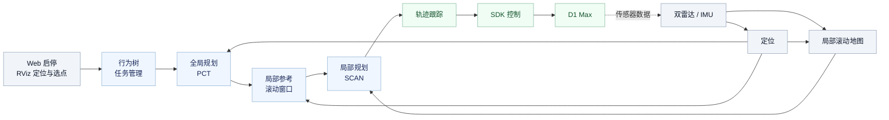

<div align="center">

# D1 Max 导航系统

面向轮足机器人的室内外导航与跨楼层路径规划


[系统架构](#系统架构) · [主要功能](#主要功能) · [快速开始](#快速开始) · [项目文档](#项目文档)

</div>

---

本项目围绕 D1 Max 轮足机器人，集成建图、定位、全局规划、局部避障与运动控制。通过 Web 启停服务，在 RViz 中设置初始位姿和三维目标，使用同一套导航主线完成任务。

> **当前进展**：已开展平地和楼梯实机测试；完整跨楼层执行、动态避障恢复及长期稳定性仍在验证。

## 系统架构



行为树负责目标与任务切换；全局路线提供导航方向，局部规划结合实时环境持续生成轨迹，跟踪器将轨迹转换为运动指令。全局路线使用 `map` 坐标，局部参考、规划和跟踪使用连续 `odom` 坐标。

## 主要功能

| 模块 | 功能 |
| --- | --- |
| 建图与定位 | 双雷达与 IMU 数据接入、点云建图、回环优化、全局重定位与连续定位 |
| 全局规划 | 基于点云地图生成可通行区域与三维路线，支持楼层、楼梯及平台场景 |
| 局部规划 | 基于 SCAN 滚动地图和实时传感器数据生成局部避障轨迹 |
| 轨迹跟踪 | 根据局部轨迹计算前进与转向指令，通过 SDK 接入机器人控制 |
| 交互与可视化 | Web 管理连接与服务；RViz 提供初始定位、三维选点及规划可视化 |

PCT 和 SCAN 是当前使用的规划后端；任务管理与算法实现分离，便于后续替换。

## 快速开始

在新电脑上获取源码并检查工程文件：

```bash
git clone https://github.com/dingzhen60027/d1max-system.git
cd d1max-system

source tools/deployment-env.sh
python3 tools/deployment_preflight.py --scope source
```

生成导航源码的构建计划：

```bash
bash tools/build-source.sh --scope nav --output /absolute/path/to/new-build
```

该命令默认只显示计划；配置好依赖后追加 `--apply` 才会开始构建。完整步骤见 [新电脑部署指南](docs/DEPLOYMENT.md)。

地图、录包、厂商 SDK 和本机封存运行包不包含在 Git 中，需要另行准备。源码构建完成后，还需在目标机器上组装并核验运行版本。

## 项目结构

```text
d1max-system/
├── d1max_nav_ws/       定位、行为树、规划、跟踪与 RViz
├── d1max_ros2/         Web、SDK 桥与 Foxglove 管理
├── tools/              环境检查、源码构建与同步工具
└── docs/               部署、交接与验证记录
```

导航的统一入口为 [`d1max_nav_ws/tools/navigation_entry.sh`](d1max_nav_ws/tools/navigation_entry.sh)。

## 项目文档

| 文档 | 内容 |
| --- | --- |
| [部署指南](docs/DEPLOYMENT.md) | 依赖、构建与新机器部署 |
| [模块与入口索引](docs/PROJECT_GUIDE.md) | 运行入口、目录与模块职责 |
| [导航主线说明](d1max_nav_ws/src/d1max_pct_scan/README.md) | 任务流程与规划控制接口 |
| [当前问题与验收边界](docs/KNOWN_ISSUES.md) | 已知问题与待验证事项 |
| [验证记录](VERIFICATION.md) · [源码同步记录](SOURCE_SNAPSHOT.md) | 测试范围与源码来源 |

第三方组件保留各自的许可证与来源说明。厂商 SDK 与相关资料需自行合法取得。
