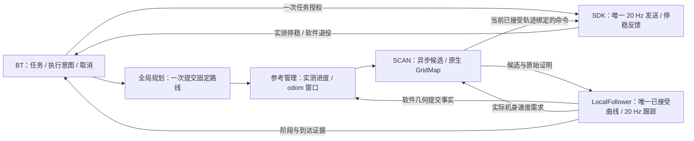
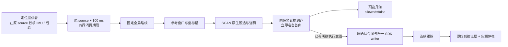
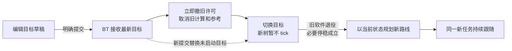

# 导航任务与规划输出的生命周期

## 轻量启动与显示解耦（2026-10-14）

Web 使用一次 `prepare --seal` 创建并封存当前会话，不再启动两个相同环境的准备进程。
同一 core 进入 active 且会话身份落盘后即可自动打开 RViz，地图、定位和规划器在后台
继续初始化。显示入口不等待功能就绪，也不签发任务或运动许可。

显示仅核对已封存会话、输入与参数、实际显示模块和接口；不再重建规划地图、遍历
科学依赖并逐个执行 `ldd`。核心启动和发布包检查仍保留完整审查。没有新缓存、令牌或入口。

慢开窗复用原生命周期 worker，不占状态锁；状态读取与退出仍可受理。启动中重复开窗
合并为同一请求，取消后的晚到视图身份只用于清理。保持一个 RViz，关闭窗口不取消导航任务。
显示是否打开与定位、规划、运动是否就绪分别表达。软件核验通过不等同现场启动耗时或运动验收。

## 显式初值可重复提交（2026-10-14）

RViz 每次合法初值是新的用户意图，不按 XYZ 去重，也不要求上一种子已匹配成功。
客户端只保留最新草稿；新 PREPARE 校验通过后替换旧事务等待，保留旧应用是否确定的
处置记录。旧 COMMIT、应用回执和定位身份不能改变新事务，超时不永久锁住后续初值。
正在运动的旧任务仍先撤权、退役并确认停止，才能 COMMIT 新机身初值；重新定位不会
恢复旧任务权限或自动执行旧目标。

定位应用回执是绑定请求的持久因果事实，不是可续期的运动证书。定位器使用原始
用户意图时间建立应用顺序：晚到的旧邮箱指令不能覆盖新种子；部分应用保留未知事实，
不冒充完整成功。非法新初值不能替换有效旧请求，重复旧消息不重复应用。

RViz 定位行单独显示初值事务的等待、已提交与拒绝原因；只有对应新种子的真实定位
状态就绪后才恢复“已定位”。这些展示字段不参与规划、跟踪或 SDK 授权。

## 模块边界收敛（2026-10-14）

借鉴参考项目的全局目标持久、局部循环独立、跟踪与驱动分离；保留现有 BT、
PCT、SCAN、定位与跟踪算法，不替换其求解器，不新增任务管理者或启动入口。
参考项目实际采用 PCT / EGO / Unitree RL，不是本项目的 SCAN / D1 SDK 实现。

| 层级 | 所有者 | 唯一输出与边界 |
|---|---|---|
| 任务层 | BehaviorTree.CPP | 目标、固定路线、执行意图、暂停、取消和最终结果；不解释 SCAN 内部失败字符串 |
| 路线计算 | 全局规划服务 | 不可变 `RouteSnapshot`；机器人运动、局部失败不触发重新计算 |
| 参考准备 | 连续参考管理器 | 接收 `RouteReference` 并保留任务，按自己的定位、坐标锚及地图事实准备窗口 |
| 局部规划 | 原生 SCAN / GridMap | 候选轨迹及原生碰撞结论；不取消上层任务、不连接 SDK |
| 几何提交与跟踪 | LocalFollower | 唯一已接受曲线、运动需求和类型化 `LocalExecutionStatus` |
| 设备执行 | 唯一 SDK writer | 按任务许可发送、急停、失权与停止反馈；不接收全局目标 |
| 展示与诊断 | RViz / JSON 状态 | 单向呈现；诊断字符串不能代替正式执行反馈或授权 |

**两阶段交付。** 上游先交付固定路线；参考管理器返回精确绑定的持久
`RouteDeliveryReceipt`。ACCEPTED 仅表示已接收并拥有该路线，不代表已有地图、
可执行轨迹或运动许可。地图暂缺时路线仍保留，真实输入与原生证明仍约束后续窗口。
首次投递不再等待下游 SCAN JSON 就绪，避免上游流程依赖下游准备结果。

**单一状态来源。** 正式 FollowRoute 使用独立纯投影 `formal_follow_status.py`，
依据精确路线回执、当前任务身份及 LocalFollower 原始源时 / 机身期限报告阶段。
不再先根据 JSON `spline_visual_valid` 或 `failed_reference_geometry` 判定，再由
类型化消息覆盖。未就绪不能由 JSON 补绿，局部诊断错误也不能自行取消任务。
恢复样本计数采用真实机身源时间；重复状态、执行器心跳及 JSON 更新不能增加样本。
正式轨迹编号来自 LocalFollower；展示进度容错，不参与任务与控制决策。

**保持既有合同。** 普通局部失败在同一路线内等待；用户取消、新目标、真实定位身份
重置与 SDK 硬故障仍走既有退役流程。任务完成仍要求实际终点位置、可选朝向及匹配的
实测停稳证据。旧兼容架构的诊断分类单独保留，不进入正式 task_follower 分支。

## 当前局部失败策略（2026-10-14）

提交目标创建一项持续任务。全局计算成功后，普通局部无路、候选失败、优化超时、
地图／参考暂缺只进入等待，不取消 FollowRoute、不清除路线、不重新调用 ComputeRoute。
局部恢复仍属于原 task／route／hash；用户新目标或取消及明确的身份／SDK 硬故障
沿既有退役流程处理。控制输出在局部事实不可用时仍为零，保留目标不等于保持旧速度。

`navigation_runtime.yaml` 的 `keep_committed_route_on_local_failure` 是唯一策略源。
BT 在 **全局路线已提交之后** 才允许持续等待；启动、全局计算、SDK 准入和关停仍
有独立期限。历史封存会话缺少该字段时沿用原有限恢复策略，不静默改写旧证据。
全局显示已有独立持久缓存，暂停／退役不会发布空路径；显示路径不具有运动权限。

对照参考仓库 `fdsf3e2342/3d_navi_ros2@4ff715f`：PCT 使用持久 Path，EGO 保持目标，
局部失败停车后继续重规划。该项目实际采用 EGO、Gazebo 状态和 Unitree RL，非本项目
的 SCAN／SDK 链路；仅借鉴目标生命周期，不复制同步求解或过期里程计控制行为。

## 新目标替换时序（2026-10-13）

RViz 拖动三维手柄只编辑草稿；明确提交新目标后，BT 立即撤销旧任务权限，
取消其全局计算和局部跟随，最新目标占用唯一待办槽。旧工作退役、必要的实测
停稳完成后，仅为最新目标计算一次新路线。A→B→C 连续提交不会排队执行 B，
旧 Action 的反馈、结果和迟到接受只能影响旧任务，不能取消 C 或覆盖 C 的路线。

`FollowRoute` 的终结退役证明可能先于 BT 的 `stop()/retire()` 回调到达。
任务所属的 schema 2 证明必须单调锁存，不得因当前尚未 stopping 丢弃；服务端
明确拒绝也证明该任务未进入局部 worker。锁存后立即禁止旧任务再次申请权限或
签发 allowed 租约。软件退役不等于 SDK 退役或物理停稳：曾提交 SDK 的任务仍
分别等待精确 SDK 退役和实测停止证据。发送异常不能冒充明确拒绝。

本轮修复只处理该可复现的目标切换竞态，不增加碰撞门控或重规划周期。
正式入口与默认包不变；未启动服务、重连 SDK 或发布目标/运动命令。

## 现行执行架构：任务授权与局部几何分离（2026-10-12）

唯一入口不变。`task_follower_v1` 替代运行图中的逐曲线 SDK CAS；下文带日期的
旧 `writer_applied_cas_v3` 时序为历史记录，不再描述新默认图。



| 合同 | 所有者与含义 |
|---|---|
| `TaskExecutionLease` | BT 签发任务级权限；普通 anchor、窗口、曲线更新不改变 task / control epoch |
| `TrajectorySplice` | 不可变旧曲线的计划接缝＋新尾段；计划位置/速度不是新实测状态 |
| `LocalTrajectoryCommit` | LocalFollower 软件几何事实；包含实际前驱、Native 原始证明及真实接入状态，不是 SDK 写入 ACK |
| `LocalMotionCommand` | 绑定当前 SCAN 已接受轨迹与原始正面碰撞结论的速度命令；SDK 仅核验任务域、因果租约、原始期限、控制权和限速 |
| `LocalExecutionStatus` | 几何就绪、暂停、到达与软件退役；不替代运动许可或物理停稳 |

**换轨规则。** 新候选求解期间继续跟踪仍可用的当前曲线。移动换轨保留已验证公共
前缀，从旧曲线前方的计划边界求解尾段；只有实测 XYZ 进度到达接缝，实际位置、
速度和最新 Native 证明相符后才原子替换。先投影本次真实状态，再判接缝；不使用
墙钟预测机器人位置，不将候选提前装入 active，不重置速度限制器。错过接缝、
候选失败或迟到只影响局部准备，不重新计算全局路线、不复活旧目标。

**调度规则。** 样条与支撑索引准备使用单 worker、单最新待办和单完成槽。
跟踪需求在有界常数时间交付；它不再启动第二次反应/制动扫掠地图查询。
SCAN 的当前轨迹刷新使用原生快照、独立查询缓存和有界预算；
取消及零输出不排在长求解后面。三维传感器与占据只有生产 SCAN 裁决，
正式图不再启动 Python `execution_safety_node` 或旧逐曲线跟踪节点。

**时间规则。** LocalState 原始消费期限仍最多 100 ms。Native 不能在异步验证结束后
用比命令源时更晚的任务租约，也不能重盖命令或状态源时间。几何提交与退役是
有身份/CAS 的持久软件事实；实时数据与运动命令仍严格区分期限。参考的交付期限不
代表不可变几何的生命期：晚订阅可接收原参考，但提交仍必须使用新鲜实测状态和
原生证明。跨话题支撑、候选、证明可先到，均有界暂存，只有正式参考绑定新任务。
局部提交引用占据快照版本，而不是坐标合同版本。LocalFollower 是唯一几何提交者；
Native 核对其软件事实与原始整曲线证明，不要求第二订阅流收到同一历史帧后才能
观察几何。缺失原始帧或插值不冒充独立观测，已有精确原始帧的矛盾仍拒绝。实时
非零需求继续要求新鲜独立状态和当前已提交曲线的原生碰撞结论；
不签发没有实际查询过的 `MotionValidation`，几何观察不制造状态、证明或权限。

**碰撞职责清理（2026-10-12，现场诊断后）。** 原重构只移除了 Python 第二环境
检查进程，却仍在 Native 的任务发送路径保留完整制动扫掠。现场 8 秒只读采样中，
51 个非零需求全部被 `motion_sweep_occupied` 拒绝；SDK 同时持有控制权且就绪。
规划机身轮廓为 0.93×0.30 m，而静止时工程参数的扫掠已约 1.91×1.71 m。
这不是未知体素问题，也不能据此认定占据来自机器人自身。
正式链改为 SCAN 负责候选/当前轨迹碰撞判断，LocalFollower 跟踪，Native 只绑定
已提交曲线与原结论后交付命令，SDK 唯一发送；不重复查询更大的运动包络。
旧 v3 对照接口仅留作历史回归，不能出现在正式执行图中。

**终点与故障。** 到达位置/可选朝向后撤销任务权限，提交停止并等待同一执行的
新鲜 MC 停稳证据；发送零、局部曲线结束或软件退役均不代表物理完成。
短时输入故障保留任务，恢复沿唯一配置的稳定窗和新的实际状态；急停、失权、
定位身份重置及明确取消终止旧权限。普通同层走廊/平台按语义 portal 推进，
楼梯与模式切换不通过普通同层逻辑放行。

本轮只做软件重构、隔离验证及一致默认包更新；不重启生产、不重连 SDK，
不恢复初值或目标、不发送运动、不修改物理验收标志。运行进程是否已更新需另行核对。

## 历史实施背景与边界（以下保留早期合同用于追溯）

一条用户目标只创建一项任务。全局规划生成一次经过验证的路线，局部规划沿这条路线推进，
实时感知更新局部地图；输入暂时缺失只暂停局部准入，不隐式撤销目标、重置沿路进度或重算全局路线。

本轮已改为 **真正的 BehaviorTree.CPP v3 执行器**，不是用状态枚举模拟行为树。
独立 `navigator_node` 加载 XML、执行节点并记录节点状态转换；ROS Action 适配器调用现有 PCT / SCAN，
不重写地图、碰撞查询或求解器。前一轮的纯事件策略保留为工作器内部合同，不再拥有 RViz 用户任务。

这是采用 Nav2 职责划分的自定义导航行为树，**并非把 Nav2 的全部服务器原封不动接入**。
截至 2026-10-08，连续 odom 参考、生产 SCAN 验证交接、跟踪、安全门和唯一 SDK 写者
已经接入默认主线包；不再仅是预览接线。实机运动验收仍未完成，Web 当前明确运行 `planning_only`。
下面的早期改造目标和历史测试命令保留用于追溯；当前实际状态见
[测试前主线核对](../status/PROJECT_TAKEOVER_STATUS_20260928.md#实机测试前主线核对2026-10-08)。

参考 Humble 官方树：

- [仅在目标更新时规划](https://github.com/ros-navigation/navigation2/blob/humble/nav2_bt_navigator/behavior_trees/navigate_w_replanning_only_if_goal_is_updated.xml)：全局计算与 FollowPath 分离。
- [路径失效时重新规划](https://github.com/ros-navigation/navigation2/blob/humble/nav2_bt_navigator/behavior_trees/navigate_w_replanning_only_if_path_becomes_invalid.xml)：重规划需要独立、明确的路径有效性判据，不能拿短暂传感器超时替代。

当前采用“目标驱动、提交后固定路线”的策略。重新提交目标可以请求新的规划；
没有新增周期性全局重规划，也没有把局部一次求解失败当作全局路线失效。

### 连续执行合同（2026-10-11）

主线为：连续定位 → SCAN 轨迹与原生环境判断 → 20 Hz 实测进度跟踪 → 唯一 SDK 写者。
BT 持有任务、固定路线和执行意图；下游不再用第二份跟踪进度消息重复审批 SCAN 的非零命令。

- **定位只有一个时间判据来源。** `LocalNavigationState` schema 2 增加原始
  `valid_until`。提供者在采集源时核对 IMU ≤100 ms、后验 ≤400 ms，签发最多
  `source_stamp + 100 ms` 的消费期限；正式消费者核对该期限和身份，不在交付时
  再把网络延迟叠到原始 IMU 年龄上。重复消息不续期，失锁事件不携带可用位姿。
- **状态期限与命令传输预算分开。** 原始状态期限是 100 ms，派生命令链沿用
  原始源时绑定的 200 ms 预算及更短的许可/SCAN 证明期限；不能以接收时刻续期，
  也不能把状态期限误套成整个异步命令链的期限。发送前仍需最新实际状态。
- **SCAN 是环境裁决者。** 原生实时地图、完整曲线域和精确 `MotionValidation`
  决定命令是否可用。缺输入或计算预算耗尽返回等待，不伪造碰撞负结论；真实负结论
  仍立即禁止该轨迹的非零输出。安全门与 writer 只核对原结论、命令、任务和期限，
  不增加独立的 `TrackingProgress` 100 ms 审批。零命令的既有几何提交回执不代表运动。
- **等待不是已执行受阻。** 第一条非零命令尚未被接纳/写入时，普通接线等待保留
  原任务、路线哈希和意图，不误启动运动后的 30 秒无进展失败预算。确定的当前
  环境阻塞仍有界处理；非零发送事实出现后，实际无进展、取消、失权和失锁合同不变。
- **候选与当前轨迹分开。** 坏候选、迟到求解或短暂等待不清除仍有效的当前曲线；
  保留实测进度与速度限制器状态。证明过期时保留任务但不输出旧的非零命令。

该变更修改了 LocalState 的 ROS 布局，提供者、BT、参考、tracker、SCAN 接合和 SDK
安装产物必须整套一致。更新默认包不等于更新已运行进程；本轮不重启生产服务、
不重连 SDK、不恢复旧目标或发送运动指令。组件回归不代替实机到达与停稳验收。

### 启动与首条轨迹的时序合同（2026-10-12）

本轮修复的是原流程中的重复判据与调度竞态，不增加任务管理者、入口或等待预算。



| 断点 | 修复与仍保留的边界 |
|---|---|
| 定位回调准入后跨过期限，再次查询抛异常 | 接收阶段使用刚验证的事件身份；真正使用时检查原期限，过期进入等待，不退出规划节点 |
| 全局状态、参考及 BT 重复扣 IMU/后验消费龄 | 在原输出时核验传播 ≤100 ms、后验 ≤400 ms；消费同一原输出期限，不把交付延迟再扣一次 |
| 首曲证明在下一次 10 Hz BT tick 前过期 | 同身份的证明、准入、参考与状态到齐即尝试原准备流程；不额外 tick 树，不续期，不重复授权 |
| 低频 RobotState 空窗被当成永久失权 | 已建立执行进入零输出 HOLD，保留任务；恢复需新状态、新许可和新原生证明，清除断流前待发非零需求 |
| 到达核对仍依赖旧的启动级全局 ready | 核对当前连续局部能力及任务绑定；真实全局终点证据、可选朝向和实测停稳仍必须满足 |

schema 2 `NavigationState` 没有 `valid_until` 字段，其兼容消费合同明确为
原 `source_stamp + 100 ms`；`LocalNavigationState` 使用提供者显式签发的原期限。
源时与接收时均保留，重复消息不续期；任务级短时连续性不产生运动授权。
历史坐标锚与雷达投影历史不是新的控制状态，不能拿保存的旧 pair 初始化过期路线。

SDK 可恢复空窗仅匹配 `holding / robot_state_stale`、实际控制权仍持有、未锁存故障、
`grant_ready=false` 且模式新鲜度未确认的完整处置。真正的失权、断连、急停、
已观测到的不支持模式、会话改变和旧任务退役仍走原终止流程。
模式信息暂缺时不发送非零速度，也不显示已物理停稳。

软件证据包含同输入旧包失败/新源码通过、生产回调与真实 BT/SDK 核心回归。
安装产物与冻结源码整套同步后，默认包与已运行进程仍是两个不同事实；
本轮不重启生产、不连接 SDK、不发布目标或运动，不能声称实机导航已验收。

### 短时数据缺口与参考回执恢复（2026-10-12）

恢复职责不再混用：估计器判断当前数值与原始数据支撑，参考管理完成软件交付，
BT 保持同一任务；普通暂缺不能被各模块分别锁存成永久故障。

- **IMU 短缺口：**15 ms 是质量警告，不是停止阈值。前端对低动态、
  不超过 100 ms 的双端缺口继续真实积分并提高不确定度；缺右端时等待下一采样。
  缺口期间实时预测仍只使用原始 IMU、原后验和原期限，不能把旧数据重新盖时间。
- **弱几何：**有限滤波状态、特征不足表示本扫描无新激光后验，不再在半秒后
  永久封死前端。该扫描不发布后验、TF、已配准点云或地图增量；后续真实匹配成功
  可恢复同一 epoch，不清地图初值。数值非有限与时钟回退仍单独报告硬故障。
- **有界连续预测：**原生弱扫描通知携带真实 `last_good_posterior_sec` 和
  `finite_filter_state`。消费者仅在同 epoch、精确原后验身份与原预测期限内使用
  保存的真实后验；没有新后验时不会续期。到期如实暂不可用，新真实后验恢复。
- **软件回执：**原参考投递失去 ACK 时，仅保留一个未决候选，按有界频率重送
  完全相同的请求与支撑。原生返回该精确请求的原接纳事实，或明确从未接纳的拒绝；
  不因重送取消求解、不产生新全局任务，也不每半秒制造一代永久未决记录。
  同 ID 不同内容不被当作原请求拒绝。可能 Applied 的事实不能按时间删除。
- **事实不是许可：**历史正面参考 ACK 不构成当前净空；BT 仍需要当前原生证明、
  实际接入与局部状态。重送不改任何原 source、deadline、generation 或路线哈希。

本轮仅生产组件、真实回调与原安装包同输入验证；所有新修复整套同步唯一默认包。
未启动生产、未重连 SDK、未恢复目标或授权，未以回归结果宣称实机已验收。

### RViz 新目标抢占（2026-10-12）

拖动 XYZ、贴地和朝向编辑只修改草稿；明确提交目标才改变导航任务。
连续提交 A → B → C 时，只保留最新尚未启动的 C，不排队执行中间目标。
同一活动意图的重复点击幂等，同位置的“预览”与“执行”是不同意图。



- **唯一所有权：**沿用 BT 的 `current_` 和原退役合同，不新建队列或第二个导航器。
  普通退役期间可以接收更新目标；新树只在前项义务结束后开始，不提前消耗新任务的定位/准备预算。
- **明确撤权：**已准备几何但尚未发送非零速度的旧任务也必须关闭其执行域。
  跟踪器消费现有正式路线退役回执，仅关闭精确匹配的旧任务；撤权不等于实测停稳。
- **异步隔离：**旧 Action 接收、反馈、结果和执行确认不能覆盖新 UI 意图。
  迟到接收只取消其自身 UUID；BT 按目标句柄识别取消，不能把 A 的取消应用到 C。
  新目标执行确认绑定该 Action 反馈命名的任务及实际路线，不借用迟到的旧路线。
- **资源复用：**退役清除目标、结果和参考，保留健康空闲的 PCT 预热进程。
  正在计算的工作器仍退役，硬故障、地图变更和关停仍销毁相关资源；不保留旧目标结果。
  退役事件立即通知适配器，不额外等待周期状态发布。
- **显示：**切换阶段显示“切换目标/等待新路线”，历史路线只供查看，
  不能当作新任务已规划或正在执行。切换不重置定位、不重启服务、不继承旧运动授权。

定向证据覆盖实际 RViz Python 回调、原 BT/跟踪核心、已有全局工作器生命周期及显示回调；
不启动 ROS 图或 SDK。软件时序通过不代表实机切换时延、制动或连续导航已验收。

### 执行准入等待

当前主线的 `Navigate.request_execution` 只表达这一个目标的执行意图；启动和纯预览不申请 SDK 授权。
局部轨迹准备完成后，若唯一 SDK 写者的授权服务尚未出现，从第一次 `waiting_single_sdk_writer` 开始
使用现有 `execution_blocked_timeout_s`（默认 30 秒）计时。轨迹刷新、Action 心跳和短暂恢复不会重置该期限；
超时以 `execution_sdk_writer_wait_timeout` 结束本次尝试，撤销意图、按原有流程清退工作，保留已提交路线供查看。
新任务使用自己的计时；取消或定位身份替换不能继承旧意图。该计时不代替 SDK 授权后的控制权与实测停稳合同。

SDK 明确拒绝准入与“停止未确认”分开表达：只有写者回传匹配请求、执行身份、版本、会话和传输模式的
`definitely_not_admitted`，且 BT 尚未收到本次 SDK 状态或实际提交证据，才能结束这项未接纳尝试。
该结果不标记机器人已停稳，也不清除旧任务的停止义务；重复请求、已安装上下文、超时或不明回复仍保留停止核对。

### 按实际任务时序复核（2026-10-08）

运行链是一个持续任务，不是各模块收到更新后分别启动一项任务：

| 时刻 | 唯一决策者 | 交接及退出条件 |
|---|---|---|
| 接收目标 | BT | 先撤旧许可、退役旧工作；新目标不继承旧执行授权 |
| 初始定位及全局规划 | 定位提供证据，BT 调用 Compute | 定位与工作器准备分别有预算；一次成功结果锁存为固定路线 |
| 局部窗口更新 | 连续参考管理器 | 保持任务/路线身份；prepared 快照、native 回执、writer 结果不可被一次投影失败抹掉 |
| 候选求解 | SCAN | 求解不拥有任务或 SDK；失败不清掉仍安全的当前曲线 |
| 换轨 | BT、验证器、跟踪器、唯一 writer 的明确交接 | prepared 不等于 applied；实际写入事实与当前运动许可分别处理 |
| 短断流/受阻 | BT 持有同一 Follow | 暂停运动依据，不重算全局路线；恢复要求新的真实证据，等待预算不被心跳重置 |
| 到达 | Follow 回报证据，BT 确认 | 实测停稳后等待匹配的全局到达证据；证据确认和算法退役使用不同预算 |
| 取消/关停 | BT 先退役，supervisor 再关闭依赖 | 导航核心先于 SDK/Zenoh 退出；软件退役和物理停稳各自报告 |

本轮确认的生命周期缺陷不是新的碰撞参数问题：

- **计数域错误：** writer 每项执行重启换轨计数，下游却保留上一项执行的序号地板。
  现在原生验证器、跟踪器和安全门按完整任务/SDK 执行身份重建该域；
  普通参考/坐标锚更新不会触发重建，旧任务回执仍不接纳。
- **窗口过早丢弃：** 一次候选失败或投影失败不表示已经发布的参考没有被 native/writer 接纳。
  有界 prepared 快照保留原版本及回执事实；只有准确的 BT 提交许可安装当前参考。
  未决交接不能靠超时猜成“没有发生”，而由上层固定恢复/退役预算处理。
- **事实与几何混淆：** Applied 回执到达时若证据已过期，记录真实版本并 HOLD；
  此时“版本相同”不等于“曲线仍已安装”。保留原曲线与支撑准备数据，
  重新取得真实验证、实测接入及新鲜 BT 提交许可后才能恢复几何，不自动恢复运动。
- **启动状态误锁存：** 首次 grant 前的姿态、模式或档位未就绪只阻止准入，
  不把尚未开始的执行永久记成故障。已授权执行中的真实状态变化仍撤许可，不自动清故障续跑。
- **终点等待没有出口：** 实测停稳后缺全局到达证据，不能无限 `RUNNING`。
  Follow 使用 BT 同一个 `arrival_evidence_timeout_s`（当前 4 秒），从首次终点停稳许可起计，
  确认证据后立即锁存原始源时，再进入独立的算法退役流程；不把退役耗时重复算作证据等待。
- **关闭依赖倒序：** Web 创建的核心 unit 保留 Web 所有权，对 monitor 使用
  `Requisite`、`StopPropagatedFrom` 和 `After`；显式断开时先排核心退役、后排 monitor 退出。
  不用 `BindsTo=monitor` 自动拉起已断开的 SDK，也不把 monitor 重启传播成旧核心会话重启。
  管理器的停止等待为 60 秒，
  覆盖核心 30 秒与 monitor 15 秒的关停预算。既有运行中的管理器须在正常重启后读取该配置，
  本轮没有重启它。

写入回执描述已经发生的事实；源龄和许可描述此刻是否可以运动，两者不能混为一谈。
实际写入若发生在原签发事务的授权区间内，消费时迟到不能导致各模块永久认为执行版本不同；
记录事实也不能刷新原许可、传感器或碰撞证据，更不能复活已退役任务。
原始写入凭据使用有界在途记录，心跳缓存的轮换不能挤掉已经实际输出的命令；
首次零输出可能提交曲线身份，但零输出不是碰撞净空或停稳证明。

本轮仅代码审查、构建和默认运行包一致性检查，没有启动 ROS 图、回放录包、连接 SDK 或运动。
调度频率和等待预算是配置，不是本轮测得的实时性指标；实际连续性、绕障及停稳仍需整链验收。

## 执行目标：按 Nav2 职责划分，而不是只完成预览

### SCAN 确定占据反馈与可恢复局部目标（2026-10-09）

**2026-10-11 主线替代说明：**以下两层证据策略为历史实现。现在候选及运行中曲线
统一采用 SCAN 原生 `official` 占据规则；原始 unknown/insufficient 仍保留，但不再
由下游 observed-free 规则另行否决。SCAN 独自核对实时感知及几何并签发有限期结论；
BT、跟踪器、命令接合与 SDK 只消费该结论、任务身份及原始期限，不重判传感器源龄。
新候选失败不影响仍有效的当前曲线；计算预算未完成不冒充碰撞，也不延长旧证明。
急停、失权、命令到期、确定障碍及定位身份变化仍独立生效。

候选搜索沿用官方膨胀障碍查询；实际运动扫掠沿用独立、原始源时的严格证据。
两种查询结果分开记录，不将“可规划”解释为“可发送”。

1. 碰撞分类与遍历顺序无关：同一原生有限查询内占据优先于越界、未知和自由。
   未知不提前遮住确定障碍；纯未知仍拒绝运动。占据早退和计算截止均标记部分查询，
   原体积/时间预算不变，不生成部分自由证明。
2. 已匹配的前进直行/转向占据反馈可以请求替换入口；tracker 保留任务、几何及路线，
   进入 `WaitingEntry`，不反复对齐到已受阻的相同方向。
   unknown、过期、旧任务、零需求或倒退不能作为确定占据反馈。
3. 受阻后的强制侧向目标是一次有界尝试，不是永久修改路线策略。
   快照未取得不消费请求；实际搜索后消费，后续真实环境更新允许重新考虑原路线。
   障碍持续存在时独立实际指令证明仍拒绝；障碍移除不要求机器人先运动才能恢复。

全局路线哈希、BT 任务和执行授权身份不因这些局部尝试变化；候选失败不清空安全旧曲线。
同输入生产方法及 tracker 负例见
[近身恢复报告](../reports/NEAR_FIELD_FEASIBILITY_20260927.md#2026-10-09官方规划语义与可恢复性整改)。
本轮已整体更新唯一默认包，并核对冻结源码、安装头、ELF、selector/Web；
真实未知、实体滤除测量和物理停止验收仍保留，不凭软件通过签发运动许可。

### 功能连续性复核：不把计算等待当作环境阻塞（2026-10-08）

本次沿默认入口及真实消息合同复核，不新增任务管理者、不改变 Zenoh、不启动服务。
在本次修改前，默认包已包含此前的任务/换轨整改；下面两项是本次追加源码修复。
**2026-10-09 已按用户授权同步唯一默认封存包**：默认 BT、SCAN 重新编译安装，
冻结源码和安装头一致；入口、Web 绑定及 SDK launcher 指向同一个清单。未启动服务或实机。

| 环节 | 已确认应保持的状态 | 仅在何时改变 |
|---|---|---|
| 初始定位 | 成功后不重新执行初始化阶段 | 明确的定位重置/身份变化 |
| 已提交全局路线 | 固定任务和路线哈希 | 新目标、取消或任务明确结束 |
| 连续 Follow | 短缺数或求解等待保留同一次 Action | 硬故障或固定恢复预算耗尽 |
| 当前局部曲线 | 新候选失败不清除仍有效的曲线 | 最新实测接入/碰撞证据失效或通过新曲线交接 |

初始化成功锁存与实时运动证据不同：不要求重复初始定位，也不把旧位姿重新盖时间戳。
首个正常状态立即准入；0.6 秒/三个新样本的稳定窗口只用于确实发生过撤销的恢复。
普通运动、坐标锚更新、局部候选刷新不重新触发全局规划。

本次确认并修正的两个断点：

1. **不可用事件合同不一致。** 定位输出的 `usable=false` 包只有原始身份、时间和原因，
   本来不带位姿；BT 接收端却先要求位姿、frame 和采样时间，导致通知被丢弃。
   现在先检查 session/map/epoch/源时间及顺序，再接纳不可用事件；
   可用包仍执行原有位姿及传播检查。软不可用保留任务和路线，真实重置及时撤销旧授权。
   该改动不延长数据租约，也不把不可用包当作可用位姿。
2. **计算超时被误归类为环境失败。** 整轮 `solve_deadline_exceeded` 后进入
   `WAIT_ENVIRONMENT`，旧分类只允许 `waiting_snapshot_slot` 做资源重试；
   静止机器人及已经饱和的地图不变化时，CPU 恢复后仍无法再计算。
   该 10-08 修复当时让这两类资源等待在原 worker 退役后，以至少 500 ms 的节奏重试。
   **10-15 已取消这一额外固定下限**，现行调度使用配置的提交间隔及失败冷却；
   数值失败还需真实双雷达源时间前进，不借显示或定时器刷新旧证据。
   新尝试使用独立的 400 ms 总预算；旧预算不续期，不并发第二个 worker。
   真实占据、未知空间、取消、无效输入及未分类异常不能借用这一分支放行。

同输入软件证据：

| 验证对象 | 默认冻结头 | 修复头 |
|---|---:|---:|
| 原生 BT 状态准入，同一测试源码/消息 ABI | 12 项中 3 项失败 | 12 项全部通过 |
| 原生 SCAN 等待/恢复方法，同一输入与方法体 | 93 检查中 2 项失败 | 93 检查全部通过 |

此外，BT 执行/交接合同 130 项、固定路线/暂停/取消时序 9 项、恢复/异步请求 13 项通过；
实际 `navigator_node` 与 `scan_planner_node` 先完成独立编译；2026-10-09 再在默认构建目录
重新编译安装，两个默认 ELF 哈希均已改变，与封存清单一致。
测试 fixture 补齐实际 SCAN 已提供的 `frame_id` 和 `collision_policy`，未修改生产校验。
SCAN 方法回归使用明确的地图/碰撞证明接缝，证明恢复调度，不证明真实地图绕障或实机导航。

可复现的局部调度前后对照（基线命令预期退出码 1；修复版为 0）：

```bash
cd /home/dndx/d1max_nav_ws
python3 src/scan_planner_vendor/plan_manage/test/test_replan_recovery_no_ros.py \
  --include /home/dndx/Documents/Codex/2026-10-02/repo/.navigation-sync-nGbGQz/before-runtime/source_snapshot/nav_ws/src/scan_planner_vendor/plan_manage/include
python3 src/scan_planner_vendor/plan_manage/test/test_replan_recovery_no_ros.py
```

BT 同输入编译探针及 XML、SCAN 带头文件哈希的对照 JSON 保存在
`/home/dndx/Documents/Codex/2026-10-02/repo/.nav-continuity-DPE14j`。
更新前默认清单为 `9eccfc6bbbb116afe310c7e80e89284a2e957a19c9f66f16087e1fc6e6aa8245`；
2026-10-09 新清单为 `bb74fd836f4f2d94f5f445f3d0ccb50698de5e5b9b9d5ea5f020892a35c918c7`。
`--check-release` 验证 8663 个文件及加载闭合；`robot_preflight --files-only` 确认 Web、
selector、SDK launcher 绑定一致。完整更新前包保存在上述 `.navigation-sync-nGbGQz/before-runtime`，
仅用于恢复，不是第二个正式入口。默认仍为 `planning_only`，物理验收标志未改变，
没有启动、重连 SDK 或自动恢复旧任务。整链/物理验收仍待完成。

用户确认的目标是：**一次全局规划 → 持续局部避障与跟踪 → 持续输出机器人运动指令 → 实际到达并停止**。
这段是执行改造的目标合同，不表示当前预览已经具备运动执行能力。

对照 Humble 官方 [ControllerServer](https://github.com/ros-navigation/navigation2/blob/humble/nav2_controller/src/controller_server.cpp)
和 [Controller 接口](https://github.com/ros-navigation/navigation2/blob/humble/nav2_core/include/nav2_core/controller.hpp)：
FollowPath 接收路线后持续计算速度，检查进展与到达，并处理取消和错误；
它不是每一帧重新发一个跟随任务，也不是发布一条局部曲线就算成功。
本工程借鉴这个职责边界，不假称 SCAN 已经是 Nav2 Controller 插件。

| 层级 | 对外职责 | 内部实现约束 |
|---|---|---|
| 行为树 | 接收一个导航任务，调用全局计算，再等待持续跟随完成 | 不计算速度；不按局部心跳重发全局任务 |
| 全局规划服务 | 返回一条带身份的固定路线 | 算法可替换；正常前进不更换路线 |
| 持续跟随服务 | 持有这条路线，直至到达、取消或明确失败 | 统一管理局部规划与跟踪，不再由两套任务状态分别控制 |
| 局部规划器 | 根据实时局部地图计算绕障曲线 | 求解异步、有预算；只有被采用的新曲线才能接替旧曲线 |
| 轨迹跟踪器 | 用实测位姿/速度持续计算机身速度命令 | 独立控制周期；不等待每次局部求解完成，不用显示曲线代替闭环反馈 |
| 速度与 SDK 执行出口 | 限速、碰撞停止、控制权核对和命令发送 | 唯一最终命令出口；取消、失联、无有效控制依据均停止，任务不会自动解锁 |

行为树中的 Follow 是一个长期 RUNNING 的 Action；它内部有局部重规划循环和控制循环，
两者不要求同频。新候选尚未成功时，仅在旧曲线仍有效的条件下继续跟踪；没有有效曲线就停止，
局部仍可在限定时间内尝试恢复。失败反馈要说明是哪一层失败，不能把每次局部求解失败都变成全局任务失败。
真正的执行模式需要“无实际进展”检查；静止预览中不启用这一判据。

全局路线使用 map 坐标系；控制状态使用连续的 odom 坐标系。
路线局部段、轨迹、目标和碰撞依据必须按同一有源时间/版本的变换合同交接，
不能仅把跟踪器订阅名称从 global 改成 local。全局定位校正不得直接跳变当前正在执行的局部轨迹；
新变换下的参考必须重新检查并经过明确交接。真实安全变化不能为了保持画面连续而被忽略。

早期审查的未完成项（历史，非 2026-10-08 当前部署状态）：

- 新 BT 适配器仍强制 preview；尚未把持续跟随 Action 接入已有执行跟踪与 SDK 门控。
- 跟踪器实际参数仍描述全局里程计输入，连续 odom 的整体控制数据转换尚未接入。
- 执行安全扫描仍描述 LIO 筛选后的点云输入，独立感知覆盖合同尚未完成。

这些是需要实施的接口工作，不是靠修改验收开关就能消除的问题。
已有 1.5 m/s 总速度上限保持；初次物理测试仍使用现有较低调试限速，不自动提速或申请控制权。
最终验收必须包含实际位姿闭环、绕障后继续跟随、取消停机、断流停止、恢复不复活旧命令，
不能以 RViz 中出现局部曲线作为完成标准。

## 最终验收目标：可执行的跨楼层导航系统

本节记录用户明确的最终要求，作为后续实施和验收的统一基准，**不表示这些能力已全部实现**。
目标不是某个规划器跑起来，而是从定位、RViz 三维目标、全局路线、局部避障、轨迹跟踪，
一直到 SDK 控制和实测反馈，完成可重复、可解释的跨楼层任务。接口从一开始按跨层设计，
按平地、楼梯、整程逐级验收，而不是做完平地后再次更换整个上层。

### 必须保持的系统约定

1. **一项任务只有一个上层所有者。** BT 拥有接收、取消、替换和最终结果；Follow 持续管理局部规划与跟踪。
   定位、感知、界面和 SDK 适配器不能擅自创建新导航任务。暂停、恢复、终止必须区别处理；
   新目标等待旧执行撤销确认，不能仅凭取消请求已经发送就开始。
2. **统一三维目标和身份。** 目标携带地图版本、坐标系、XYZ、楼层/可通行表面归属；
   有朝向要求时明确携带 yaw 及容差，不能接受了朝向却仅用位置判成功。
   必须区分地面接触点与机身参考点，高度补偿只由约定的边界执行一次。
   同 XY 的不同楼层不允许互相匹配、吸附或宣告到达；存在归属歧义时不能静默选层。
3. **统一坐标、时间和版本。** 路线、局部地图、曲线、位姿与命令均可追溯到
   session/task/route/segment/trajectory、定位 epoch、地图版本和变换版本。
   测量源时间与接收时间分开，跨设备时钟映射需有证据；截止期限使用单调时钟，
   换坐标、重发布、等待恢复不刷新原始数据年龄。对时、坐标或任务身份变化后，旧结果不能冒充新结果。
4. **连续性是执行合同，不是显示效果。** 正常跟踪不得出现不符合实测运动的位姿跳变，
   或由重算、换帧、任务重置引入的控制突变。全局路线提交后不反复改形；局部交接检查位置、
   速度、加速度边界与剩余碰撞有效性，不能只要求两条曲线画起来接得上。
   真实急停不受舒适性平滑优先级约束；真正失效时停止，不保留“看着连续”的无效命令。
5. **规划与控制解耦。** 重型求解不得阻塞控制和停止响应；控制持续使用当前已采用且仍有效的曲线。
   新候选先检查，再原子交接。候选失败不等于当前曲线失效；当前曲线失效也不等于用户任务被删除。
   所有队列有界，任务过期结果可丢弃；用于连续估计的传感器序列不能为了减负任意丢帧。
6. **取消、失联和恢复有闭环。** 停止命令已发出、SDK 接受、机器人实测停止不是同一件事，
   三者应分别报告。软件停止动作需符合当前运动模式，不把平地停止假设直接套到楼梯上。
   控制权丢失、SDK 重连、定位重置不自动恢复旧运动；应用程序启动不隐式申请运动控制权。
7. **模块可替换，但接口含义不能随算法变化。** 当前 PCT/SCAN 只是实现；BT 节点、界面和机器人出口
   不写死算法名称。每个模块声明支持的空间维度、地形/运动模式、坐标与时间约定、输入输出及失败原因，
   不兼容组合在准备阶段报告，不等机器人开始走后才发现。

这里的“无跳变”要准确界定：ROS [REP-105](https://github.com/ros-infrastructure/rep/blob/master/rep-0105.rst)
区分全局 map 的定位校正与局部 odom 的连续运动。全局估计发生真实校正或重定位时，不能伪造其连续性；
应保证它不直接跳变控制空间，必要时受控停止、重新验证，再交接参考。换楼层本身不应重置连续 odom。
因此不能承诺任何故障下所有显示数值都永远不变，而应验收正常运动连续、异常处理明确且不会产生错误运动。

### 跨层段落的执行合同

保留现有跨层几何全局规划能力，不强制改成另一套拓扑规划器。路线需要能标识楼层段、楼梯/连接段及出口，
让执行层知道当前通过哪一段、使用什么经过验证的运动模式和包络。楼梯是连接通道，
但其入口对齐、局部通行、台阶/平台、机身姿态及出入口确认仍需执行规则。

同一用户任务贯穿“本层走廊 → 连接段 → 目标层走廊”，沿路进度和连续里程计保持一致。
模式切换必须有前置条件、SDK 实际能力核对、状态确认、超时和失败后处理；
暂不支持的楼梯动作明确拒绝，不能用自动重试、无依据清障或取消高度限制来掩盖。
上下楼需分别验收，不能用上楼成功推定下楼安全，也不能用机器人产品能力指标代替现场通行验收。

早期跨层实施前代码中的差距（历史）：`motion_execution.py` 会返回
`stairs_or_cross_floor_execution_not_supported`；`tracker_core.hpp` 按任务起始高度限制
`single_floor_max_height_change`（当前默认 0.25 m），并在目标、样条及实测机身越界时停止。
这些是单楼层控制器的能力边界，不是应直接放宽的坏参数。
当时到达确认也尚未完成最终朝向及稳定停机的执行闭环。

当时上游已产生楼层/楼梯标签，但 Compute/Follow Action 仅传递 `nav_msgs/Path`，
路段语义还没有完整传到执行层。跟踪器当时的最近点搜索主要使用 XY；这不能直接用于重叠楼层或折返楼梯，
需要三维距离、路段身份和单调进度共同约束。当时三维目标传到工作器时使用 PointStamped，
因此当时实际只支持位置目标，不能宣称已经保真传递并执行最终朝向。
楼梯中暂停后的恢复也要核对原路段和运动模式，不能假定总能把当前位置重新当成某层平地起点。

### 落地顺序与可重复验收

| 阶段 | 必须交付 | 不得当作完成的替代品 |
|---|---|---|
| 统一执行合同 | 单一任务所有者；跨层目标、路线段、控制坐标、轨迹交接和退出协议 | 多个进程各自保存一套任务，再靠状态字符串互相猜测 |
| 隔离执行闭环 | 实际生产规划/跟踪模块接模拟反馈与模拟 SDK，覆盖到达、障碍、取消及故障注入 | 仅播放固定 rosbag、展示路径，或重写简化地图替代原生实现 |
| 平地实机 | 低速实际闭环、动态障碍、暂停恢复、目标替换和可靠停止 | 仅预览；或解除未验收标志强行启动 |
| 楼梯实机 | 入口、上/下楼、平台和出口的模式/包络/定位交接 | 把 single_floor 高度阈值放大后称为跨层控制 |
| 跨楼层整程与 NUC | 多次完整任务、资源受限与长时间运行、异常恢复及版本可追溯 | 单次成功录像或开发机上的单元测试计数 |

rosbag 用于可复现的定位、感知与规划输入对照；它的机器人运动是录制时已经确定的，
不能单独证明新控制指令能形成闭环。模拟反馈、录包检查和实机验收分别标明范围。

验收记录至少包括：任务成功率/失败原因、定位与轨迹交接误差、跟踪误差、速度/加速度变化、
控制周期与数据端到端延迟的 P95/P99/最大值、超期次数、求解耗时、CPU/内存峰值、取消到实测停止的时间。
这些阈值需在测试前按机器人模式、控制频率和允许的测量误差固定到配置，不能看到结果后放宽阈值冒充通过；
当前未实测的指标明确留空，不填虚构的“稳定频率”或保证值。

危险反例必须包含：同 XY 错楼层、旧任务消息迟到、定位校正/重置、地图或 IMU/里程计断流、
局部求解超时、障碍突然出现、SDK/控制权丢失、取消与换目标竞争、进程退出及 CPU 过载。
任务日志必须能串起触发原因、BT 节点、参考/轨迹版本、控制输出与机器人反馈，
让一次失败能被定位和复现，而不是只留下“等待轨迹”。

本次固定设计与验收基准，不修改运行算法、验收标志或运动限制；不启动服务、连接 SDK 或发送控制。

## 唯一职责

| 模块 | 拥有什么 | 不允许做什么 |
|---|---|---|
| 行为树执行器 | 用户目标、任务编号、取消/抢占、节点状态和完成结果 | 把局部一帧失败当作新全局任务 |
| ComputeRoute Action / 全局工作器 | 一次计算请求、原生结果和路线摘要 | 消费公共目标或发布公共局部参考 |
| FollowRoute Action | 已提交路线的唯一发布权、同路线恢复确认、实测到达证据 | 更换全局几何或把样条时钟到达当作机器人到达 |
| 局部跟踪适配器 | 路线引用、局部轨迹配对、当前有效性许可 | 用局部求解失败取消用户目标，或擅自更换全局路线 |
| 原生局部规划器 | 路线进度、滚动地图、候选曲线与碰撞检查 | 把尚未采用的候选当作已交付轨迹 |
| 定位/感知 | 带源时间和坐标身份的测量、有效性证据 | 用消息到达时间刷新旧观测；制造新导航任务 |
| RViz | 已提交路线、有效局部输出和诊断的显示 | 用显示刷新触发规划；把历史曲线当作可执行许可 |
| 运动执行入口 | 独立执行许可与停止 | 因预览里能画出路线而自动解锁 |

## 事件合同

| 事件 | 已提交全局路线 | 局部跟踪 |
|---|---|---|
| 新目标/用户重新提交规划 | 创建新计算请求 | 清退旧任务轨迹 |
| 正常前进 | 保持原几何和路线身份 | 只更新沿路进度 |
| 同身份输入短暂缺失 | 保留 | 暂停许可，不改路线身份 |
| 输入恢复 | 不重算 | 等待新的原生有效性证据 |
| 同一已激活路线的刷新 | 确认原路线，不换几何 | 不新建原生任务、不检查“仍在最初起点附近” |
| 新局部候选失败 | 保留 | 与当前已采用轨迹失效分别处理 |
| 当前局部曲线碰撞或失效 | 保留 | 撤销该曲线许可，不能继续宣称有效 |
| 取消、坐标身份重置/变化 | 清退 | 清退并丢弃旧结果 |

首次全局结果尚未提交时，机器人移动仍需校验起点快照；
**首次提交之前的起点校验，不适用于已提交后机器人沿路线前进的阶段。**
迟到的旧目标、旧坐标身份、旧求解结果仍不能覆盖当前任务。

## 上一轮确认的耦合错误

1. `resume_intent()` 在短暂停顿恢复时，即便路线已提交，仍拿当前机器人位置与最初起点比较。
   超过约 0.3 m 便重规划，发布空参考，导致局部任务连带重置。
2. `ReferenceGate.accept()` 在识别“同一已激活路线”之前检查距离最初起点是否超过 1 m。
   因此全局不变也可能在机器人前进后被误拒绝。现在只对真正新路线/非激活路线执行起点准入；
   同几何刷新仍检查真实源时间、坐标系、有限数值与连续几何，不更新原任务起始时间。
3. 原有测试没有串联“已提交真实缓存 + 移动后的恢复回调 + 局部参考接收”，
   只测试了暂停或手动注入相同路线，因此没有覆盖上述交互缺陷。
4. 局部调试图层在每次心跳时先 `DELETEALL` 再重画。现在固定命名空间/编号原位更新，
   只删除本次确实消失的图元；明确失效与取消仍清除，显示有效期没有被延长。
5. 原生局部重规划把“使用参考路线”混入了“冻结预览”的判断，导致执行时也重置速度、加速度。
   现在仅在非冻结、同任务且已接受的样条仍在有效时间范围内时，继承其速度/加速度边界；
   起点仍使用实测位置。冻结预览、新目标、旧任务、过期或非有限导数均使用实测边界。
   这不修改 guided 搜索种子或碰撞算法，也不让静止预览沿样条时钟假装前进。

同一已经激活的路线刷新只更新接收确认，既不改变全局几何，也不重置原生任务编号和沿路进度。
全局显示仅在真正提交路线时发布；全局状态“路径已生成”与局部可跟踪许可分别计算。
旧的“身体移动自动唤醒失败全局计算”入口已移除，失败计算不会擅自重新分配计算预算。

## 上一轮离线证据

真实生产回调串联测试：机器人位置从 1.2 m 推进至 1.9 m，经历 8 次短暂位姿中断、8 次引用刷新。
修复前进入 `replanning_from_current_body:body_moved_after_soft_outage`；修复后：

- 0 次新全局求解、0 条空参考路径。
- 1 次全局显示发布、1 次原生任务路径提交；17 次接收确认不改变任务身份。
- 全局及局部的 generation、路径摘要保持不变。
- 取消、新目标、定位重置、seed 改变四类反例仍清退旧路径；只有新目标发起新求解。

另有真实 C++ 起始边界/重规划方法编译回归 18 项断言，以及完整 FSM 语法编译检查。
该原生测试使用被动时钟和已知样条导数，不运行优化器，**不能当作绕障可行性或实机连续性验收**。
当前生产原生二进制未替换，预览未重开，SDK 会话未重连。

最终整包回归：**1259 passed in 52.65s**，记录位于
`experiments/navigation_architecture_20260927/task_lifecycle_regression.xml`。
原生边界断言记录位于 `experiments/navigation_architecture_20260927/local_replan_handoff_after.json`。
本轮 Python 源码和原生源码均已更新，但没有重新部署原生可执行文件；
生产原生 SHA-256 仍为 `47aa05535ce7ba7b93b31755e011b4e5bff798b99e250b32817883c585a8a25e`。

## 实际行为树与交接规则

XML 位于 `src/d1max_navigation_bt/trees/navigate_committed_route.xml`。每次新建会话将 XML、
执行器参数、Action 适配器参数复制到会话目录并纳入内容指纹；旧会话不能悄悄退回旧的直连链路。
当前策略是一次计算、持续跟随，不做周期性重算，也不自动清障、倒车或重试整项任务。

```text
NavigateTask（ReactiveSequence）
├─ CheckTaskIdentity                  身份改变/硬故障：终止旧任务
└─ WaitForNavigationInputs            短断流：RUNNING，保留子树与路线
   └─ CommittedRouteLifecycle
      ├─ ComputeRouteOnce             异步 ComputeRoute Action
      ├─ FollowRoute                  异步 FollowRoute Action
      └─ VerifyArrival                核对实测到达结果
```

特别注意：不能简单写成 `ReactiveSequence(数据有效, 计算, 跟随)`。
数据条件短暂失败时，ReactiveSequence 会 halt 后面的节点，从而取消跟随并可能重新计算。
这里使用真实的自定义 BT 装饰节点 `PauseOnUnavailable`：软暂停时不 halt 子树，终止或超时才 halt。
持续输入等待上限默认 30 秒，全局计算节点的有效运行时间预算默认 60 秒，可在 XML 中配置。
Action 工作器另外使用会话 `result_timeout_s` 的墙钟超时（当前 45 秒），防止异步计算长期占用资源；
它不会因状态消息刷新而续命。树以 10 Hz 调度任务，不代表全局算法以 10 Hz 重算。

公共 `goal` / `goal3d` 由行为树接收。原全局工作器的目标、取消、参考输出均被 supervisor
重映射到 `bt/worker_*` 私有话题。它输出的是计算候选；只有 FollowRoute 适配器可以发布
公共 `reference_path`。定位、感知、显示不拥有任务，也不因数据更新提交新目标。
首条目标要等工作器的有效状态与目标订阅匹配后再发送，首次路线同样等待桥接器订阅。
接口发现不被当作重型地图加载已经完成；未派发的请求可直接取消，不等待不存在的后台操作。

所有交接带会话号、任务号、定位 epoch/seed；路线再绑定精确几何摘要。
结果晚到只能结束对应的旧请求，不能覆盖当前路线。新目标先 halt 旧树，再等旧 Action 的
**终止结果**；收到 cancel 请求接受并不代表工作器已退出。Follow 终止等待桥接器撤销、原生 SCAN 同代
`cancelled` 确认、PCT worker 退休三项证据；仅终止事件才清理两侧。取消超时进入明确失败状态，
不并行堆叠新任务。

局部碰撞/缺少新轨迹可以使 FollowRoute 保持运行并报告原因，但不能产生全局重算。
这不表示旧局部轨迹可以无限使用：原 SCAN、桥接器仍独立验证源时间、任务编号和碰撞有效性。
到达判定使用新的真实机身里程计，补偿一次机身离地高度，要求 XY/Z 距离合格且连续至少 3 个样本、
跨越至少 0.2 秒；局部样条完成或机器人在预览中未移动不构成到达。当前不承诺最终朝向控制。

`bt/status` 发布真实节点的 IDLE / RUNNING / SUCCESS / FAILURE、活动节点、原因、任务号和
有界转换历史。RViz 的“任务”行显示上层阶段，“诊断详情”显示节点状态；原来的定位、全局、局部状态
保留，便于区分“任务仍在执行”与“当前没有可采用的局部曲线”。没有增加世界坐标中的说明文字。

实际测试发现并修复的接缝问题包括：Humble 原生记忆序列的 XML 注册名是 `SequenceStar`；
任务编号必须满足工作器的字符合同；取消不能在 ROS 处理 cancel-ACCEPT 前调用 canceled；
收到取消接受也不能提前宣告父 Action 已退出；节点 RUNNING 的原因必须来自当前阶段反馈，
不能一直展示初始化时的 `not_requested`。这些都经过真实 BT 库或生产回调回归，而非仅检查 XML 文本。

当前隔离 C++ 回归：真实树/冻结 XML 19 项、异步请求与公开 Action 完成协议 17 项，全部通过。
隔离 RViz 插件的 64 项 Qt / 插件回归通过，其中包含真实树节点状态显示且不改变运动许可的用例。
最终 Python 整包回归 **1307 项通过（50.37 秒）**，结果为
`experiments/bt_upper_20260927/python_regression.xml`；包含 36 项新增 Action 适配器生产回调用例。
测试结果分别在 `experiments/bt_upper_20260927/build/d1max_navigation_bt/test_results/` 和
`experiments/bt_upper_20260927/build/d1max_pct_rviz_tools/test_results/`。
隔离 navigator 可执行文件 SHA-256 为
`3a6b364ce21113dbef8177f2bbe3bb58836d5dc99a263fe5c054179ed4fac472`。
这些测试不包含真实 ROS Action 传输联调或实机移动，不能作为运动放行证明。

## 不能靠行为树掩盖的事项

- 定位源本身跳变、近身感知标定问题、真实动态障碍仍需独立验证。
- 当前预览的路线、里程计、逐束点云在同一个全局定位坐标系中；全局定位校正仍可能改变局部边界条件。
  真正运动的跟踪器改用连续局部里程计，需要实现路线/轨迹变换与重置合同，不能只改订阅话题名称。
- 近身过滤仍仅用于无运动预览；运动限制、物理未验收标志不变。
- 离线生命周期测试不等于实机移动时的定位和避障验收。

## 2026-09-27：全链路复核与局部连续性修复

这轮沿实际的 XML → ROS Action → 全局工作器 → 局部桥接器 → 原生 SCAN 逐层复核，
没有新增一套替代地图或简化规划器。修复目标是：**任务不因短暂输入变化而重建，
已经采用的安全曲线不因下一条候选失败而消失，真正失效的曲线也不能为了画面连续而续命。**

### 找到的具体问题

1. 原生预览复查把实测位置一直与旧样条 `t=0` 比较。位置离开初始点超过四分之一体素
   （当前约 2 cm）就不能取得有效证明，下一次周期求解前形成空档。
   现在按实测三维位置投影到原曲线，进度单调且受真实位移预算约束；不按墙钟假装前进，
   不跨楼层、不跳到自交曲线的远端分支。接入段、转向包络与原生完整曲线碰撞检查仍保留。
2. 冻结预览即使机器人不动、已有曲线被新感知证明安全，也每秒重新优化。
   现在这种情况下复用原曲线；发生足够真实进展或碰撞等有效事件才重新求解。
   丢失几何接入条件时进入有频率上限的重新求解，不等待无关的全局任务重启。
3. 局部等待环境时只注意地图版本和位置变化，漏掉原地转向、位姿数据恢复。
   现在这些输入能唤醒等待，但仍遵守重试间隔，防止忙循环。
4. 原始样条、采用确认、重新验证证明分不同话题送达。证明先到时曾被直接丢弃，
   即使后两项齐全也只能等下一次证明。现在以有界缓存配对，六种送达顺序均覆盖；
   原始源时间和接收时间不刷新，取消、碰撞或更新的暂停事件会挡住迟到的旧正面证明。
5. 已提交全局路线之后，BT 仍要求全局 Action 服务每轮可发现。现在服务发现只在派发前检查；
   已派发任务由自己的 Action 接受结果、反馈和终止结果监督。
6. 部分等待没有失败出口，失败后的清理结果也缺少结构化确认。现在明确区分正常规划失败、
   工作器失联、取消未确认；不能因为收到 ABORTED 就假定原生工作已停止。

### 每个阶段失败后的处理

| 阶段 / 事件 | 处理 | 默认上限与出口 |
|---|---|---|
| 全局计算 | 单次请求；不因里程计更新重算 | 会话墙钟 45 s；树有效输入时间 60 s，超时取消并清退 |
| Action 接受 / 反馈丢失 | 独立看门狗，即使树因定位短断暂停也检查 | 3 s，失败后等待真实退出 |
| 同身份定位短断 | 保留任务和已提交路线；局部有效许可独立撤销 | 30 s，恢复不创建新全局目标 |
| 缺少有效局部地图 | 等新源数据；不清空地图、不改碰撞策略 | 累计 15 s，明确失败并清退 |
| 局部未接收参考 | 只允许确认同一条路线；禁止换几何 | 累计 5 s，失败；未交付时不等待不存在的原生 ACK |
| 候选求解失败，但已有曲线仍有新有效证明 | 继续使用该曲线，局部继续求解 | 不撤销全局路线，不制造新任务 |
| 当前曲线失效 / 暂时无可用曲线 | 原生局部恢复，反馈实际失败原因 | 无有效曲线累计 20 s，失败；不自动全局重算 |
| 各种等待来回切换 | 共用一次恢复过程的预算 | 总计 30 s，单个好包不能续期；稳定 0.6 s 且至少 3 个新状态报告才复位 |
| 到达核对 | 真实里程计确认到达后，先清退再完成 | 测量事件源龄最多 4 s；最终核对有效输入时间最多 3 s |
| 取消 / 新目标 / 坐标身份变化 | 按任务身份清退，旧结果不得覆盖新任务 | 适配器 2.5 s、上层 3 s；未确认则隔离会话，不并行叠加 |

上述等待不是感知有效期：地图、位姿、曲线证明仍按原来的源时间要求失效。
即使 Action 允许等 20 秒重试，也不意味着旧曲线可以继续有效 20 秒。
静止预览没有“必须向目标移动”的进度超时，不能因为用户没有驱动机器人而误报跟踪失败。
终止的 Follow 消费掉本次路线快照，重放相同任务请求不能复活旧路径。

局部恢复参数统一写在 `live_visualization.yaml` 的 `follow_recovery_policy`，
会话创建时复制到 `bt_adapter.yaml` 并纳入原有指纹。XML 的计算、输入等待、到达核对时间必须为
有限正数；未知配置键以及稳定复位时间不小于恢复总期限的组合会被拒绝。

### 已验证与没有验证的边界

- 最终整包 Python 回归 **1362 项通过，53.31 秒**，包含真实生产回调串联、六种跨话题顺序、
  持续障碍超时、障碍恢复、不重发全局目标、过期源时间、终止请求重放、取消清退正反例。
- 真实 BehaviorTree.CPP 树测试 26 项、运行期策略测试 24 项，共 **50 项通过**。
  新接口包含 `retirement_confirmed` 与不可续期的 `measured_arrival_stamp`，并完成隔离编译。
- 原生曲线相同输入对照：机器人沿曲线实际移动 0.20 m，旧 `t=0` 检查拒绝，新实测进度检查通过。
  使用的是实际样条和原生检查函数；查询返回占据、未知/越界，以及转向碰撞、错层、远距离跳点仍拒绝。
  原生查询策略本身未更改。原生 gtest 25 项、FSM 恢复断言 33 项、起始状态交接断言 18 项通过；
  另有原生预览证明 28 项与参考回调 13 项断言通过。

Python 报告：`experiments/bt_stability_20260927/python_regression.xml`。
真实树报告：`experiments/bt_stability_20260927/build/d1max_navigation_bt/test_results/d1max_navigation_bt/`。
原生同输入与反例报告：`experiments/bt_stability_20260927/native_progress.xml`、
`native_recovery.json`、`native_handoff.json`；完整编译及复现命令见同目录 `NATIVE_CONTINUITY.md`。
隔离执行器 SHA-256：`bdcab3409752e4a95e720130a987fcd19b3718406c1b54e12323755dcdd23490`。
生产 SCAN 二进制仍为前文的 `47aa0553…`，没有被替换；没有重启预览、SDK 或修改运动验收标志。

**这些结果证明软件中的具体失败路径已修复，不是实机连续跟踪或动态避障验收。**
当前是冻结、无运动预览链路；真正执行仍缺连续局部里程计控制合同及物理验收。
BT 的暂停标签本身不是停机指令，执行层必须另有独立停止、轨迹时效与许可约束。
原生复用仍保守检查完整旧曲线，包括已经经过的部分；没有暗中改成只检未走后缀或放开未知空间。

本轮复现（不运行 ROS 图、SDK 或生产节点）：

```bash
cd /home/dndx/d1max_nav_ws
source /opt/ros/humble/setup.bash
source install/local_setup.bash
source experiments/bt_stability_20260927/install/local_setup.bash
PYTHONPATH=src/d1max_pct_scan:src/d1max_localization:src/d1max_pct_planner:$PYTHONPATH \
  OPENBLAS_NUM_THREADS=1 /usr/bin/python3 -m pytest -q src/d1max_pct_scan/test \
  --junitxml=experiments/bt_stability_20260927/python_regression.xml
ctest --test-dir experiments/bt_stability_20260927/build/d1max_navigation_bt --output-on-failure
```

## 复现

所有测试均使用实际生产回调或纯合同、内存消息，不连接 ROS 图或 SDK：

```bash
cd /home/dndx/d1max_nav_ws
source install/setup.bash
PYTHONPATH=src/d1max_pct_scan:src/d1max_localization:src/d1max_pct_planner:$PYTHONPATH \
  OPENBLAS_NUM_THREADS=1 python3 -m pytest -q src/d1max_pct_scan/test
```

重点覆盖：提交后前进、多次暂停恢复、同路线刷新、局部候选失败、旧消息乱序、取消和坐标重置。
不能只检查一段状态字符串，也不能只用 RViz 不闪作为判定标准。

原生边界交接回归（不创建 ROS 节点）：

```bash
python3 src/scan_planner_vendor/plan_manage/test/test_replan_handoff_no_ros.py
```

真实行为树和界面插件的隔离构建（不覆盖生产 `install/`，不启动节点）：

```bash
cd /home/dndx/d1max_nav_ws
source /opt/ros/humble/setup.bash
source install/local_setup.bash
colcon --log-base experiments/bt_upper_20260927/build_log build \
  --base-paths src/d1max_navigation_bt_interfaces src/d1max_navigation_bt src/d1max_pct_rviz_tools \
  --build-base experiments/bt_upper_20260927/build \
  --install-base experiments/bt_upper_20260927/install \
  --executor sequential --cmake-args -DBUILD_TESTING=ON -DPython3_EXECUTABLE=/usr/bin/python3
source experiments/bt_upper_20260927/install/local_setup.bash
ctest --test-dir experiments/bt_upper_20260927/build/d1max_navigation_bt --output-on-failure
QT_QPA_PLATFORM=offscreen ctest --test-dir experiments/bt_upper_20260927/build/d1max_pct_rviz_tools --output-on-failure
PYTHONPATH=src/d1max_pct_scan:src/d1max_localization:src/d1max_pct_planner:$PYTHONPATH \
  OPENBLAS_NUM_THREADS=1 /usr/bin/python3 -m pytest -q src/d1max_pct_scan/test
```

这些测试运行真实 BT 库和生产 Action 回调，使用内存输入，不连接 SDK、不发布实机目标。
**历史记录（对应上述早期隔离构建）**：当时新执行器与接口尚未放入生产 overlay，旧生产原生 SCAN 未替换。
2026-10-08 默认封存包已整套更新；这不把上述历史测试解释为当前实机验收。
生产入口会核对实际安装位置、接口库和会话参数；缺失时拒绝启动，不回退到旧任务所有权。
本轮不重开预览、不解除运动限制、不修改物理验收标志。
