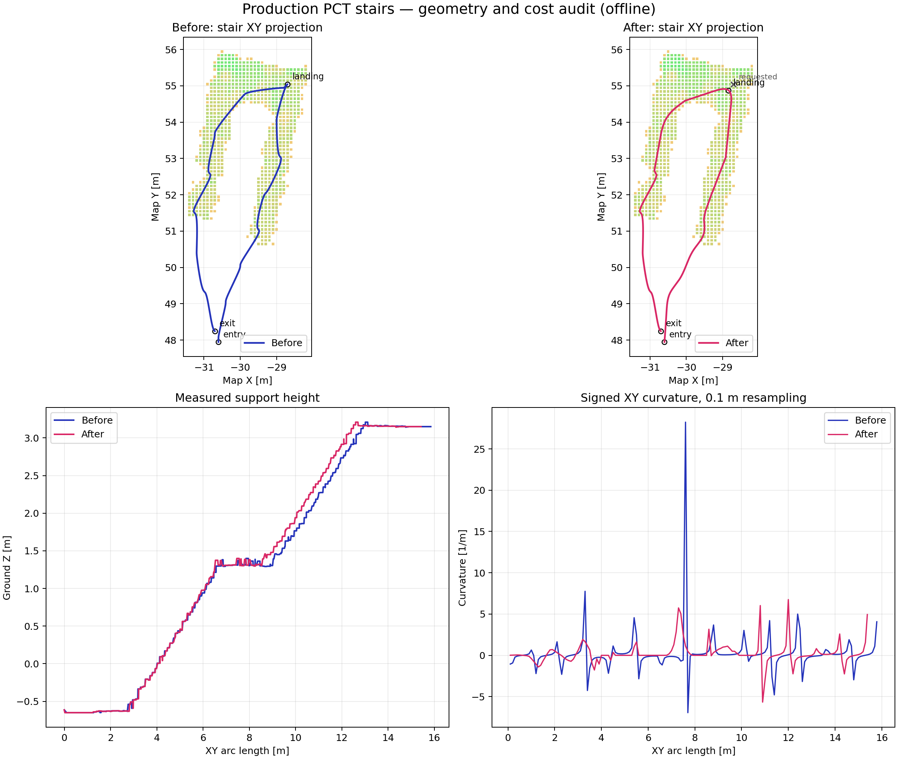

# PCT 长直走廊路径弯绕修复

日期：2026-09-23。范围：单层离线全局路径与 RViz 预览。未启动 SDK、运动控制、SCAN 或实机导航，未修改点云、tomogram 或 Zenoh 通信方案。

## 结论与原因

地面连通不等于路径形状合理。此前保存的长走廊路径横向摆动约 2 m，但相同起终点的直线能够通过完整通行检查。主要发现：

1. 原生代价插值把整数栅格中心与半格偏移混用：下角点为 `floor(x-0.5)`，权重却为 `x-lower`，产生外推及半格跳变。行代价 `[0,0,50,0,0]` 在 x=2.49/2.50 时分别得到 74.5/25。20 cm 分辨率下，仅移动 2 mm，代价跳变 49.5。已修正为整数格中心的一致插值及梯度；未修改层选择和原始代价。
2. 优化目标偏向沿零碎的低软代价格子走，而不是沿合法的直通方向走。修复插值本身并不足以消除全部弯绕，因此新增独立、可关闭的路径形状整理模块。

原生修复说明：[BILINEAR_PATCH.md](../../src/d1max_pct_planner/test/native/BILINEAR_PATCH.md)。修复前源文件及运行库保存在 `log/pct_preview/path_quality_20260923_audit/native_backup_before_fix/`。

## 当前处理链

PCT A* → GPMP 原生曲线 → 原有严格检查 → 同层可视直连简化 → 五次 Bézier 拐角过渡 → 多项式穿格检查 → 最终发布折线独立检查。

- 原生结果不合法时直接失败，不能靠后处理把失败结果伪装成通过。
- 可直接通行时输出 XY 直线；真实拐角使用切向连续、XY 几何 C2 的连接。
- Z 仍跟随 tomogram 地面并保留所选起终点，不宣称三维 C2 或时间轨迹连续。
- 修整必须保持精确起终点，且相对本次原生结果不恶化长度、总转角和所检查的曲率统计。
- 曲线穿越的栅格边界及区间内部、最终发布折线均检查；不是只抽样几个点。
- 无合格候选时明确保留已验证原生结果；不会输出未检查的捷径。
- 只处理同层路径。工作量有点数、长度、可视检查次数上限；预览任务超过 20 秒失败关闭。

实现分离为 `path_quality.py`（指标）、`corridor_refinement.py`（形状整理）、`tomogram_route.py`（集成）。其他配置默认不开启修整。

## 配置与效果

生效配置：`src/d1max_pct_planner/config/preview_flat_floor.yaml`。

```yaml
astar_cost_weight: 1.0
optimizer_cost_margin: 8.0
max_heading_rate: 1.0
path_refinement: visibility_c2
refinement_corner_cut_m: 1.5
```

`optimizer_cost_margin` 是软代价罚项起点，不是几何膨胀；`max_heading_rate` 属于原生优化器内部时间参数，不能解释为机器人实测角速度限制。1.5 m 是转角切入长度上限，实际受相邻线段与碰撞检查约束，并不是保证的最小转弯半径。

对比为“原插值 + A* 2 / margin 8 / heading 10”与“修复插值 + 当前参数 + 显式修整”的整体效果，不能把收益全部归于插值补丁。

| 用例 | 旧 XY 长度 | 新 XY 长度 | 旧曲率 P95 | 新曲率 P95 |
|---|---:|---:|---:|---:|
| 23 m 直走廊 | 24.54 m | 23.33 m | 0.473 /m | 约 0 /m |
| 18 m 直走廊 | 19.13 m | 18.13 m | 1.275 /m | 约 0 /m |
| 11 m 直走廊 | 12.54 m | 11.29 m | 1.593 /m | 约 0 /m |
| 保留用户起终点的约 39 m 路线 | 40.37 m | 38.98 m | 0.635 /m | 0.254 /m |


最终离线套件 `final_corridor_14`：14/14 通过原通行检查，其中 12 组使用修整，`break_B1` 与 `ring_quadrant_4` 没有找到更好的合法候选，保留本次原生路径。不是宣称所有路线均达到最优形状。曲率使用统一 0.1 m XY 弧长重采样估计，非解析最大曲率约束，不能推导高速跟踪能力。

## 验证与复现

代码回归：`src/d1max_pct_planner/test` 与 `tools/pointcloud_preprocessing/tests` 合计 **430 passed, 1 skipped**。包含原生插值的 16 项独立编译测试，路径指标及修整模块测试，以及配置/集成测试。

离线复现（`--output` 必须为新的目录）：

```bash
cd /home/dndx/d1max_nav_ws
python3 tools/benchmark/benchmark_pct_path_quality.py \
  --output log/pct_preview/path_quality_recheck \
  --astar-cost-weight 1 --optimizer-cost-margin 8 \
  --max-heading-rate 1 --path-refinement visibility_c2
```

保存的最终证据：

- `log/pct_preview/path_quality_20260923_audit/final_corridor_14/summary.json` 及各用例 JSON：算法、参数、路径、质量指标及独立检查。
- `log/pct_preview/20260923_112428_41cd27714bc0/quality_live_verification.json`：保留上次 `path_000038.json` 的起终点，在隔离的实际预览中重新规划，1057 个路径点通过发布后复核，RViz 存在路径订阅。XY 长度 43.8427 m，曲率 P95 0.209 /m。此项验证 ROS 消息链路，不等于检查了 RViz 渲染截图。
- 新预览由 `d1max-pct-preview.service` 管理，仍为 Zenoh / ROS Domain 24 / 私有回环端口 7465；`robot_connected=false`，`motion_enabled=false`。

tomogram 保持不变：

```text
maps/processed/sc_pgo_20260919_pct_flat_floor_v6_20260923/tomogram.npz
SHA256 fb6897abb9624e493bea6f7c6ac723c20627bcd51f0dc97af9e320c6aab59433
```

## 边界与后续

硬通行掩码、阈值 20、0.55 m 顶空要求、0.17 m 地面阶差限制和地图膨胀未改。当前 `unknown_ceiling_policy=allow_unobserved` 仍是既有假设，不能解释成全部净空已经实测确认。

修整在同一合法区域内优先几何简洁，软代价可能上升，也不承诺始终沿走廊正中心；结果保存修整前后的代价审计。这不是放宽硬障碍阈值，但确实改变了软偏好。真正上线前仍需机器人足迹/净空确认、时间参数化、速度与转弯能力约束、实时避障和跟踪测试。本轮只解决离线全局路径不必要的弯绕，不能宣称完整导航已验证。

## 2026-10-15：默认跨层地图的走廊残影与圆角回退

本节对应唯一默认包 `experiments/navigation_runtime` 的跨层地图，不是上文 09-19 单层图。
实际部署 PCD、tomogram、floor evidence 与 10-14 审核图一致；不是旧缓存。
tomogram 与审核原件只有部署路径元数据不同，全部数值数组相同。

### 地图数据修正

原始点 `#100002`、`#155987` 在已确认平整的走廊中保留了约 11.4 cm、14.34 cm
的重复高度层。它们不是墙体或上方结构，但超过旧 10 cm 处理上限；PCT 按 slice 下最高点
取地面，造成 cost=50 的假凸起。另有 10 格的中心在审核区内，最高贡献点却在边界外最多 4.01 cm。

复用原处理链，将相同确认区域的低残影上限改为 17 cm，并补足 0.1 m PCT 半格对角线
的记录足印（向外 7.5 cm）。保留真实下层支撑、墙体／上方结构保护及楼梯排除区。
不补造地面，不改定位 PCD、TF、实时障碍输入或 PCT 膨胀，不是仅将显示涂绿。

| 同一旧审核区的 2,758 格 | 修复前 | 修复后 |
|---|---:|---:|
| 地面高出基准 >3.5 cm | 28 | 5 |
| PCT cost>20 | 201 | 178 |
| 地面高出基准 >5 mm | 31 | 8 |

剩余 5 个较高格均有墙／上方结构保护；另 3 格仅 5.7～8.2 mm，低于本轮处理下限。
平均代价下降约 15.83%，没有新增不可通行格；墙边正常代价不清成绿色。
仅新增校正 107 条记录的 Z。全部 1,028,678 条记录数量、非 Z 字段、恢复点尾部、
原始测量支撑成员不变；140,563 条墙记录和 58,317 条楼梯记录逐字节不变。
楼梯 XY 范围每层 ground、ceiling、cost、allowed 数组完全一致；二楼未应用本轮 prior。
重复处理工具与验证器改为检查 prior 单调新增，不能把旧修正重复计为新测量支撑。

### 同输入发现的圆角候选缺陷

清图后六组真实 PCT 请求仍全部可规划，但一组路线的整理失败，退回了较贴边的原生曲线。
该请求前后都只有 layer 4；不是等高 slice 切换。旧的平顺路线及其 XY 多项式在新图上
仍通过完整检查，说明通道没有被封住。

实际原因是贪心可见性选中一段切角：大／中圆角撞到前后都保持 cost=25 的两个格，
小圆角则峰曲率过大。保留这些格和原曲率界限，仅在原候选全部失败后，补充有界的
相邻切角交点候选，仍进行完整多项式穿格、端点、地面及质量检查。不改官方 PCT 搜索／GPMP。
候选代价优先于长度排序，且最多四组交点、每组三个原圆角尺度；普通成功请求不增加此项工作。

证据：`experiments/corridor_residual_20261015.rPRDGm/`。
逐格原点追溯与同色标图：`experiments/corridor_residual_audit_20261015.pvFCIW/`。
地图处理检查 218 项、修整／路线／源身份／跨层相关回归 79 项通过，
六组同输入路线均通过真实源支撑核对。复现切角退化的真实数值裁剪 fixture 已纳入测试，
同输入旧修整失败、新修整通过，墙／未知格反例仍拒绝碰撞候选或选择完整验证过的绕行。

原退化请求的最终路线长 55.934 m（原图 56.007 m），解析峰曲率 1.224 /m，
仍低于原峰值变差权衡分支的 1.25 /m 上限（非所有普通候选的统一绝对上限）。
同批保留结构回波的最小 XY 距离为 0.475 m：
原图 0.397 m，仅清图但旧修整退化时 0.297 m；距离 P10 为 0.572→0.640 m。
这不表示始终位于绝对中线：轴线平均偏差 0.060→0.113 m，其他路线的 XY 保持不变。
新修整只在原三个圆角尺度均失败时启用；反向请求仍可能保留合法原生路线，
不声称任意输入都能平滑或严格居中。
固定结构回波 XY 距离只作前后几何对照，不是机身包络净空或实机运动验收。
另一组既存的等高 slice 别名问题仍单列，没有混入本轮整改。

## 2026-10-20：楼梯与平台联合路径优化

### 实际输入与根因

默认包仍使用 `navigation_runtime/map/crossfloor_20261002`。本轮没有切换地图、
压平台阶、降低障碍代价或调整运动许可。原生 PCT、定位源图回投、Zenoh 和控制器不变。
同输入对照读取默认安装包作为 before、主线源码作为 after，而不是拿两个不同地图比较。

楼梯发黄不是全部被判为障碍。真实楼梯有效 layer-cell 共 4,660 个：
cost 中位数 12.35、P90 为 17.01，84.4% 的 cost ≥8；净空惩罚为零。
坡度／可跨台阶项产生基础代价，既有邻域膨胀又抬高其中 86.6% 的代价。
用生产 tomography 公式重新计算，与保存成本逐格差值为 **0**。
因此保留真实成本色标；不能以“楼梯必须像平走廊一样绿”为优化标准。

真正的几何缺陷是：原上、下梯段各自优化，再被要求精确经过同一个平台点；
这个拼接点两侧的有限距离切向夹角达到 172.73°，形成很短的折返。
此前走廊有可见性／圆角整理，楼梯段没有相应的联合整理。

### 本轮实现

原生分段结果 → 原检查 → 联合两梯段 → 连续 slice 内的平滑／居中候选 →
原地面与边界复核 → 重建平台分界及逐边语义 → 定位源图回投。

- 沿用真实地面 Z，保留原层间连接的两个端点、楼梯入口／出口和 ROI。
  平台所在 slice 跨越旧拼缝整体处理，不再强迫曲线绕回旧平台单点。
- 每个修改区间分别比较边界距离，使用沿输出折线的连续双线性距离场最小值，
  避免采样密度变化造成“净空改善”的假象。该量是栅格质量指标，不是机身实体净空。
- XY 曲率、累计转向、长度和边界距离共同选择候选。单区间可以用很小的累计
  转角增加换取更低的 P95／峰值曲率，但不允许更贴边；增加量不超过 10° 且不超过
  原区间的 15%，综合目标必须改善。整段楼梯累计转向仍须改善。
- 可选候选失败、越界、缺支撑或净空不足时，保留原有效曲线，不能因此让全局任务失败。
  不添加跟踪器或 SDK 碰撞门控。
- 新平台分界在原观测平台上移动 0.226 m；保存请求位置、实际位置、层号及偏移。
  新几何使用自身验证记录，原生 GPMP 证明只保留为来源，不能冒充新曲线证明。
- 固定楼梯缓存仍只缓存两段原生结果。联合整理不修改缓存，反向请求明确重建
  点序、段索引和上下楼方向。运行消息只携带必要的路径及语义，不附加整套候选诊断。

### 同输入结果



蓝线为修改前，红线为修改后；背景是原成本图。高度曲线按各自 XY 弧长绘制，
不同位置处的台阶横坐标变化不代表修改地图高度。

| 上楼梯段及平台指标 | 修改前 | 修改后 |
| --- | ---: | ---: |
| 累计绝对转角 | 847.86° | 579.97° |
| 最大离散曲率 | 28.237 /m | 6.753 /m |
| P95 离散曲率 | 4.087 /m | 2.917 /m |
| 平台拼接有限距离转角 | 172.73° | 28.79° |
| XY 路线长度 | 15.849 m | 15.427 m |
| 连续距离场最小值 | 0.073657 m | 0.073657 m |
| 距离场 P10 | 0.161 m | 0.178 m |

曲率按固定 0.1 m XY 弧长重采样，平台切向取距分界至少 5 cm 的邻点。
这些是有限距离几何诊断，不是解析曲率上界、转弯半径保证或动态连续性验收。
部分保留的层间接口仍有弯折，不能称为整段 C2 连续或完全居中。
上半梯单独重采样的 P95 为 3.605→3.185 /m，但局部峰值为 7.171→7.344 /m，
不是每个局部指标都下降；分界移动也会改变离散采样起相。

- 8 组真实原生 PCT 请求全部成功，包括上楼、下楼、二楼及原长走廊。
  使用真实 `native_global_worker.RESULT_FIELDS` 裁剪后的数据构建 RouteSnapshot，
  所有源点支撑检查通过。上下楼 XYZ 和 layer 列表精确互为逆序。
- 六组单层请求的 XYZ 逐字不变；跨层路线中的一楼、二楼段 XYZ／layer 也逐字不变。
- 额外通过现有多层地图检查：实际 3D 选点、源图目标、上下楼及二楼规划、
  RouteSnapshot 和 RViz 地图层。它不启动 ROS 图或 SDK。
- 728 项 PCT／路径合同／选点测试通过；15 项旧地图 fixture 用例因当前配置不匹配跳过，
  当前地图另由上述真实用例覆盖。新增反例包含占据、未观测、低净空、错误楼层、
  平台越界、伪旧证明及候选失败回退。
- 全图规划加源图验证本次样本：上楼 2.122→2.779 s，下楼 2.143→2.716 s。
  新整理约 0.64 s，尚未达到“全局端到端 P95≤2 s”的早期目标；
  这些单次样本也不构成 P95 或硬实时结论。它不改变 SCAN／控制频率。

tomogram SHA-256 保持
`519953806989c8cd316c4c5f69920a087b1e6380eae035d4ffc8f1b415f5875a`，
manifest、规划 PCD、route 配置也保持原字节。详细证据见
[实图证据](pct_stairs_20261020/evidence.json)。
本轮保留上下楼运动模式证据尚未接通的既有缺项；完成的是全局路线优化，
不是已经完成自主上下楼运动验收。

### 复现与安装

```bash
cd /home/dndx/d1max_nav_ws
PYTHONPATH=src/d1max_pct_planner:src/d1max_pct_scan \
  /usr/bin/python3 experiments/pct_stairs_20261020/compare_stairs.py --phase after
PYTHONPATH=src/d1max_pct_planner:tools \
  /usr/bin/python3 experiments/pct_stairs_20261020/stair_geometry_report.py \
  --before experiments/pct_stairs_20261020/before/full_crossfloor.json \
  --after experiments/pct_stairs_20261020/after/full_crossfloor.json \
  --reverse experiments/pct_stairs_20261020/after/full_crossfloor_reverse.json \
  --output experiments/pct_stairs_20261020/reproduced_geometry
```

同一默认包的明确文件清单、回退备份与安装核对位于
`experiments/pct_stairs_20261020/deployment/`。仅同步本轮 PCT 模块、测试和说明，
不新增入口／分支，不启动或重启服务、不连接 SDK、不下发目标／运动、不自动 push。
