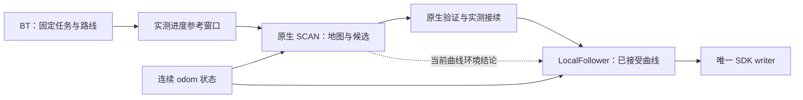
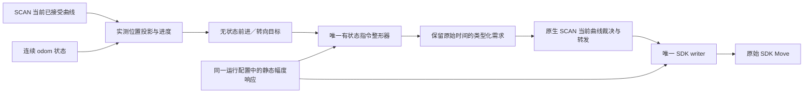
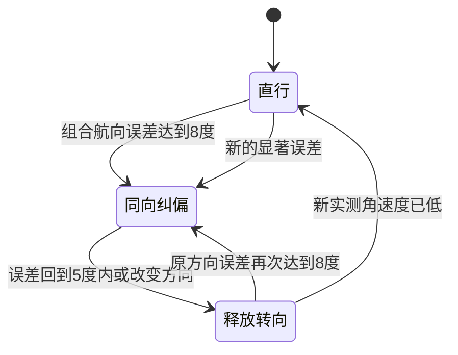

# SCAN 与控制链：作者用法对齐整改

> 当前导航策略已按用户后续要求调整为“前进＋连续转向，不横移”。
> 前六轮记录保留为历史对照。当前控制器采用文末第七轮的连续前进/转向策略；
> 第六轮固定工作幅度、角度锁存和反向等待策略已被替换，不代表默认控制行为。

## 范围与版本事实

本轮修改同一导航主线，不另建入口或 Git 分支，不启动节点、连接 SDK 或发送运动。
公开入口仍为 `tools/navigation_entry.sh`；默认包仍为 `experiments/navigation_runtime`。
BT 管固定任务，全局路线不重算，原生 SCAN 管环境裁决，LocalFollower 管当前曲线，SDK 只有一个 writer。
没有增加独立运动扫掠检查，没有改变未知空间、实体滤除、地图、SDK 模式或物理验收标志。

参考 [SCAN 作者 main（348e8a59）](https://github.com/wuyi2121/SCAN-Planner/tree/348e8a590a50a5a6bbab8d8c6dcfd171f009be26)，
同时核对作者仓库的 ROS2 社区版本 d0b921c9。两个版本并非完全相同：
作者 mode 3 保留外部参考路线，社区版部分重规划会重建起点到终点的多项式；主线不采用后者。
本轮不再将假设的大机身惯性或仿真假设当作 D1 的实测动力学。

修改前默认清单：`85bb54860bcd9318bdded4d002cedf0766b461b9c6d1c32e9140cebba8ff1c92`。
实际安装、冻结源码、生成接口及 Web activation 同步后重新封存。
第一轮清单：`4119f54fc7a92e69092aa74bf9caf2f032dd4d238426507bfdbe09937da91381`。
第二轮连续性复核以该清单为基线，最终绑定见文末。
正在运行的旧进程没有重启，文件更新不等于当前会话已加载新代码。

## 连续执行链



候选计算、提交和当前跟踪相互独立。普通新候选失败不清空可用旧曲线；
真实负环境结论、取消、失权和源数据过期仍不能继续发送旧运动。

## 规划与调度

| 环节 | 当前配置/语义 |
|---|---|
| SCAN 状态机 | 10 ms / 100 Hz；检查状态，不等于每秒求解 100 次 |
| 原生当前曲线环境检查 | 50 ms / 20 Hz |
| 普通周期参考刷新 | 0.2 s；按进度、待接续状态和求解资源决定是否提交 |
| 实测偏离/障碍触发 | 优先处理；提交间隔 0.1 s，单 worker，无无限排队 |
| 单次完整求解 | 保留原有共享 400 ms 预算；失败重试不能延长旧预算 |
| 地图积分 / 地图显示 | 10 Hz 上限 / 3 Hz 上限，独立于状态机 |
| 跟踪 / SDK | 20 Hz / 20 Hz，求解期间持续运行 |
| 状态诊断 / 曲线显示 | 同状态最多 20 Hz；提交曲线按身份事件更新 |

确定修复：

1. 去掉非官方 `max(0.5, failed_replan_cooldown)` 额外延迟。
   碰撞事件先进入重规划状态，实际 worker 仍按独占资源与既有间隔提交。
2. 重复的同一碰撞替换请求合并，不反复取消已经运行的同一求解。
3. 周期与行进距离两类普通触发共用待接续轨迹保护，避免接缝不断向前移动。
4. 数值失败可在冷却后凭真实双雷达源时间前进重试；
   不要求静止且已饱和的地图一定产生新占据位，也不把重复消息当新证据。
5. 定时器等待、worker 等待不是一次失败的求解；失败计数不能按 100 Hz 轮询累计。
6. 轨迹 Marker 使用稳定 ID、无限 lifetime 和 durable 发布；取消显式删除。
   求解候选不冒充已经提交的执行曲线。

## 跟踪与 SDK

平移采用作者闭环结构，全部运算基于连续 odom：

\[
\mathbf v_{odom}=\mathbf v_{ref}+0.8(\mathbf p_{ref}-\mathbf p_{actual}),\qquad
\mathbf v_{body}=R(-\psi_{actual})\mathbf v_{odom}
\]

完整 XY 位置误差保留，不再只保留横向误差。默认速度阻尼、惯性预测和额外 jerk 滤波关闭；
保留一个有状态的加速度限制器，换轨不清零其历史。
当前指令配置：XY 0.30 m/s、yaw 0.50 rad/s，XY 加速度 0.35 m/s²、yaw 加速度 0.80 rad/s²。
这些是指令域配置，不是实测机身速度或制动保证。

航向采用当前 Native 认证切线的几何转向前馈加 1.5 倍角度误差反馈。
几何前馈是当前曲率乘实际受限的沿轨迹指令速度，不是假设的惯性。
小误差时平移和转向同时进行；第二轮将 0.4～0.8 rad 区间改为 C2 几何权重连续减速，
0.8 rad 以上仍请求平移减速、先转向，不取消任务、冻结进度或增加等待状态。
静止零导数处以同一曲线内 7 cm 空间 P 预览起步，不用墙钟伪造进度，也不放大微小反向导数噪声。

作者控制器用未来 chord 作为目标航向，而当前 Native 认证的是当前切线。
本轮不单独换成未来航向而留下不一致的碰撞模型。

低速换轨接口显式传输：

- `body_heading_seed_valid` / `body_heading_seed_yaw`：原求解或 splice 的冻结朝向。
- `body_heading_sampling_intervals`：原 Native 全曲线采样数。
- `join_pose` / `join_twist`：保持真实接入测量语义，不冒充冻结朝向。

跟踪器在既有准备 worker 中缓存相同采样历史，控制时按实测进度查询；
不是每个控制周期重放整条曲线。缺失、冲突或迟到的新候选不能替换当前有效曲线。
所有接口与消费方一起重建；入口用非默认字段 round-trip 和整包哈希核对生成布局。

SDK 新默认映射 `continuous_amplitude_ratio_v4`：

- 每个被选中的当前指令直接映射，不叠加一秒起步计时器、二阶 PD 或另一层 slew。
- 零附近连续融合到响应幅度，保持 XY 方向及 yaw 符号；第二轮的精确幅度与数学合同见下文。
- 小 yaw 不强制变成 ±30%，普通符号切换不额外插入等待零指令。
- 取消、失权、过期和急停仍输出零；历史 1–3 映射只保留封存兼容。

第一轮 cubic/max 版本在 20 Hz、0.35 m/s² 下的首个理想控制步为 0.0175 m/s 指令，
映射约 18.72%；这些旧版数字不用于描述第二轮 quintic/pnorm16 产物。
两轮都不存在人为固定一秒的起步等待；这些计算不是实机响应时间或百分比到 m/s 的标定。

## 验证与未验证项

生产代码和原生成接口离线验证，不启动 ROS 图：

| 证据 | 结果 |
|---|---|
| SCAN 同输入调度方法 | 修改前 169 检查 / 4 失败；修改后 0 失败 |
| 原生地图碰撞触发同输入 | 修改前 27 检查 / 2 失败；修改后 0 失败 |
| Native 核心 | 194 GTest / 4 CTest，通过 |
| 调度等待不算失败，同输入 | 185 检查，旧版 8 失败 → 新版 0 |
| B 样条与朝向采样 | 85 GTest / 5 CTest，通过 |
| 当前控制与低速朝向 | 60 用例，通过；旧同输入 5 个差异保留 |
| 跟踪接口与准备/退役 | 184 用例，通过 |
| SDK typed writer | 37 用例，通过；映射与校验通过 |
| BT / SDK 包回归 | 各 6 CTest，通过 |

计数会重叠，不能相加冒充独立场景数。
回归覆盖当前轨迹保留、碰撞撤销、低速反向噪声、原始朝向历史、
坏 seed / 坏采样数、乱序、取消、迟到、SDK 失权、过期和急停。
另修正两项已在修改前复现的旧坐标测试假设：默认地图已是既有跨层处理版本，
不应硬编码成早期一楼 `source_identity`；没有改运行地图或坐标判断。

未做：完整 rosbag 回放、完整 ROS/RMW 闭环、实际 RViz 晚订阅、实机运动和物理速度标定。
组件与理想响应验证不能证明实机已经顺滑，或已完成跨层运动验收。

## 复现与默认包核对

主证据目录：`experiments/official_scan_following_20261015/verification`。
原生同输入证据：`experiments/scan_official_replan_20261015/native`。
旧安装产物、参数、清单和 preflight 保留在主证据目录旁的 `baseline`；不作为另一正式入口。

```bash
cd /home/dndx/d1max_nav_ws
bash tools/navigation_entry.sh --check-release
python3 tools/release/check_scan_authority_consistency.py \
  --nav-root /home/dndx/d1max_nav_ws \
  --app-root '/home/dndx/智元四足机器人D1 Max二次开发文档资料包v0.1.0/d1max_ros2'
```

命令只核对产物，不启动服务、SDK 或运动。跟踪数学同输入命令见证据目录的 `reproduce.txt`。
实机使用前须完整重启导航与 SDK 数据后台以加载同一新包；不自动恢复旧运动授权或目标。

## 第二轮：连续性、时序与末端一致性复核

### 确定问题与最小修复

1. **平移加速度的坐标基错误。** 上一拍 BODY 速度与当前拍 BODY 目标不能直接相减。
   在同一连续 odom 基中保留历史，再转到本拍机身坐标做同一个向量限幅；
   换轨复制坐标基，临时航向计算保存/恢复坐标基，硬停清除历史。
   真实核心同输入中，yaw 每 50 ms 变化 ±0.025 rad，旧版 odom 指令变化
   0.0207296 m/s（差分加速度 0.414592 m/s²），超过原 0.0175 m/s / 0.35 m/s² 预算。
   不使用虚构惯性或把指令当实测速度。
2. **航向阈值处的平移开关。** 原 0.8 rad 两侧把 FF＋P 平移目标直接切成零。
   新几何权重在半阈值以内为 1，在半阈值至阈值之间用 quintic 连续下降至 0。
   默认 0.18 / 0.34 rad 输入保持完整作者 FF＋P，认证 yaw 与曲率前馈定义不变。
   同一 0.8±0.001 rad、40 拍真实核心输入：指令脉冲由 0.0175 降为约 3.89e-8 m/s；
   最大差分加速度由 0.35 降为约 7.78e-7 m/s²。
   精确/近零边数仍可能随输入交替，不能把这个结果说成软件从不出现零输出。
3. **SDK 对角归一的尖角。** `max(abs(vx),abs(vy))` 在 45°换轴时没有共同导数。
   新 V4 明确使用 `rounded_dominant_pnorm16_direction_preserving_component_cap`，
   标量段为 quintic，方向分母为 p-norm16。旧 V4 token 明确拒绝，不静默改旧合同。
   同输入 0.2 m/s 指令范数、0.1 rad/s 方向变化，导数跳幅从
   0.1043713425 降到有限差分残差 7.58e-7 fraction/s。
   XY 有效系数为 `0.30*2^(1/16)`：混合边界的主分量从对角 30% 到轴向 31.328%，
   每轴上限仍 40%；yaw 有效系数仍 30%。这不是百分比到物理速度的标定。
4. **到达状态和同拍输出。** 实测位置及静止已经满足既有完成条件时，
   不能一边报告 `at_goal/request_stop`，一边继续输出历史指令的减速尾巴。
   到达后的停止输出不等于 SDK 已确认物理停稳，后者仍由原 MC 证据流程处理。
5. **hold-heading 的恢复遗漏。** `waiting_measured_target_heading` 必须纳入真实 body 恢复分类。
   否则静止且占据已经饱和时，新鲜 body 恢复也不触发重试。
   默认 path-tangent 不受此分支影响，不能把它冒充所有走走停停的根因。

### 时序与未改变的合同

- BT 只管理固定任务/全局路线；短时局部失败不重算路线或取消任务。
- Native 仍是唯一碰撞裁决；候选失败不清空可用当前轨迹。
- Native 100 Hz 是状态机轮询，20 Hz 是当前曲线检查；不是 100 Hz 求解。
- 独立 20 Hz 控制与 20 Hz SDK writer 的相位不同，不应自动插入零。
  使用原始时间的 typed writer 回归覆盖十种相位、每种 200 拍、1～45 ms 到达抖动及换曲线。
  真正超过原 body/command 期限、撤销及失权仍输出零，未扩大源龄或伪造采集时间。
- 不新增运动扫掠门、不重加 SDK 起步计时器或 PD、不修改实体滤除、未知体素或物理验收标志。

### 加速度声明的边界

默认仍是一个有状态的加速度限制器，jerk 整形关闭。
这次修复消除了不必要的坐标差分超限、航向开关和静态幅度折点，
**不等于正常命令的加速度已经全程连续，更不等于真实机身加速度有相同上限。**
硬停仍优先于平滑。SDK 在零至混合区仍有较高增益：轴向最大约
19.5801 fraction/(m/s)、yaw 11.25 fraction/(rad/s)；
SI 命令域的 0.35 / 0.80 加速度上限不能当作 SDK 幅度导数或物理加速度上限。
只有实际运动数据能判定是否仍有物理振荡，组件数学通过不能替代现场验收。
同输入探针同时保留未被掩盖的残差：启动第一拍的加速度变化仍为 0.35 m/s²；
小幅 XY ±0.005 m / yaw ±0.002 rad 测量输入仍可产生逐拍加速度变号。
严格 jerk 有界不能靠把旧二阶 PD 打开或声称 quintic 静态映射已完成来实现。

### 本轮证据与交付

证据目录：`experiments/control_chain_review_20261015.5Qam64`。
保存修改前完整源码快照、原清单、activation 及 Native/Tracker/SDK/Application 安装产物。
软件复核期间不启动服务、不初始化 ROS 图、不连接 SDK、不发送初值、目标或运动。
统一安装、冻结源码、Python、配置与 Web activation 已同步同一个默认包。
最终清单：`1ace4223b2258e7e52652286c500e84d6ed6d60cdeb4269bcf7fa50e6ef60fd5`。
运动配置：`2a4353658058f0dfd0a0f3a2677fd07806760b5fef43796754e011dcd0a118f2`。

| 本轮验证 | 结果及范围 |
|---|---|
| 任务、参考、时序、短时断流、来源及配置 | 652 Python 针对性用例通过 |
| 当前跟踪核心及类型化接续/退役 | 6/6 CTest、307 GTest 通过；另 23 参数用例通过 |
| SDK 新数学、解析及发送逻辑 | 19/19 CTest，通过；其中 TaskWriter 40 用例 |
| Native hold-heading 恢复同输入 | 193 检查，旧版 3 失败 → 新版 0 |
| Native 输入及真实接续/源时/取消 | 15 输入 GTest、11 生产组件接续 GTest 通过 |
| BT | 6/6 CTest 通过 |
| 默认包 | 4982 启动依赖、9107 清单文件通过；95 组源码/冻结/安装一致性通过 |

用例与检查可能重叠，不能相加作为独立导航任务次数。
正在运行的旧进程未重启；**默认文件已更新，不代表旧会话已加载新 ELF、配置或模块。**
当前 RMW、实际 RViz、实机跟踪与硬件加速度不在本轮验收声明内。

```bash
cd /home/dndx/d1max_nav_ws
bash tools/navigation_entry.sh --check-release
python3 tools/release/check_scan_authority_consistency.py \
  --nav-root /home/dndx/d1max_nav_ws \
  --app-root '/home/dndx/智元四足机器人D1 Max二次开发文档资料包v0.1.0/d1max_ros2'
ctest --test-dir experiments/navigation_runtime/tracker/build/d1max_trajectory_tracker --output-on-failure
ctest --test-dir experiments/navigation_runtime/sdk/build/d1max_sdk_bridge --output-on-failure
experiments/control_chain_review_20261015.5Qam64/sdk_evidence/mapping_before_rebuilt
experiments/control_chain_review_20261015.5Qam64/sdk_evidence/mapping_after_rebuilt
```

数学和跟踪同输入源、重编命令、原输入 CSV、旧失败及新结果均保留在证据目录。
上述命令不启动生产导航或连接 SDK。

## 第三轮：导航禁横移与直线小角纠偏带

按用户最新要求，默认导航只请求前进与转向，不请求横移。平台能力合同仍为
`holonomic_xyyaw`，不伪造硬件能力或改变 SDK 幅度映射；导航策略统一设置
`align_then_forward=true`。这是已有的前进与连续转向分支，不是停下、完全对齐、再起步的状态机。
SCAN 与跟踪器使用相同的该项配置，保留现有几何、碰撞、任务和源时间合同。

直线路径的转向迟滞由原硬编码角度改为两项正式参数：

| 参数 | 当前默认 |
|---|---:|
| `steering_enter_angle_rad` | 0.1396263402 rad，约 8° |
| `steering_exit_angle_rad` | 0.0872664626 rad，约 5° |

无明显曲率时，小误差不启动纠偏；启动后进入停止带则使转向目标归零，已有角加速度限幅保留。
该判据同时使用已有实测角速度预测，因此 8°/5°不是所有动态情况下的精确原始角度开关。
真实弯道保留曲率前馈，不必等累计到 8°才转弯。侧向位置偏差通过转向渐进纠正，不发送横移。
终点朝向仍使用用户目标原有容差，不用直线迟滞替代终点验收。

配置完整贯通 `motion_tracking.yaml → tracking_profile → session → tracker.yaml → ROS 参数 → Config`；
生成配置、原生 SCAN 策略、安装 ELF、冻结源码、默认选择与 Web activation 已同步。
证据目录：`experiments/forward_yaw_20261015.Gi8ucr`。
默认清单：`7cb15ce5b4016ed7e99bbf6fb33deb9953ca33f9db1e85c014400dc895fcb588`。

验证：跟踪包 6/6 CTest 通过；新增 5 组真实跟踪核心用例覆盖直线小角、迟滞、
换轨保持前进、侧偏转向及真实弯道前馈。默认包 4982 启动依赖、9107 清单文件与源码/安装一致性核对通过。
未启动、重启任何导航或 SDK 服务，未发送运动；已有旧会话仍使用旧代码和参数。
这些是软件验证，不是实机无振荡或物理跟踪验收结论。

## 第四轮：连续前进/转向控制与终点减速

### 取舍与执行策略

核对本地 Go2 的 `nav2_config/nav2_fused_params.yaml`（MPPI 15 Hz、速度平滑 20 Hz）及
[仿真 A1 的实际 SCAN 适配器](https://github.com/Robot-Nav/legbot_3D_Nav/blob/f60606a4903bad58fca813f76072f9940a284d1d/src/SCAN-Planner/src/planner/plan_manage/src/a1_cmd_adapter.cpp)。
借鉴其持续跟踪、实测进度与速度反馈的职责分离；不照搬横移、100 Hz、仿真楼梯最小速度和 RL 底层参数。
[Nav2 Humble 速度平滑器](https://github.com/ros-navigation/navigation2/blob/humble/nav2_velocity_smoother/src/velocity_smoother.cpp)
亦将正常速度变化与超时/停止分开处理。本轮保留自己的 20 Hz 控制和唯一 SDK writer，不叠加另一套惯性模型。

1. **转向反馈去掉隐式 0.8 秒预测。** 不再按测得角速度猜测未来转角而提前收零；
   不因反向请求增加强制零速等待。当前曲率转向量与当前角度偏差共同形成目标，
   通过同一个既有限幅器正常减速、穿零或加速；换轨保留其历史。
2. **小角反馈由开关改为连续空间权重。** 5°以内角度纠偏为零，5°～8°用 quintic 权重
   从零渐变到完整反馈，8°以上使用完整反馈。不再存在跨 8°才激活的迟滞跳变。
   参数名 `steering_exit_angle_rad` / `steering_enter_angle_rad` 保留兼容，分别表示零反馈/全反馈边界。
   真实弯道转向独立于该角度带，不要求先累积偏差再转弯。
3. **曲率转向消除硬开关。** 原 `abs(kappa)*preview > .04` 的整项切换，
   改为 0.02～0.06 rad 的 C2 权重。大角度平移降权也统一复用已有 C2 函数，
   小角不再额外反复降低前进目标。前进投影仍符合当前机身方向，不发送横移或倒退。
4. **终点位置容差不是急停条件。** 进入 20 cm 范围且实测仍在运动时，保留普通 XY/yaw 减速；
   不因默认 jerk=0 直接清零。终点朝向用其独立容差与同一个正常 yaw 限幅器，
   不借用路段角度带、不预测提前停转。只有新鲜实测满足既有静止条件才使用精确零输出。
5. **紧弯的速度与转向能力一致。** 无横移策略的局部速度包络取原法向加速度限速与
   `v <= max_yaw_rate / abs(kappa)` 的较小值，再沿既有制动包络提前减速。
   避免前进太快、转向饱和、航向误差再压低前进的循环；不是新增任务拒绝门。

取消、急停、失权、真实碰撞结论及原始源期限仍保留原停止优先级。
全局路线、地图、自体滤除、未知空间策略、SDK 幅度配置和物理验收标志均未修改。

### 同输入结果与范围

证据：`experiments/continuous_forward_control_20261015.lGmdjC`。
使用真实 `TrackerCore`、生产 B 样条及 SDK V4 映射，固定 20 Hz、每种输入 80 拍；
这不是实机数据，也不是完整闭环导航成功。

| 反例 | 修改前 | 修改后 |
|---|---|---|
| 固定角误差、测得角速度交替变化 | SDK 转向精确零边 79 次 | 0 次，持续有符号转向 |
| 原曲率边界附近抖动 | SDK 转向零边 79 次 | 0 次；稳定段相邻幅度差约 0.01494 个百分点 |
| 未停稳进入终点 | 上拍 0.20 m/s 下一拍直接零 | 同输入首拍 0.1825 m/s，沿原 0.35 m/s² 限制减速 |
| 终点角误差仍超容差、测得正转角速度 | 被旧预测压成零 | 按实测角误差正常转向，不误报完成 |

跟踪包 6/6 CTest、321 GTest；参数与真实包准备 92 Python 用例；原 SDK 敏感性/合同 16 用例；
SDK 包 19/19 CTest、Native 生产跟踪接续 1/1 CTest 通过。计数有重叠，不合并为导航任务次数。
新增反例也核对迟到/坏候选不清空可用轨迹、普通换轨不清速度历史、源期限和负碰撞结论不能被心跳续期。

剩余边界如实保留：默认 jerk=0，只限制正常 SI 指令的速度变化幅度，不声称加速度严格连续。
SDK V4 近零仍有较高静态增益，首次 0→0.04 rad/s 仍可映为约 28.26% 转向幅度；
SI 减速不等于物理制动已标定。4.9°/5.1°数学零边仍存在，但该组 SDK 峰值仅约 2.49e-9 fraction。
不能将消除上述重复大脉冲宣称为已经证明实机无振荡、无丢帧或无停车。

### 默认包与复现

源码、冻结快照、Python 配置、安装 ELF、默认选择与 Web activation 已同步。
新清单：`dd5fe8fa23fff3b98fac5ee1d467cdf1a7b1b339086cca29b9cd684d1e0281f0`。
旧文件和清单保留在证据目录；通过暂存安装后原子替换文件，不覆盖运行进程映射的 ELF。
本轮未启动或重启任何生产服务、未连接/重连 SDK、未发送运动，旧会话仍为旧代码。

```bash
cd /home/dndx/d1max_nav_ws
bash tools/navigation_entry.sh --check-release
python3 tools/release/check_scan_authority_consistency.py \
  --nav-root /home/dndx/d1max_nav_ws \
  --app-root '/home/dndx/智元四足机器人D1 Max二次开发文档资料包v0.1.0/d1max_ros2'
ctest --test-dir experiments/navigation_runtime/tracker/build/d1max_trajectory_tracker --output-on-failure
bash experiments/continuous_forward_control_20261015.lGmdjC/sdk_probe/reproduce.sh
bash tools/validation/run_sdk_mapping_inertia.sh /tmp/d1max-forward-sdk-regression
```

## 第五轮：统一控制职责、响应约束与发送时序

本轮在同一默认包内完成软件收敛，没有启动生产服务、连接 SDK 或发送运动。
不修改 PCT、SCAN 搜索/碰撞算法、地图、未知空间、自体滤除、物理验收标志或任务所有权。
SDK V4 静态换算和原始源数据有效期保持不变。

### 职责与状态



- `forward_steering_controller.hpp`：只根据曲线、横向误差、实测朝向计算前进／转向目标；
  不管理任务、回调、许可、发送或速度历史。保持“不横移、小偏差边走边修、曲率前馈”。
- `TrackerCore`：拥有实测进度和唯一输出历史；`LocalFollower` 负责候选接入及已提交曲线。
  同任务换轨继承速度、幅度变化率及坐标基准，不把换轨当作重新起步。
- `response_command_limiter.hpp`：在原 SI 加速度可达区间内选择输出，并核对该输出经过
  **原有静态 SDK 映射后**的幅度变化。无第二个 SDK 滤波器、启动定时器或假设的机身惯性。
- SDK 适配器：按同一冻结配置换算；writer 仅管理当前任务、原始期限、控制权、急停和唯一发送。
  SCAN 仍是唯一碰撞裁决者，没有重新加入独立运动扫掠检查。

### 幅度连续性

原 V4 中，0→0.04 rad/s 的 SI 指令可直接对应约 28.26% SDK 转向输入。
因此仅限制 SI 加速度不足以约束最终输入。控制器现从同一 `runtime_motion_profile.json`
投影静态响应描述，而不是另配一份幅度模型。4001 个正负样本与实际 SDK 映射核对到 1e-14。

| 正常控制项 | 当前配置与优先级 |
|---|---|
| 跟踪周期 | 20 Hz；使用实际稳态时钟间隔，不按轨迹发布时间假造进度 |
| SI 变化约束 | 原 0.35 m/s²、0.80 rad/s² 配置保留 |
| SDK 输入变化率 | 1.6 fraction/s；50 ms 对应最多 8 个百分点 |
| SDK 输入变化率的变化 | 12 fraction/s²；这是离散指令域约束，不是实测机身加速度 |
| 固定目标收敛 | 输入域提前减小变化率，避免约束自身造成往返限环 |
| 约束冲突 | 已有曲线/SI 可达边界优先，诊断 `input_limit_override`；不新增任务失败门控 |
| 真正停止 | 取消、失权、源期限耗尽、SCAN 负结论及实测终点停稳仍优先零输出 |

起步保留有效幅度区间，但连续进入，而非首拍硬跳。固定输入例中前进幅度依次约
3%、9%、17%、23.75%、28.13%、30.44%，历时约 0.30 s；这不是实机速度或起步时间测量。
这些约束针对控制器产生的指令序列；操作系统调度、消息跳帧及厂商内部执行不在其证明范围。

### 消息时序与发送隔离

确认并修复跨话题乱序丢指令：跟踪器已经使用新的机身状态，但 Native 的独立机身回调尚未送达时，
旧实现丢弃当前需求，状态随后送达也不补处理。现使用一个 latest-only 待处理槽，
在对应真实状态到达后重核同一条需求；不修改原始时间、不排队回放、不延长 100 ms 状态期限。
零指令、取消、撤销及提交身份变化仍有明确的序号/屏障关系，旧需求不能复活。

同样处理首条曲线/换轨时的跨话题顺序：速度需求若先于 `LocalTrajectoryCommit` 到达，
只有已知、同任务、身份完整的候选可进入同一个待处理槽；真实提交到达后重核，
不是提前执行候选。初始尚无 active 曲线也适用。新零速可撤销旧待发速度，
不要求候选的正碰撞结论仍有效；零速撤销本身不授予运动。

writer 在共享状态锁内登记一次不可变 SDK 事务，释放该锁后才调用厂商接口，
返回后只对捕获的任务/epoch/arm 身份处理结果。接管返回后重新选择当前速度，
不使用接管前缓存的指令。事务必须等“厂商调用栈返回”和“回调完成”两者都结束，
内联 ACK 不能让仍阻塞的旧调用提前退役或接纳新任务。

普通 writer 维持 20 Hz 节奏，跳过错过的周期，不补发积压速度；
撤销或急停可以提前唤醒，但提前处理只允许零输出，不能加速非零发送。
厂商函数若永久阻塞，同一 writer 仍不能在其返回前发送后续零指令；
释放状态锁不等于证明了物理停止时限。

现有日志/诊断另记录被选中指令的原始序号、源时间、机身状态时间、截止时间，以及
源/机身状态到软件发送受理的时差、剩余期限；不以最新收件时间替代它们。
等待/停止零指令无对应类型化需求时明确标空。该受理点不是网络写入或机器人响应证明。

### 同输入对照与验收边界

证据目录：`experiments/cohesive_control_20261015.TqUiFL`。
使用真实 `TrackerCore`、生产样条、Native ledger、SDK V4 和类型化 follower，未初始化 ROS 图或厂商 SDK。

| 输入/反例 | 修改前 | 修改后 |
|---|---|---|
| 未停稳进入终点的转向输入最大相邻变化 | 约 20.48 个百分点 | 8 个百分点 |
| 7.9°/8.1°/6°/4.9°突变观测 | 最大约 23.37 个百分点 | 最大 8 个百分点 |
| 80 个 20 Hz 周期、20 次同任务换轨 | 作为同输入基线保留 | 无幅度历史重置、无约束覆盖、无转向零边 |
| 固定正负目标 | 无输入域变化合同 | 120 周期无输出限环，误差小于 1e-10 |
| 同一真实需求先到、对应机身状态后到 | 0/20 次转发 | 20/20 次在原始期限内转发 |
| 换轨首条速度需求先于真实提交通知 | 0/1 次转发 | 1/1 次在真实提交后转发 |
| SDK 内联 ACK、调用栈尚未返回 | 状态锁掩盖相应竞态 | 事务仍记为未退役，不能接受新任务 |

不把每一条曲线都描述为“全面变好”：一部分本来平稳的恒定输入，其修改后起步过渡更长；
数学零边变化且幅度仅约 2.49e-9 fraction 的反例也不被当作实机抖动证据。
原假设机身模型的敏感性测试中未到达结果原样保留，不冒充 D1 实机验收。

精确测试计数、默认清单、二进制与同输入重现结果保存在证据目录的最终检查日志。
本轮通过：跟踪包 7/7 CTest（331 GTest）、Native follower 43 GTest、Native ledger 114 GTest、
SDK 包 20/20 CTest（其中 task writer 45 用例）、BT 6/6 CTest、配置接线 105 Python 用例、
SDK 启动参数 74 Python 用例及真实 SDK 静态映射/跟踪集成 21 用例。
这些用例可能重叠，不合并为导航成功次数。
控制核心、Native 和 SDK 分项通过不等于已经完成实机导航；
SDK 幅度到真实速度、真实加速度、网络断流停车及完整轨迹平顺性仍需现场确认。

另保留一项未证实风险：Native 既限制请求速度，也将实测速度超过同一配置上限归入
`PermitBindingMismatch`。这不是新增碰撞检查，但可能将响应过冲与坏需求混为一谈。
本轮没有实际超限轨迹证据或校准后的处理策略，不据猜测删除它；若现场出现此原因，
应区分请求越界、实测越界与 SCAN 负结论，结合原始速度及受理时序分析，不能以加大阈值宣称修复。

```bash
cd /home/dndx/d1max_nav_ws
bash tools/navigation_entry.sh --check-release
python3 tools/release/check_scan_authority_consistency.py \
  --nav-root /home/dndx/d1max_nav_ws \
  --app-root '/home/dndx/智元四足机器人D1 Max二次开发文档资料包v0.1.0/d1max_ros2'
ctest --test-dir experiments/navigation_runtime/tracker/build/d1max_trajectory_tracker --output-on-failure
ctest --test-dir experiments/navigation_runtime/sdk/build/d1max_sdk_bridge --output-on-failure
bash experiments/cohesive_control_20261015.TqUiFL/command_boundary_probe/reproduce.sh
```

## 第六轮：实机左右振荡、转向死区与指令断档

### 已核实的事实

- 上次实机会话 `f3b8bbc83951449aa01d89011e02fdfc` 实际加载了第五轮的 Native、跟踪器和 SDK，
  不能将这次问题归咎为“旧程序没有更新”。本轮检查时导航和 SDK 已退出，没有重新连接。
- 原控制与生产 SDK 换算同输入：3 cm 横向误差对应约 3.76% 转向，4 cm 对应约 31.93%；
  单纯给幅度增加变化率限制没有降低闭环增益。
- 用户明确补充：**转向低于约 20% 基本不动，20% 已足够**。因此不能只降低 P 或将正常纠偏
  长期压在 2%～10%，也不能将平移的 30%～40% 响应套到转向。
- 记录中有 `waiting_local_command` 及 194 次 raw restart；也有接近局部曲线末端后，
  新曲线方向使跟踪误差接近 ±π 的事实。旧日志没有保存逐条授权到达/拒绝及完整验证结果，
  不能将所有断档都归为同一个原因，或声称已证明 194 次的完整因果链。

### 转向：有效工作幅度与纠偏决策分开



这是控制器内部的转向记忆，不是 BT 暂停、任务取消或停车许可。
横向偏差仍通过转向修正，不发送横移。小误差下，前进在释放和等待角速度回落时继续；
大角度确实不可前进、真实负碰撞结论或源期限耗尽时仍按原合同处理。

- 在同一 V4 数学合同中，将 yaw 的工作点和上限均设为 **0.20**；平移换算不变。
- 20% 是操作者确认的响应线索，不是 rad/s 标定。小曲率不再独立放大成持续 20% 转向；
  曲线的实际方向变化进入同一误差纠偏决策。没有新增 SDK 二次滤波、PD 或启动计时器。
- 同任务换轨保留纠偏阶段。反向修正必须等释放后的**新实测低角速度样本**，
  重复旧样本不能作为已经停止转向的证据；没有固定时间冷却。
- 平台上多个 SI 值都映射为 20%，因此内部使用最小工作点，避免先积到 0.5 rad/s 的虚构历史，
  释放时又花约 0.6 s 慢慢降低 SI、期间 SDK 仍持续 20%。这不是声称真实角速度为该最小 SI 值。
- 修复平台逆映射：20% 的最小原像是 `reference * blend_ratio`，不是直接取完整 reference。
  原有唯一条件器仍控制正常幅度过渡；取消、急停等真实停止保持优先。
- 普通纠偏原拟 3°释放，用户希望不追求过细角度，本轮默认改为 **8°进入、5°释放**。
  5°是收转向阈值，不是前进或任务执行门槛。
- 终点朝向沿用自己的目标容差，不用普通跟踪的 8°激活条件阻挡终点对齐。

用户所说“30% 应该约等于 0.3 m/s”作为估计保存在同一配置的来源记录中；
未将其改成已验证的速度换算或物理验收。

### 规划边界与发送接续

规划起点必须区分原始实测速度与优化器选择的边界。前进策略下，近静止的反向/侧向速度
直接固定为曲线导数，会使很短的初始段朝向相反。只有差值小于既有 0.05 m/s 接入容差时，
才可选零优化边界；原始状态、时间和实际接入复核不变，固定 splice 与正常前进边界不变。
实机日志另有约 0.12 m/s 反向起点，不在该近静止处理范围内，不能将它伪造成零或扩大容差。
若真实机身和有序参考已一致朝前（夹角小于 60°），但实测沿参考速度仍小于等于 −0.05 m/s，
不提交仅为追随这段反向导数而转身的新候选；复用原有 `candidate_measured_join_rejected`
可恢复流程，保留任务、旧轨迹及真实速度，等待新的实际边界。
目标在身后、转角朝向不一致、固定 splice、全向策略和预览不适用此分支。
这是候选边界与前进策略的一致性检查，不是把所有反向任务禁掉，也没有保证所有错误反向参考均被解决。

另一处实机数据已出现的错误是：发送端将实测 0.337 m/s 或 −0.701 rad/s 与
0.3 m/s／0.5 rad/s 的**请求配置上限**直接比较，并当作坏指令丢弃。
这些配置并非已标定的物理响应上界。现只用它们约束请求值；实测状态仍须有限、源龄有效，
并受原生 SCAN 的实际机身接入及当前曲线结论约束。不再凭该混淆制造额外零脉冲；
没有删除 SCAN 碰撞复核或扩大请求上限。

SDK 新修复的是跨发布者顺序：Native 已有真实授权 N，速度可能先于授权 N 到达 SDK。
现在最多保留一条只等待该原始授权事实的命令；事实到达后重新完整接纳。
不重写时间、不延长期限、不提前授权，旧/未知未来序号不污染已接纳序号。
新零速使用独立源时间屏障，防止迟到的旧非零速度在零指令之后重新生效。
该屏障不占用未知授权的序号，更新的合法速度仍能正常恢复；无效、过期或外来零包不能建立屏障。

跟踪日志新增验证等待的细分来源、原生原因、序号、原始剩余期限及转向阶段；
SDK 日志记录授权重排的暂存/完成/丢弃计数。这些只用于诊断，不改变碰撞结论或 UI 任务所有权。

### 对照、范围与复现

证据目录：`experiments/steering_gain_20261015.OfCFil`。

| 同输入软件反例 | 修改前 | 修改后 |
|---|---|---|
| 80 拍 ±7°方向噪声 | 每拍转向，峰值约 29.74% | 不触发工作转向 |
| 80 拍 ±4 cm 横向交替噪声 | 每拍转向，峰值约 28.94% | 不触发工作转向 |
| 微曲率变号 | 77 拍转向、7 次反向 | 不独立触发工作转向 |
| 明显偏差、转向释放后反向 | 峰值约 34.45%，可能提前反打 | 工作幅度不超过 20%，先释放再确认实测角速度 |
| 命令先于其因果授权到达 | 原始有效命令被丢，旧命令到期后出零 | 原授权到达后在原期限内使用该命令 |
| 实测速度超请求配置值、当前几何仍通过 | 3 个同输入状态均丢弃受限请求 | 3 个均转发；加入真实占据后仍拒绝 |

验证结果：跟踪包 7/7 CTest、342 GTest；实际当前配置 SDK 换算/跟踪 24 用例；
SDK 包 20/20 CTest（TaskWriter 57 用例）；Native 非 ROS 图 CTest 24/24，
其中 candidate adoption 27、follower 45、ledger 114 用例；配置接线 105、启动参数 74 Python 用例通过。
计数可能重叠，不相加为导航任务成功次数。

上述是实际生产核心和 SDK 数学的同输入结果，不是新的实机无振荡证明。
大幅交替反向参考仍作为危险反例保留：控制器不能掩盖错误路线方向，也不能承诺在错误参考下持续前进。
20% 以下无响应意味着不能同时承诺“任意小的连续角速度”和“每次指令都有效转动”；
本轮选择有界误差带内直行、必要时有效纠偏，实际误差带、转向惯性和停止响应仍需现场核验。

```bash
cd /home/dndx/d1max_nav_ws
bash tools/navigation_entry.sh --check-release
python3 tools/release/check_scan_authority_consistency.py \
  --nav-root /home/dndx/d1max_nav_ws \
  --app-root '/home/dndx/智元四足机器人D1 Max二次开发文档资料包v0.1.0/d1max_ros2'
ctest --test-dir experiments/navigation_runtime/tracker/build/d1max_trajectory_tracker --output-on-failure
ctest --test-dir experiments/navigation_runtime/sdk/build/d1max_sdk_bridge --output-on-failure
bash experiments/steering_gain_20261015.OfCFil/reproduce_yaw.sh
```

未启动或重启生产服务、未连接 SDK、未发布初值、目标或运动；所有物理验收标志保持未验收。

## 第七轮：无横移的连续曲线跟踪重构（2026-10-15）

本轮替换第六轮的固定工作幅度及角度锁存策略，不叠加一个外部控制节点。
用户约束只有导航 `vy=0`；前进和转向共同跟踪，不要求先完全对齐再行进。
公开入口、任务所有权、地图、定位、SCAN 碰撞裁决和唯一 SDK writer 不变。

### 控制链与职责

`实测 odom → 当前已提交曲线投影 → 前进/转向目标 → 单层联合整形 → SDK 静态映射`

1. **参考几何**：在当前路段的有界 XYZ 投影中获取切线、曲率及横向偏差。
   不按墙钟强行推进，不用远处目标直连抄近路，不把局部曲线结束当任务完成。
2. **前进目标**：使用曲线速度及沿线误差。零速样条的起步需求由已有 SDK 有效幅度点推导，
   与横向收敛距离解耦；普通低速曲线不再被错误持续提速。
3. **转向目标**：当前曲率乘已整形的前进速度，叠加柔性航向误差反馈及实测角速度阻尼。
   柔性误差为 `e − s·tanh(e/s)`，斜率位于 `[0,1]`；没有 3°、5°、8° 的开关或固定转向脉冲。
   偏角增大时前进连续乘 `max(0,cos(e))²`，前进和转向协同变化。
4. **唯一命令整形器**：每轴只保存命令、命令加速度、SDK 幅度变化率。
   在同一可行区间联合约束 SI 加速度、jerk 及映射后幅度一、二阶变化，不串联两套低通/限速器。
   普通换轨保留历史；取消、急停及真实失效仍可立即归零，不以平顺性延误停止。
5. **SDK**：保持原 V4 静态映射，不增加时间滤波或假设惯性。
   前进有效幅度约 30%，上限 40%；转向从零连续经过 20% 向 30% 增长，保留曲率控制余量。
   幅度响应尚不是实际 m/s、rad/s 的标定。

| 参数职责 | 当前配置 |
|---|---|
| 跟踪 / SDK 发送 | 20 Hz / 20 Hz |
| 横向收敛距离 | 0.40～0.80 m，按实测速度与 1.2 s 预瞄缩放 |
| 航向反馈 / 实测角速度阻尼 | 1.2 / 0.15 |
| 命令线速度 / 角速度上限 | 0.30 m/s / 0.50 rad/s |
| 命令加速度上限 | 0.35 m/s² / 0.80 rad/s² |
| 命令 jerk 上限 | 0.70 m/s³ / 2.0 rad/s³ |
| SDK 幅度变化约束 | 1.6 /s、12 /s² |

这些是命令域参数，不是物理制动或最高实际速度的证明。硬上限变化与平滑约束不相容时，
优先遵守上限并记录冲突；不能为了声称平滑而越限，也不将这种冲突永久锁成任务失败。

### 换轨是确认过的版本切换

生产夹具复现了原竞态：Follower 已切 B，Native 的 B 被新候选 C 覆盖，导致 B 提交被拒绝，
双方之后分别拿 B、A 比较前驱身份，持续不同步。

现在通过同一 `LocalTrajectoryCommit` 合同完成：

`prepare → Native 保留一个候选槽 → prepared 回执 → 实测接缝提交 → committed 回执`

准备期间旧轨迹继续；新候选不能覆盖准备槽；最终提交按原文幂等重传。
参考管理器只消费 `local_commit_result` 的成功提交，不提前推进前驱。
源时间、实际接入和已有碰撞证明不被刷新或放宽。取消及任务切换清除准备槽，迟到消息不复活任务。

交叉审查还复现了拒绝回滚复制整个控制核心的问题：新收到的 HOLD、源时间顺序屏障和
最新整形历史会被旧快照覆盖。现在只回退曲线几何、支撑及任务修订，不回退运行状态。
同输入反例中，原实现会重新接受较旧状态并输出 0.02 m/s；修复后保持 HOLD。
正常拒绝场景的输出也从错误回落至 0.02 m/s，恢复为与无中断基线一致的 0.07723144 m/s。
最终提交后取消、定位身份重置以及迟到 ACK 均有独立负例。

### 同输入、控制驱动的验证

测试使用实际 TrackerCore、原生样条数学和生产 SDK 映射；仅机器人响应为明确声明的假设模型。
不是录包预定轨迹，也不是重写控制器。三组响应覆盖不同死区、增益、延迟及响应时间；
场景覆盖直线噪声、横向偏差、弧线、连续弯道、S 弯、移动换轨和坏候选。

| 软件闭环指标 | 原控制器 | 重构后 |
|---|---:|---:|
| 含预瞄解耦契约的测试 | 15/28 通过 | 28/28 通过 |
| 模拟到达并实测模拟停稳 1 秒 | 25/27 | 27/27 |
| 弯道最大横向偏差 | 0.621 m | 0.178 m |
| 中途最长工作幅度停顿 | 0.95 s | 0 s |
| 中途再次起步次数 | 10 | 0 |
| 正常线命令 jerk 峰值 | 6.826 m/s³ | 0.70 m/s³ |
| 正常角命令 jerk 峰值 | 5.943 rad/s³ | 2.00 rad/s³ |

这轮回归确实检出了两个此前只查指令曲线会漏掉的问题：预瞄参数错误提高整条曲线速度；
以及把切线有效阈值当启动幅度，导致“轨迹有效但静止”。二者均已修复并加入回归。
快照 `experiments/forward_closed_loop_20261015.FuqFUT/{before_final,after_final}` 保留输入哈希、
每拍 CSV、XML 和日志；最终主线复核放在
`experiments/forward_controller_refactor_20261015.3Pzwdn/closed_loop_final`。

另加 120°、±179°、180° 初始朝向及 ±1°测量噪声，沿用上述三种响应模型：12/12 到达并停稳，
无短周期工作幅度左右反打，最大横偏 8.91 cm。完整闭环集共 40 项。
这组只验证控制律，不代替 Native 对具体起点旋转空间的准入。

运输竞态的原版失败、正反例及源码备份位于同一证据目录的 `transport/`。
最终跟踪器 CTest 8/8、Native 非 ROS 图 CTest 24/24 通过；其中 Native/Follower
联合夹具 59/59、授权账本 114/114。配置及真实入口参数接线 137/137 通过。
当前 YAML＋JSON 的生产 SDK 静态映射及换轨连续性 8/8 通过；旧固定转向状态断言已迁移。
历史 V1/V2/V3 参数与假设惯性实验保留为显式选用，不作为当前配置的验收结论。
这些计数覆盖不同层级，不能相加当作实机任务数。
联合整形器独立测量约 P95 137 μs、P99 165 μs、最慢 221 μs/轴，
仅代表当前电脑的该软件测试，不替代全链调度或 NUC 验收。

**物理结论保留**：硬死区越过工作阈值时，实机可能仍有明显加速度，
因此“指令连续且导数受控”不能写成“实机已不抖”。本轮未连接/启动 SDK，未运行实机。
模拟只支持所声明响应族下的控制行为，不能证明实际幅度比例、真实加速度或现场导航成功。

### 参考与复现

- 本地 Go2 的默认是 MPPI 15 Hz、Omni 模型，速度整形 20 Hz；不能直接照搬其横移或硬死区适配。
- [SCAN 作者控制器](https://github.com/wuyi2121/SCAN-Planner/blob/348e8a590a50a5a6bbab8d8c6dcfd171f009be26/src/planner/plan_manage/src/closed_loop_controller.cpp)：
  借鉴持续参考速度与位置反馈，不照搬全向指令及大偏角停钟。
- [ROS2 社区控制器](https://github.com/wuyi2121/SCAN-Planner/blob/d0b921c9b05a6d291d144d60882b2e0e88d2c0e0/src/planner/plan_manage/src/closed_loop_controller.cpp)：
  核对输入和控制时序，不在每条新曲线到达时重置实测进度。
- [Robot-Nav 集成](https://github.com/Robot-Nav/legbot_3D_Nav/blob/f60606a4903bad58fca813f76072f9940a284d1d/src/SCAN-Planner/src/planner/plan_manage/src/a1_cmd_adapter.cpp)：
  借鉴实测位置推进，保持本工程的原生曲线几何合同。
- [Nav2 RPP](https://github.com/ros-navigation/navigation2/blob/humble/nav2_regulated_pure_pursuit_controller/src/regulated_pure_pursuit_controller.cpp)：
  借鉴前进与曲率协调，不新增第二个碰撞所有者。

```bash
cd /home/dndx/d1max_nav_ws
bash tools/run_forward_closed_loop.sh /tmp/d1max-forward-closed-loop
bash tools/validation/run_sdk_mapping_inertia.sh /tmp/d1max-current-sdk-mapping
ctest --test-dir experiments/navigation_runtime/tracker/build/d1max_trajectory_tracker --output-on-failure
ctest --test-dir experiments/navigation_runtime/native/build/scan_planner -LE launch_test --output-on-failure
bash tools/navigation_entry.sh --check-release
```

## 最近直行卡顿：执行日志与交接整改

本节对应 10-15 19:57～20:00 的实际运动会话
`aa10857c017d40fab136d9b18a8cb56b`，不是其后没有实际运动的预览会话。
当时 Native ELF 与本节修改前默认包一致；Tracker 尚未包含上一节的重复地面判定清理。

| 现象 | 日志事实 | 本轮处理范围 |
|---|---|---|
| 直线短暂归零重起 | 同曲线 41，指令 0.221266→0.001727 m/s，参考仍约 0.249541 m/s，航向误差 −0.053 rad；零速原因 `waiting_fresh_local_map` | 排查 Native 证明更新时序，不以提高起步幅度掩盖 |
| 走完局部段才续接 | 曲线 41 剩余 0.0972 m 后等待，约一秒后曲线 77 接入；同期已有多次求解成功 | 修正未来接头调度与实测接入尺度不一致 |
| 较缓的速度波谷 | 同曲线 6，样条与指令速度均约 0.276→0.192→0.281 m/s，零速计数不变 | 不冒充暂停或计算超时；仍遵循曲线速度，不强制恒速 |

该会话 423 次 NativeSolve 的 P50/P95/最大值为 10.212/16.894/23.791 ms。
不能将本次顿挫归因于每次规划耗时 500 ms。样条优化含 jerk、碰撞和动力学上限代价，
不等于匀速时间参数化；日志没有保存曲线 6 的完整控制点与节点，不能断言其波谷来自哪一步优化。

### 换轨调度按真实接入合同工作

旧调度用 5 cm 体素分辨率判断能否继续预留旧曲线上的未来接头，而正式接入要求
实测位置误差不超过 1.25 cm。实际平行偏离 2～4 cm 时，旧逻辑仍保留不可接入的接头，
且不触发从实测位置重播；当前曲线只能继续到末端制动。

调度统一使用原有 Native 接入尺度 `min(1.25 cm, resolution/4)`。超出时，撤换的是
**待接入候选的生成方式**：从实际机身位置、速度生成新候选，不继续把旧曲线上的未来点
作为起点。当前已接受曲线不因此清空；Follower 的实际接入与 Native 碰撞判断不放宽。
1 cm 内仍保留可接入的未来接头，避免每次微小误差都重播。

### 证明来源与诊断

已复现的线程竞态是：求解占用第三槽期间，快速验证槽更新了射线时间；第三槽因借出而
保留旧采集。占据类别没有变化时，两槽的占据 revision 相同。慢线程后来取得更大的证明
序号和较新的机身状态，却仍使用旧射线；旧仲裁仅比较序号、占据 revision 和机身时间，
因此其“源过期”结果会覆盖快线程仍有效的新源证明。

现在正证明不能使任一路射线源倒退；同 revision、双雷达源均被当前更新证明支配的
纯源过期结果不能覆盖它。保留的证明仍按**原期限**失效，不延期。新占据、新 revision、
非支配的源更新及几何否决仍立即生效。另修正最终源过期处理：若检查已发现占据或其他
几何否决，保留原原因，不再将其重命名为“源过期”。

原 `ControlTrace` 只有检查年龄、总期限和笼统等待原因，无法区分前雷达、后雷达、机身源
及准备失败。现增加原始逐源年龄、地图 revision、检查耗时与候选原因；运动→全零边沿
补充最多 2 Hz 的 `ControlInterruption`，避免 1 Hz 摘要漏掉一两个控制 tick 的中断。
缺失源保持缺失，不伪装成年龄零；这些字段不续签期限、不改变指令。

现场日志没有保存逐雷达源时间，因此不能将每一次旧等待断言为同一个根因。
本轮软件对照与后续默认包更新不等于新的实机平顺性验收；未重启服务、重连 SDK 或发送运动。

### 对照、边界与复现

- 交接对照：`experiments/splice_join_gap_20261015.yOI4xA/`。原生 GridMap、Native 验证与
  Follower 联合用例 62/62；2/4 cm 偏离接入后首拍非零且相邻速度变化不超过 `a_max × dt`。
  1 cm 正常接头、占据/过期候选、失败后再次接入与取消旧任务均保留对应反例。
- 源序对照：`experiments/straight_continuity_20261015.HsHLyW/proof_source_order/`。
  修改前新加的 5 项中 4 项失败，修改后账本 119/119；其中包含生产三槽借还顺序、
  真实 `checkAt`，以及已发现占据后恰逢源过期的反例。
- 本轮不修改速度幅度、横移策略、碰撞模型、地图、源期限或 SDK。真实断流仍会停车；
  样条自身的速度波谷没有被强行抹平，仍需完整曲线数据才能定位其生成阶段。
- 独立审查发现的相邻时序问题一并修复：尚未消费的占据重规划通知，不再被同一曲线随后
  的纯源过期状态撤回。它只触发一次规划，不作为执行许可，且仍受通知自己的原期限约束；
  新正证明、取消、换任务/曲线及其他几何否决仍清除通知。新增对照中原版 1 项失败、
  归属/期限反例通过；合并后账本 121/121 通过，不会把失败通知变成运动放行。

合并构建后 Tracker CTest 8/8、Native 非 ROS 图 CTest 24/24 均通过，包含上述生产组件
联合用例。默认包同步仅更新本轮 Native/Follower 二进制、对应头文件及冻结源码/测试/报告；
沿用 `experiments/navigation_runtime` 和原启动入口，SDK、地图与运行参数不变。

```bash
cd /home/dndx/d1max_nav_ws
ctest --test-dir experiments/navigation_runtime/tracker/build/d1max_trajectory_tracker --output-on-failure
ctest --test-dir experiments/navigation_runtime/native/build/scan_planner -LE launch_test --output-on-failure
experiments/splice_join_gap_20261015.yOI4xA/before --gtest_filter='SpliceJoinGap.*'
experiments/splice_join_gap_20261015.yOI4xA/after --gtest_filter='SpliceJoinGap.*'
bash tools/navigation_entry.sh --check-release
```

## 20:00 会话：清理跟踪器重复地面判定

实际症状为“等待参考”，但参考已经收到、Native SCAN 持续求解成功。
Follower 尚未提交第一条轨迹，准备阶段返回 `curve_outside_support`。
当前任务版本的只读采样定位到原始支撑点近邻测试：两点水平间距 1.8484 cm，
高度相差 5.9050 cm，旧规则容许约 5.2794 cm，超出约 6.26 mm。
该曲线采样未出现 XY 缺支撑或机身高度偏差超限；重复的原图地面平整度判断阻断了接入。
该数值来自实时只读采样及诊断样条采样，不代表完整录包回放或现场导航验收。

### 职责整改

- 正式 `LocalFollower` 在构造时固定采用 Native SCAN 的通行结论，不增加开关或新入口。
- 删除正式链路的整曲线、控制 tick、恢复、进度刷新及终点对齐中的原始 PCD
  近邻高度／坡度／台阶二次否决，也不再用支撑包的坡度阈值降低平面速度。
- 支撑包仍核对任务、参考版本、源地图、坐标系和数据完整性；真实样条的导数、
  实测接入、命令平滑、SCAN 当前结论及取消机制保持原职责。
- 不把 `require_support_reference` 关闭，避免退回旧“首帧绝对 Z”限制。
  历史独立核心保留旧策略用于回归，但正式组件不选择它；缓存也绑定该职责。
- 首条轨迹尚未提交时，状态采用当前候选原因，不再显示上一任务遗留的 `route_retired`。
  坏候选不能覆盖正在执行的旧轨迹状态。

### 验证与交付范围

证据目录：`experiments/native_scan_support_authority_20261015.QyrpqP/`。
保留修改前核心头文件及节点源码、编译日志和测试结果。用实际采样点对构造的
生产 Follower 夹具覆盖首次接入、持续前进、暂停恢复、终点朝向与实测停稳；
这属于软件合同验证，样条和时间输入受控，不冒充原始整包或实机闭环。

- Tracker CTest：8/8；其中 Follower 41/41。
- 重新编译生产 Native GridMap／轨迹验证／Follower 联合夹具：59/59。
- 负例包括 SCAN 判占据、证明过期、身份／支撑哈希不符、实际接入位置错误、
  取消后迟到消息。仍拒绝错误接入并停止旧输出；没有清除近身点或放开未知格。

默认包仍为 `experiments/navigation_runtime`。同步范围仅本轮 Tracker ELF、对应安装头文件、
README 和冻结源／测试／报告；SDK、SCAN 运行二进制、Python、地图及参数不变。
新旧 ELF 原子替换后重新封包，不覆盖活动进程的已加载文件。
本轮不启动／重启导航或 SDK，不恢复目标、不发送运动指令；运行生效以新会话为准。

```bash
cd /home/dndx/d1max_nav_ws
cmake --build experiments/navigation_runtime/tracker/build/d1max_trajectory_tracker --parallel 2
ctest --test-dir experiments/navigation_runtime/tracker/build/d1max_trajectory_tracker --output-on-failure
cmake --build experiments/navigation_runtime/native/build/scan_planner --target test_local_follower_native --parallel 2
ctest --test-dir experiments/navigation_runtime/native/build/scan_planner -R '^test_local_follower_native$' --output-on-failure
bash tools/navigation_entry.sh --check-release
```

## 21:28 会话：短促归零与新目标连接失败

本轮依据实际会话 `6cb4f4002c8647f4a9750eca0a18ec8b`（21:28～21:32）整改。
当时加载的 Native/Follower SHA256 分别为
`8d90fe3bdf4e6d1c9941894b9225e9dd3242d4310189ced12a5900df79c2771e`、
`b02336f2525a2b7dadc165a473cf6b3d23a4358ab1aafa2df5d0de4b58e2daf5`。
与此前左右方向振荡区分：本轮不再调整转向增益或提高起步幅度，而是处理已记录的
**非零→零→非零短脉冲**和首次候选搜索断点。

### 源龄、控制与发送使用同一份时序预算

- 84 条限频记录的控制中断中，60 条属于源数据或其原期限过期；不能将限频日志条数
  当成全部控制 tick 数。前后雷达源龄常为 340～450 ms，后雷达个别达到 541～557 ms。
- 在曲线 36 的部分时段，Tracker 始终非零，SDK 仍出现零速与重起；发送线程维持约
  20 Hz，未记录 SDK 发送失败、失权或急停。单独降低控制增益无法解决这一命令空窗。
- 原参数分配为：感知 0.50 s＋命令 0.20 s＋发送周期 0.05 s＋时钟不确定度 0.25 s。
  但现有机身状态合同已经把命令截在 **原 body 时间＋100 ms**，名义的后 100 ms
  命令预算根本不可用。现重新分配为 **0.60＋0.10＋0.05＋0.25＝1.00 s**。
  配置总反应预算不增加，最大速度不变；这仍是工程配置，不是实测制动证明。
- 会话从哈希记录生成地图与参考的源龄参数；原生地图、参考接收组件和 SDK 使用同一
  记录。修掉参考构造器遗留的 500 ms 上限，专项检查实际构造接收组件，不只比较 YAML。
- 不续签已经发出的证明或命令，不重写采集时间。原始 body 100 ms、取消、失权和源断流
  继续生效。纳秒源龄先整数相减再比较，避免现实 epoch 下的浮点消减误差及 600 ms
  边界被表示成 `0.6000000000000001`。

组合验证调用真实 Native、GridMap、LocalFollower 和 SDK Transport 核心，不创建 SDK 客户端。
同一 20 Hz 输入，旧预算在 25/45 ms 发送相位下，每秒 Native 20 次非零而 SDK 为
10 次零、10 次非零；新预算为 20 次非零、0 次零。反例仍明确：557 ms 源龄再过 45 ms
已超过 600 ms，必须归零；不能据此宣称一切通信延迟都已消除。

### 去除虚构的“先开到格心”连接

新目标已在 21:32:29.648 进入参考管理，21:32:30.017 被 Native 接收。
之后重复失败的是 `failed_reference_search_collision`，不是参考未投递。
旧 A* 把精确起终点与最近格心之间毫米／厘米级连接当成真正行驶边，按该连接方向旋转
0.93×0.30×0.50 m 的 D1 box。实际前方通道可通时，这个量化方向仍可能碰墙；
8 mm 的同格短段甚至会先走向格心再折返。

正式精确参考分支改为：起终节点代表实际坐标；直接边完整可通时采用真实直接边，
否则仍走原八邻域 A*。首末边用实际端点和实际方向逐点查询，返回的路径就是所查几何。
不是固定一个方便的 yaw 后返回另一种几何，也不删格、不忽略实体障碍或 strict unknown。
普通内部可调整锚点搜索不改。零长精确参考明确拒绝，不能返回两点重复的伪路径。
完整直边检查和搜索共享原截止时间与取消条件。

两点直接边在生产 `sampleReferenceSeed → UniformBspline` 流程中先重采样为至少七点，
不将两个点直接传给三次样条拟合。实际日志坐标、反向和 8 mm 短段均检查了有限导数、
端点及无侧向格心折返。原生地图反例覆盖中间箱体、封路、转角、未知和预算／取消。
当时完整滚动地图没有保存，因此这是**相同坐标的生产组件机制对照**，不是该现场地图的
逐格完整重放；不能据此给出整个现场的碰撞余量结论。

状态显示同步修复：`active_reference` 在当前协议中表示已提交轨迹，不等于是否收到了
参考。首条轨迹还没提交时，界面按当前 pending generation 的 Native 回执和搜索事件
显示“连接搜索失败／等待轨迹”，不再笼统显示“等待参考”；旧任务事件不能覆盖新目标。

### 感知回调与可复现证据

投影 worker 直接生成最终 `PointCloud2` 字节缓冲，回调不再复制完整投影结果。
真实两帧各 80 次对照，输出射线、字节、元数据、采集时间及自体过滤报告一致；
每帧少一份约 3.7～3.9 MB 缓冲。主线程 handoff 中位 0.199→0.021 ms、
0.233→0.023 ms，但 worker＋handoff 总时间中位仅少约 0.15～0.21 ms，
**不能将这项微优化写成解决全部 340～450 ms 感知延迟**。
新增限频 `RayPipelineTrace` 留存每个雷达接受时源龄、排队、积分耗时及积分后源龄，
下一次实机数据能继续区分采集、投影、融合和传输阶段；它不续签数据或改变占据。

证据目录：

- `experiments/control_continuity_20261015.RWUFwx/`：本轮预算、参考接线、原生地图检查与默认包更新记录。
- `experiments/projector_wire_buffer_20261015.dGi7dW/`：投影旧版 3 项失败、新版 230/230，真实字节与内存对照。
- `experiments/reference_endpoint_20261015.69BjGc/`：精确锚点修改前后、原生地图及样条后继检查。
- Native 可选 `test_native_sdk_timing`：6 项时序正反例；原 `test_local_follower_native` 62 项保持通过。
  `D1MAX_TEST_OLD_TIMING_BUDGET=1` 可对同一连续性断言重放旧预算，预期失败。

本轮不启动服务、不重连 SDK、不恢复旧目标或发送运动命令；物理验收标志保持未通过。
默认包仍为 `experiments/navigation_runtime`，运行入口不变；新会话加载本轮封存产物后生效。
软件机制对照不能代替“实机已不抖”的验收。

```bash
cd /home/dndx/d1max_nav_ws
ctest --test-dir experiments/navigation_runtime/native/build/plan_env --output-on-failure
ctest --test-dir experiments/navigation_runtime/native/build/path_searching --output-on-failure
ctest --test-dir experiments/navigation_runtime/native/build/scan_planner -LE launch_test --output-on-failure
# 反例：此命令预期退出 1，不是默认配置的测试失败。
D1MAX_TEST_OLD_TIMING_BUDGET=1 experiments/navigation_runtime/native/build/scan_planner/test_native_sdk_timing \
  --gtest_filter=NativeSdkPhase.SameOriginalSourcesExposeOldBudgetAndRemainContinuousAfterReallocation
bash tools/navigation_entry.sh --check-release
```
