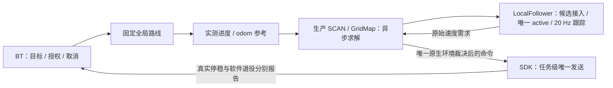

# D1 Max 单楼层导航接手状态（2026-09-28）

## 动态障碍清除续修（2026-11-06）

接续 `595dfe73…60f0` 默认包，修复投影射线二次裁剪导致清除票丢失，以及自体滤除
删除实测空闲前缀的问题。自体端点及后方不清空，真实命中、未知空间策略和地图概率
参数不变。控制、SDK、楼梯模型、膨胀尺寸未改，未增加运动门控。

旧/新同输入对照：旧版 8 轮清除观测仍占据，新版第 3 轮撤销；实际 Python wire →
原生解码器 → 生产 GridMap → 碰撞查询/新快照/显示验证通过。新增四格有界日志，记录
真实概率更新与融合来源。现场近身体素没有原始射线，**仍不能唯一归因或宣布实机验收**。

唯一默认包的最终封印与备份见
`experiments/dynamic_obstacle_clear_20261106/{verification.json,install_plan.json,before/}`；
五个原生包完整重编链接并测试，Python 投影与原生端一起更新，不只替换源码。
导航、SDK 保持未运行；没有重连、恢复目标或发送运动指令。
详细机制、反例、测量边界和复现命令见
`docs/reports/NAVIGATION_HANDOFF_DECOUPLING_20261105.md` 顶部最新一节。

## 下午实测续修：楼梯参考跨段、窗口耗尽与显示（2026-11-06）

唯一默认包：`595dfe73994ad55ab9375eb9a43e4892e8f25044c27aabdf99ed58e4c01860f0`。
Web/CLI 同源，10,078 个成员通过核验；24 个精确安装目标已有备份。

- 楼梯实测侧偏后参考停留在旧语义段、窗口走完不延伸：现在按同源有限楼梯通道跨过
  相邻分段，保留高度、实际运动和相邻段对应关系，平地行为不变。
- SCAN 将耗尽参考明确归类为等待延伸；新窗口直接恢复规划，不误报占据或反复侧向搜索。
- RViz 支持正式 Native 持续碰撞结论 `valid_until=0`，不再把已有有效曲线显示为等待。
  仅修显示，没有重新加入地图证明期限或下游运动检查。
- 参考回归 418 项，真实 Native/GridMap 同输入 68 项全通过，显示/回调 391 项通过；
  实际安装目录导入后的联合回归 641 项通过。

**尚未全部解决：** 平地遇障后同一占据格持续存在；地图仍在更新，实际逐格命中/清除
射线未记录，尚不能确定是新回波持续写入还是清除观测缺失。生产地图清除回归通过不代表
此现场问题已修复。另复现的八邻域初始朝向限制未改，不冒充现场根因。

控制器、SDK、地图/优化库、膨胀、地图资产及有效参数不变。导航保持停止，SDK PID
`382798` 和会话 `7969dd40988e20e6` 保留；没有自动重启、重连或运动。仍待物理验收。
详见 `docs/reports/NAVIGATION_HANDOFF_DECOUPLING_20261105.md` 最新章节及
`experiments/obstacle_stair_recovery_20261106/verification.json`。

## 楼梯几何误碰撞与坡面高度一致性（2026-11-06，续修）

唯一默认包已更新为
`82d92e0253282897cace155ee267776d65c28343acce03400bb7cc71e14ffdaa`；
Web/CLI 同源，20 个目标精确备份并同步源码、头文件、静态库及实际 SCAN/跟踪器 ELF。

- 刚性机身子查询复用倾斜底面的全部实测回波边界，不再因粗体素 XY 穿过底面误挡
  已匹配踏面。原始占据、墙体/箱体/真实机身侵入及未知空间语义不变。
- 同一有限楼梯坡面上，优化 XY 时同步 Z；梯度、回滚、精修、重定时、侧向优化一致。
  固定首末 PVA 与原高度残差保留，不允许任意抬高曲线绕障。
- 与前轮停后接入修复联合核对：局部失败保留任务/固定全局路线，按新实测边界继续接入，
  不增加下游地图证明期限或运动碰撞层。

同输入 GridMap 旧版 19/22 → 新版 22/22；优化器 45/45 阶段通过，高度偏差最大
1.65 cm → 浮点误差量级。平地 9 组前后控制点、时间及采样 P/V/A 完全一致。
最终构建和参考/恢复回归通过，平地控制、SDK 比例、膨胀及验收参数未改。

导航保持关闭，SDK PID `117202` 原身份未变，不自动重启或恢复目标。
仍需实测：混合楼梯/平台优化未被单一坡面模型替代；现场缺完整原始回波/曲线，不能
唯一归因全部碰撞，也不能宣称任意楼梯已经验收。详细证据、危险反例和准确复现命令见
`docs/reports/NAVIGATION_HANDOFF_DECOUPLING_20261105.md` 最新章节。

## 上楼停止后的换轨恢复修复（2026-11-06）

实际会话 `18370f10…950b` 第三任务于 11:19:01.724 因 SCAN 对当前曲线返回占据而停住。
之后仍有 255 轮求解、新参考已接收，跟踪器却沿用暂停前约 0.28 m/s 的命令历史拒收
新曲线，形成恢复死锁。定位新鲜、控制 tick 最大约 50 ms；后来的手动接管/断连不是首因。

已修复中断期间候选接入的实测运动边界恢复，以及两阶段提交回滚误覆盖恢复历史；
另修复 typed 楼梯参考先到、支撑几何后到时误用直立包络的竞态。平地控制律、SDK 幅度、
地图及膨胀参数不变，不增加地图证明期限或下游碰撞层。

同输入旧版 5 项中 3 失败，修复后全部通过；跟踪器 12 套 CTest（含 122 项 LocalFollower）、
Native 138 项 GTest、异步 worker 136 项、恢复 202 项和真实目标选择/GridMap 63 项通过。
本轮同步了 15 个源码/安装目标，旧文件已精确备份；Web/CLI 统一默认封印：
`54aa5cc26b15dea9f64eac8bda1b544c3608447bc929a824cb8fdee91448dafa`。
导航保持关闭，SDK 原 PID `117202` 和会话未更换；没有自动重启、恢复目标或发运动指令。

保留边界：日志不足以证明首次命中的回波一定是踏面或自体，也没有任意楼梯的实机验收。
此次修复通用时序，不按这段楼梯坐标写特例，不清除占据来通过测试。
证据和复现见 `experiments/stair_waiting_trajectory_20261106/` 及
`docs/reports/NAVIGATION_HANDOFF_DECOUPLING_20261105.md` 最新章节。

## 定位恢复后新任务被隔离的修复（2026-11-06）

实际会话 `563c1a50…3976` 第一任务完成；第二任务在 10:57:16 自动地图匹配恢复、
seed 变化后被撤销；第三任务虽生成全局路线，却因 `staging_context_quarantined` 立即失败。
确认根因是取消完成回执先到、新定位身份后到时，参考管理误清了已完成的退役事实。

修复只保留该精确取消代次的回执，恢复仍清空旧任务/轨迹，并等待新上下文确认。
相同 8 种时序排列由 4 失败变为全通过；参考、任务切换和楼梯切段等 631 项通过，
实际默认安装模块的 19 项针对性回归通过。SCAN、控制、SDK、地图和参数没有改变。

默认包已同步，Web/CLI 同封印
`f9ce459173de551dad33ac2ae478c40b7b9e3d7d23971f09b4572322477cb4fe`。
导航按用户要求关闭，未自动重启或恢复目标。SDK 在导航退出后仍保持原连接，
11:06 被管理服务另行停止；本轮没有请求断连或重连。

边界：自动地图重新匹配仍会改变定位身份并撤销旧任务；本轮修复的是恢复后永久拒收
新任务的死锁，不宣称重新匹配的原始原因已经查清。此次无第二次用户初值、无 LIO 重启。
证据和同输入前后对照：`experiments/reference_reset_retirement_20261106/`。

## 系统更新后的通信连接恢复（2026-11-06）

本次无法连接并非机器狗网络异常：有线到 `192.168.168.100` 正常，监控曾收到雷达。
Ubuntu 更新将 `libpcre2-8-0`、`libpcre2-16-0` 从 `10.39-3ubuntu0.1` 升到
`10.39-3ubuntu0.2`，默认包仍记录旧系统库哈希；SDK 启动校验退出，监控随之清理
Zenoh/Foxglove，表现为短暂连接后断开。其余 10,070 个封存成员没有变化。

核对 dpkg 安装文件、SONAME、SDK/SCAN/跟踪器动态符号加载及 PCRE API 后，仅更新
这两个外部库的清单记录，同步 Web/CLI 绑定；没有重编算法、改参数或关闭校验。
最新默认封印 `535694b939988efd7597f75c55f8847f7a14bfc4e771bc3e7191f940451e6df9`。
完整启动检查通过，使用原 Web 连接 API 恢复数据会话，运动状态约 50 Hz；
未由本次修复启动导航、发目标、接管控制权或发送运动指令。
备份、差异及只读连接验证见 `experiments/connection_restore_20261106/`。
这是当前系统更新后的依赖记录修复，不宣称后续任意系统库升级都已验证兼容。

## 21:06 实测后整改：保留连续执行，修正转向阻尼参考（2026-11-05）

本次现场运行的是 `2b7c1d18…b696b0`，地图证明期限造成的归零为 0；左右反复纠偏仍存在。
已修正普通地面段中“未来预瞄曲率被阻尼再次放大”的计算：预瞄负责入弯，角速度阻尼
参照当前接受曲线；极低速度和楼梯过渡连续接入。横移仍为零，不改控制增益、前进策略、
SDK 幅度或原加速度/jerk 整形，不增加地图期限或下游碰撞门控。
另修复退役上下文缓存迟到 SCAN 状态的缺口；生产 SCAN、地图、楼梯规划与调度不变。

参考/窗口等 408 项、最终跟踪器 12 套 CTest、Native/Follower 350 项全部通过。
同输入模型对照中反复转向减少，但保留 S 弯误差增大的反例；不将模型改善当作现场验收。
新增低速合法曲线反例已从初版目标跳变修正为连续，无新增归零或前进输出变化。

唯一默认包已同步为 `f20e0e1a4cf4c1d26fc824466517eddaad40fb21bc9c4c734848f67403792f04`。
Web/CLI/双选择器、实际安装 Python/ELF 及 10,072 个成员核验一致；13 个明确目标更新，
10,044 个保护成员不变。导航已按授权停止，SDK PID `2762765` 原身份保留；
未自动重启、恢复目标、重连 SDK 或发送新的运动指令。下一次正常启动加载修复。
**软件修正已交付；实机左右摇摆是否消除仍需现场确认，未改物理验收标志。**
详见 [现场证据、控制整改、反例与部署记录](../reports/NAVIGATION_HANDOFF_DECOUPLING_20261105.md#2106-实测后转向反复纠偏与收尾检查)。

## 19:48 实测后整改：SCAN 碰撞状态与地图计算期限解耦（2026-11-05）

用户明确要求 SCAN 持续规划及处理碰撞，跟踪器跟踪曲线，不再由地图证明续期决定每条命令。
最新留存 247 次归零中，233 次对应附加地图证明截止；另有机身源龄、真实占据、接入与到达原因，
不能一概删除。正式 `task_follower_v1` 已改为 SCAN 有序碰撞状态；跟踪与命令不再等待逐地图证明续期。
本轮没有修改控制增益或楼梯几何，不启动导航、不恢复目标、不重连 SDK。
唯一默认包已同步为 `2b7c1d182905a8f311fc0fc9ff1da62ae06a7d4ec9985f4d6ba5026d98b696b0`；
Web/CLI/双选择器一致，10,072 个成员及实际安装 Python/ELF 核验通过。
Web 已停止、无忙操作，SDK PID `2576796` 原身份保持；下一次正常导航启动加载新版。
Native 回归为 348/349，1 项旧候选提交测试仍因未模拟最终 Committed ACK 而失败；
记录覆盖缺项，不冒充全绿。真实碰撞、断流、失权和旧命令恢复反例仍保留。
**没有本轮实机运动验收，不宣称所有停顿或左右摇摆都已修好。**
详见 [本轮合同、官方对照与验证边界](../reports/NAVIGATION_HANDOFF_DECOUPLING_20261105.md#1948-实测后移除正式链路的地图证明期限)。

## 18:57 新实测卡顿与感知加速（2026-11-05，历史默认包）

本次实际加载 77d 新诊断。第一任务 24.150 s 内 99 次途中归零均为地图原始证据到期，
97 次沿同一曲线恢复；控制 50 ms 循环稳定，SDK 无发送/ACK 错误。不是速度幅度或控制增益问题。

本轮只将现有 CAD/BVH 自体查询原生化、释放 GIL，并把扩展纳入正式包清单；
不改模型、源时、期限、控制器、SCAN/GridMap、地图或楼梯参数。原算法保留作数值临界及缺扩展回退。
343 项 native、328 项 fallback、14 项启动/清单回归通过。同输入双源投影＋地图负载，
后雷达完整投影中位 33.976→20.915 ms，输出、源时与地图碰撞结果相同；地图融合自身无明显收益。
这是一个已验证热点修复，**不是现场所有归零已消除的结论**；第二任务另有 occupied 停车，仍单独保留。

当前唯一默认封印 `2371aafdd18e7c30922baf70f572585c87f36e6ba843db4f67816f629b29c918`，
Web/CLI/selector 一致，10,070 成员核对、实际 native 扩展导入通过。
导航未启动，SDK 原 PID `2423433` 未重连；新感知由下一次正常导航启动加载。
详见 [现场因果、同输入对照与同步结果](../reports/NAVIGATION_HANDOFF_DECOUPLING_20261105.md#1857-实测卡顿因果复核与感知热点修复)。

## 实测前轻量日志补全（2026-11-05，历史增量）

已补齐 SCAN 正式轨迹检查的快照/源时/完成原因关联，以及 SDK Move/ACK 有界分页和尾部保存。
同一 85 事件输入由旧版留存 51 条变为 85 条，包含末尾零输出及新任务首个非零；这是日志验证，
不是实机连续运动验收。本轮未改规划控制、碰撞、楼梯或源期限参数，也未新增 rosbag。

唯一默认包已同步，Web/CLI/双 selector 一致为
`77d6cca6d451e47d7c215cf9c3e0df93a74c9397c2b2d9c7ed38a0e0f2584a7e`。
15 个明确目标更新，10,035 个受保护成员不变，正式入口核对全部 10,065 成员通过。
日志专项通过；扩展回归保留 3 项严格旧基线可重现的测试缺项，未标为全绿，详见报告。

**没有启动导航或重连 SDK。原 SDK PID 2036095 仍运行旧代码；新日志与前一增量发送反馈修复，
需之后正常重启 SDK 后台才能加载。** Web 当前导航 stopped，发布包 ready 仅指完整性通过。
详见 [日志内容、同输入对照、既存测试缺项与加载边界](../reports/NAVIGATION_HANDOFF_DECOUPLING_20261105.md#实测前轻量日志补全2026-11-05后续增量)。

## 导航交接解耦与默认包更新（2026-11-05）

本次实机会话 `db8dfedf…` 的运动段留存 160 个命令非零→零边沿，155 个涉及地图源期限。
对照前一会话症状确有退化；不能以 SDK 速度幅度解释，也不能把计算优化的微基准当作整机修复。

本轮拆分投影接收与唯一地图写者：前后雷达各一个最新完整批次槽，合并唤醒，不排在上一轮融合后；
FSM 在借地图之前回收/退役求解结果，取消不等地图；候选到达后能取得最新已完成地图。
另修复 SDK 发送反馈跨任务序号去重错误。未修改跟踪控制律、平地/楼梯参数、原源期限或增加下游碰撞检查。
原生完整构建、同输入事件顺序反例及真实隔离 executor/guard 验证通过；不是实机无停顿验收。

唯一默认包已更新，Web/CLI 同封印
`7efdeafd5485859907117e4f47ed3fa878e69c099b89ce6e76b4868c17a75391`；
10,065 个封存成员核对及正式入口 `--check-release` 通过。Web 当前为 stopped，未重启导航或恢复目标。
SDK PID `2036095` 原进程未重启、未重连；磁盘已更新，但 SDK 反馈修复尚未进入该旧进程。
**仍需新版本现场验证剩余源期限空窗和实际连续行走，不能宣布所有停顿或跨层问题已解决。**
详见 [模块所有权、同输入对照、部署与剩余边界](../reports/NAVIGATION_HANDOFF_DECOUPLING_20261105.md)。

## 最新高频归零修复（2026-11-04 晚间第三轮）

22:03–22:05 会话 `0cd2a779…` 已按原始源时间关联：94 个留存跟踪归零边沿中
90 个涉及地图期限，机身源龄中位仅 9.45 ms；SDK 可在两个跟踪 tick 间按同一原期限
归零。主要是地图交付余量不足，不是 SDK 发送失败，不能再靠改速度幅度掩盖。

生产 GridMap 完整 DDA 改为固定两助手计算、唯一写者按原序提交；不丢射线，源时间、
碰撞、控制器、SDK、楼梯参数不变。历史实采楼梯 15 帧全状态一致，原生一致构建
906 项及最终实际组件链路 4 项通过。并发 10 Hz 融合/20 Hz 验证与搜索的合成负载，
完整事务 P50 66.081→42.217 ms、P95 68.322→44.652 ms，查询与搜索各 60/60、发布 miss 0。
另一个独立三快照微例只有 29.45% 改善且无复制仍有尖峰，保留原样本，不冒充现场验收。

已同步唯一默认包，Web/CLI 同封印
`1ff4fcb1a571efc53000fac4cf5d53d2ece7c000ca8a4b4a5bb8d766fad6458f`。
17 个明确目标更新、10026 个封存成员核验通过，98 个控制/SDK/定位/地图保护项未变；
原字节可回退。正式入口 `--check-release` 通过，未启动服务、连接 SDK、恢复目标或运动。
**软件性能修复已交付；最新现场无原始点云，实机无停顿、连续上下楼仍未验收。**
详见 [本次原因、同输入对照、并发结果与复现命令](../reports/LATEST_STAIR_CONTINUITY_20261104.md)。

## 最新“有轨迹却不走”整改（2026-11-04 晚间第二轮）

21:20–21:24 实测已确认：地图源龄过大，300/302 个留存非零→零边沿对应原始源到期，
起步被反复打断；SDK 非零发送无即时错误。上轮快照池没有活锁，新旧原生 ELF 同核
未复现计算退化。不能把断开数据后的尾部当成现场原因。

本轮将前后雷达投影改为每源一个运行任务＋一个最新待处理帧；只对 SCAN/投影启动
应用显式混合核拓扑的性能核放置，未知/受限机器继承原策略，不增加启动限制。
原始时间、600 ms 源期限、CAD/碰撞、楼梯模型、控制器和 SDK 均未改变。
344 项投影回归通过；同输入生产 owner 离线双帧中位耗时 23.7→17.0 ms，输出字节一致。
该对照不代表现场通信/负载，也未宣称实机连续行走已验收。

已按授权正常停止导航、同步同一默认包，**未自动重启**；SDK PID 912726 原身份保留。
最新封印 `3553f229b663f93e27fe92bcf3ae558c0c5345a32b409984325a4ea34716460a`，
Web/CLI 一致；10,023 个封存成员核验通过，原生算法/控制/SDK 依赖没有替换。
详见 [最新实测因果、修复与验证边界](../reports/LATEST_STAIR_CONTINUITY_20261104.md)。

## 最新实测停顿与楼梯误判修复（2026-11-04 20:53）

针对 19:55–20:04 实机日志，修复新地图发布被旧快照读者反复占槽拖延、
下一重融合抢在待交付地图前运行、同一次原生轨迹检查重复查询完全相同位姿，
以及楼梯倾斜机身下沿与粗体素外框假擦碰。没有修改跟踪控制律、SDK、速度、
机身尺寸或全局地图。897 项原生核心回归、4 组实际生产方法接线测试通过；
48 组原始碰撞见证同输入重放只解除 7 组已证实假擦碰，其余判定保留。

同一默认目录已同步，Web／CLI 新封印为
`20a9815aa1d136a71a3c207888fe8915d5988cc3b072b3007d3863e5ebfc094e`。
检查了实际静态链接来源，相关库与 SCAN 全量一致重编，10,019 个封存成员核对通过。
未重启导航、重连 SDK、发目标或运动，SDK 原 PID 739270 保持不变。

**剩余：**22 条模型硬边界端点阻塞缺少当时的完整模型变换，尚不能认定是假碰撞；
已补有界原始几何见证，不录大 bag。没有宣布实机连续上下楼通过。
详见 [本轮修复及未解决项](../reports/LATEST_STAIR_CONTINUITY_20261104.md)。

## 楼梯碰撞剩余项（2026-10-27）

本轮修复生产 SCAN 的楼梯姿态缓存：5 cm 代表中心拟合无效时，按同一原始支撑、
同一阈值重查实际查询位置；不将点特有结果写回整格缓存。平地控制、SDK、地图、
机身尺寸和膨胀参数未动。真实五包隔离构建的 73 个非 launch CTest 目标通过。
新默认清单为 `13be56a45c3f89821a3314168a73e32f3a92433e94375350c18089200caa321a`，
两份源码、安装头文件及 SCAN ELF 共四文件已同步；其余 10,388 个保护文件字节不变。

**没有完成实机连续上下楼验收。** 完整来源 PCD 仍为 5/18，现用历史保留点集仍为
18/18；不能混称全部原始数据通过。上次实机有 22 条当前机身本身也碰撞的见证，
其中底边擦碰未保留原始射线及完整数值坐标锚，无法认定踏面或轮腿，也没有清占据。
这轮修复的 14 个缓存边界差异来自合成侧偏/高度敏感性输入，不是 14 次实机误停。
没有连接 SDK、启动服务或发出运动，未验收标志保持不变。

详细证据及复现入口：[楼梯碰撞审计](../reports/STAIR_COLLISION_AUDIT_20261027.md)。

## 新目标取消旧任务：竞态修复（2026-10-13）

沿正式 RViz → Navigate → BT → FollowRoute → 原生参考取消链检查，修复了一个
可以离线复现的新目标阻塞原因：本任务局部 worker 的退役证明先于 BT stop 到达，
被原 `if(stopping_)` 丢弃，后续替换目标持续等待旧任务退役。另补齐 FollowRoute
明确拒绝时的未进入 worker 事实。回执按原任务闭包隔离，退役一旦成立，禁止该
任务重 arm 或续发 allowed；SDK 退役和实测停稳义务未放宽。

新增两条相同输入回归先红后绿；真实 BT 六套共 355 例、RViz 目标入口 57 例、
适配器及参考取消链 423 例通过，均未创建 ROS 图。连续 A→B→C 只为 C 开始新
规划，迟到的 A 结果不覆盖 C。默认 `experiments/navigation_runtime` 的 BT、安装
头文件和冻结源码已同步并重新封存；没有新分支、入口或自动 push。

可复现竞态不等于已证明本次现场只有这一种原因。未启动 RViz/生产服务、连接
SDK、恢复初值或目标，也未执行实机测试；物理验收状态保持不变。
原包字节、前后对照及复现命令保存于
`experiments/runtime_rollback_20261013_goal_switch_fbwAeQBk/goal_switch_evidence.json`。

## 当前整改：移除正式发送链的重复扫掠（2026-10-12，现场诊断后）

上轮所称“移除第二环境检查进程”不代表已移除所有重复门控。
真实会话已运行新 SDK，控制权与 `grant_ready` 均为真；跟踪产生非零需求，
但采样 8 秒的 51 次 Native 运动扫掠均被确定占据拒绝，SDK 因而保持零速。
另有当前轨迹源期限间断触发恢复等待；不是 SDK 断连或未知体素阻塞。

整改只保留 SCAN 对候选和当前轨迹的碰撞裁决。正式 `task_follower_v1`
不再对跟踪速度追加独立反应/制动扫掠，也不制造未执行查询的 `MotionValidation`。
原始状态期限、当前曲线绑定、任务租约、取消、失权、急停与发送限速保留。
用户已断开机器狗；本轮只修改、构建和更新唯一默认包，不启动服务或恢复旧目标。
软件交付及现场复验结果分开记录，不能把本次清理宣称为实机导航已通过。
原字节回退、同输入旧扫掠/当前曲线对照、取消和恢复反例及准确复现命令保存在
`experiments/runtime_rollback_20261012_scan_authority_t5SWOUNN/cleanup_evidence.json`。

## 现行主线：局部执行器集中重构（2026-10-12）

现行合同为 `task_follower_v1 / local_executor_v1`。以下旧逐曲线 writer CAS 记录仅供
追溯，不能与本节组合成运行图。唯一正式入口仍是 `tools/navigation_entry.sh`，
默认目录仍是 `experiments/navigation_runtime`，没有新增分支、入口或另一个任务管理者。



核心整改：

- 取消正式图中的逐曲线 SDK 几何 CAS 与 Python 第二环境检查进程。BT 只拥有任务级
  权限，LocalFollower 只拥有已接受曲线，生产 SCAN 只裁决环境和候选，SDK 只发送。
- 新候选与当前曲线分离。移动更新使用已验证公共前缀和未来尾段，实测进度到接缝
  后核对实际位置/速度再替换；保留速度限制器，不拿时间预测作为机器人实测位置。
- 普通坐标校正只产生新参考候选，不改变路线哈希或任务身份。同层平台按语义连接
  推进；楼梯与跨层运动不借同层逻辑放行。
- 修复正式订阅 QoS、退役话题、支撑先到/参考后到、持久几何被交付期限丢弃、
  占据快照与坐标合同版本混淆、提交先于原始定位到达，以及首接管误判失权。
- 原生新控制需求按当前已接受 SCAN 曲线结论直接交付，不启动第二扫掠查询；任务租约按原命令源时选取，原始纳秒
  和消费期限不重签。候选失败不清仍安全的旧曲线，真实碰撞或失权仍停止输出。
- 正式 `official` 策略下，未知体素不再额外当作占据；三态原始证据仍保留。
  没有清空近身区域、将全部未知标成自由或修改物理验收标志。

实际组件验证包括生产 GridMap、SCAN 原生查询、真实跟踪核心和 SDK Transport / BT
TaskAuthority，不用简化地图替代。控制驱动移动、移动接缝、零速起步、取消/新目标、
消息乱序与真实占据反例分别保留。独立 Zenoh 回环图启动实际 LocalFollower，验证
生成消息 ABI、持久订阅、正式退役端口和 20 Hz 定时输出；没有提交目标或启动 SDK。
详细清单、哈希、同输入前后结果与缺项写入
`experiments/runtime_rollback_20261012_local_executor_lERod3H4/refactor_evidence.json`。

软件结果不是现场到达、绕障、制动或整链延迟验收。当前 SDK 旧进程没有重启；
整包更新不能宣称旧进程已更新，也不能只重开 RViz 后混用旧 SDK。下一次正常启动
必须使用同一包及 `task_follower_v1` SDK 会话，不自动恢复旧初值、旧目标或旧授权。
未自动 push，未连接、重连或发送实机运动。

旧默认目录和 selector 已保存。外部 Web/SDK 启动脚本的回退覆盖情况单独记录；
没有原字节的文件不得声称可以完全回退，不能把历史 Git 内容冒充本轮前字节。

## 导航链路末次复核（2026-10-12，后续）

沿正式入口检查路线交付、参考接收、SCAN、换轨、跟踪和 SDK 回执，新增修复四类确定的衔接问题：

| 原因 | 修复与边界 |
|---|---|
| 一次性路线接收回执晚到 600 ms，被按实时状态年龄丢弃 | 按当前完整 delivery 身份接收软件事实；不重发全局规划、不刷新定位或运动证据 |
| 原生取消回执晚到被丢弃；等待新定位上下文超过 2.5 s 后，已证退役又被判过期 | 精确取消事实与实时曲线诊断分流；恢复核对当前退役屏障、空任务槽、新鲜状态和新上下文 ACK，不恢复旧路线或授权 |
| 停稳换轨的 Python 接合仍拒绝合法 MC 映射领先接收时间 26/60 ms | 使用原始 source/receipt 的保守较早时间，与 SDK、任务管理和跟踪的时间合同一致；原期限、捕获区间及停稳条件不延长 |
| SDK 明确“未写入”的换轨回执晚到超过 350 ms，任务管理与接合永久保留未决事务 | 仅退役精确当前候选；核验 CAS、双方几何和未写入标志，不更新当前轨迹、许可或已退休事务的 ACK 顺序 |

以上软件事实不具有运动授权或物理停稳含义。定位、地图、碰撞、实时运动需求仍使用各自原始有效期。
旧目标、旧取消、错误身份/CAS、矛盾写入标志、未来时间及缺失新上下文均保留反例。
历史高序号负回执是合成协议健壮性反例，不是现场已出现的根因。

同输入旧默认包与修改后代码对照保存于
`experiments/runtime_rollback_20261012_final_review_TQ4o25Nu`。
正式 Python 相邻回归 674 例、原生 BT 341 例通过；Web 启停/退出/RViz 所有权 165 例、
前端启停状态 25 例及显示/退出 59 例通过。原生 SCAN 此轮只读复核，未增加算法改动；
前轮障碍重规划、静止保留和跟踪器零速起步修复保留。
源码、正式 BT ELF 和 Python 安装文件同步唯一默认包，并重新核验整包一致性；无新入口或分支。
本轮未启动生产、重连 SDK、发送初值/目标/运动或 push，物理验收标志不变。
当前实机动态绕障、运动中接入质量和制动仍未由这些软件回归验收。

## 局部轨迹连续性与障碍重规划（2026-10-12，后续）

此次按实际会话排查“曲线消失、换轨跳动、遇障不重规划”，不把三个现象归为一个参数问题。
健康数据时，原生日志已在当前曲线 1/93 上多次给出 `occupied`，但正式分支直接返回，
没有将当前曲线的碰撞事实交回 SCAN FSM；另一条触发路径依赖非零需求被拒，
而跟踪器已因负证明保持零输出，形成循环等待。

| 确定断点 | 职责内整改 |
|---|---|
| 当前曲线发现障碍，没有直接触发绕行求解 | 原生产验证器向 FSM 交付精确当前曲线的单槽碰撞事件；沿原有侧向通道搜索重规划 |
| 占据/清空交替时，重复事件会取消同一替换求解 | 按被替换曲线身份合并在途事件；最新负判据仍约束执行，最终提交仍检查最新地图 |
| 实测零速起点与仅按实测进度取前馈构成自锁 | 跟踪器从同一提交曲线取有界空间前瞻速度和局部切线；实测进度不随定时器推进 |
| 正式流程静止时也固定每秒重新生成曲线 | 依据原生账本中精确 active 曲线、正证明和真实进度，仅延期无必要的周期求解；事件优先 |

新候选拒绝不撤销仍可用的当前曲线或固定全局路线。静止保留只改求解调度，
不续任何源时间、碰撞证明或运动许可；新障碍、参考变化、接入重建及实际终点仍单独处理。
空间前瞻不把未来点当成当前位置、不沿跨弯道的未来弦追踪；原矢量加速度、
曲率与终点制动约束保留。候选接纳失败新增类型化原因及源时间、位移、速度、
地图版本和剩余预算诊断，不再仅以 `waiting_recheck` 混报；原日志不足以断言该类拒绝的具体根因。

同输入跟踪核心对照：原版 40 个 20 Hz tick 最大需求为零，修复后为 0.04 m/s；
两版在未运动的实测输入下，曲线时间、弧长均保持零。233 项完整跟踪器回归通过，
含前进、侧移、倒向、弯曲零入口、短起停曲线、终点不蠕动和坏候选保留。
原生障碍反馈同输入 24 检查从 8 失败变为全通过，周期调度 124 检查从 2 失败变为全通过；
原生账本 94 例、候选准入 22 例和 21 组无 ROS 回归通过。原始纳秒身份还覆盖了真实
UNIX 日期下浮点秒回转换产生 +133 ns/−21 ns 的误查反例；未通过放宽时间来处理。
理想运动响应闭环与生产组件回归不等同现场动态避障或制动验收。
对照证据、原默认包及日志保存在 `experiments/runtime_rollback_20261012_scan_continuity_s1D9fBNW`。
原生前后对照及可复现命令另见 [障碍与周期换轨证据](../../experiments/scan_occupied_replan_20261012/README.md)。

14:26:06 的真实 `sdk_callback_safety_veto` 已撤销旧任务，随后 SDK 数据退化；
该事件解释之后的撤参考，不解释之前健康时的零速自锁或碰撞反馈缺失。
本轮不清该故障、不恢复旧目标、不重启服务、不重连 SDK 或发运动。
新产物只同步唯一默认入口，不能声称仍持有旧 ELF 的运行进程已经修复。
仍等待现场验收，不改变物理验收标志、不 push。

被动复现（无 ROS 初始化或运动调用）：

```bash
cd /home/dndx/d1max_nav_ws
experiments/runtime_rollback_20261012_scan_continuity_s1D9fBNW/tracker_evidence/build/before_probe \
  --gtest_filter='ActualHolonomicStartProbe.*'
experiments/runtime_rollback_20261012_scan_continuity_s1D9fBNW/tracker_evidence/build/probe \
  --gtest_filter='ActualHolonomicStartProbe.*'
ctest --test-dir /tmp/d1max-tracker-bootstrap-63HDjWJi/build --output-on-failure
ctest --test-dir /tmp/d1max-reference-recovery-native.lkRnE1/build --output-on-failure \
  -E 'test_test_(planner_startup|waypoint_parameters)'
tools/navigation_entry.sh --check-release
python3 tools/release/check_scan_authority_consistency.py \
  --app-root '/home/dndx/智元四足机器人D1 Max二次开发文档资料包v0.1.0/d1max_ros2'
```

## 首条轨迹从几何提交到运动跟踪（2026-10-12，后续）

此次运行已核对为 `7ef2065c…` 默认包，不是旧进程未加载。当前任务 `.3` 的
SCAN 曲线 134 已验证，BT 持续发布匹配 SDK 会话、arm generation 3 的运动许可；
SDK 已接纳授权并持有控制权。五秒只读观测中，50 条许可全部有效，101 条
跟踪需求却全部是 `geometry_only_no_motion_permission` 和零速度，尚无安全需求或运动证明。

确定断点在跟踪器及原生验证器相同的 writer 身份交接：几何阶段已包含 execution ID
和 control epoch，但 SDK session 为空、arm 为零；代码误把它当成已固定的 SDK 身份。
正式许可在同一 epoch 补齐 SDK 身份时被拒，旧几何许可始终不能进入运动阶段。
之前从完整 SDK 许可直接起步的测试未覆盖这一真实启动顺序。

修复遵守同一合同：未绑定 SDK 的阶段只表示待准入的执行身份，不表示实际 SDK
incarnation；同一已提交任务的首次完整绑定可进入跟踪。已绑定后禁止同 epoch
改换 SDK 或 arm，禁止旧几何许可回退，以及取消后复活；更高 epoch 的明确
disallowed arming/holding 先退役旧事务，再等待新绑定。碰撞、未知空间、急停和停止证据不变。

软件回归按“几何提交 → 未绑定 SDK 的 arming → 完整绑定许可 → 首条需求 →
精确 writer ACK → 连续跟踪”执行，不把单个方法返回值当作闭环通过。
原输入和回退包保存于 `experiments/runtime_rollback_20261012_writer_bind_FGjZIFZg`。
跟踪器同输入七组：原版四组失败，修复后全部通过；完整跟踪器 224 例通过，
原生验证账本 81 例及 21 组不启动 ROS 的 SCAN 回归通过。真实两个生产 ELF
重新构建，整包同步默认入口；SDK、BT 和定位组件本轮未修改、未重启。
随后 14:26:06 的 `sdk_callback_safety_veto` 和之后断连是独立事件，不解释之前
SDK 健康、授权已接纳时持续零输出；本轮不清除该故障、不恢复旧目标或运动。

被动复现：

```bash
cd /home/dndx/d1max_nav_ws
ctest --test-dir /tmp/d1max-tracker-bootstrap-63HDjWJi/build --output-on-failure
ctest --test-dir /tmp/d1max-reference-recovery-native.lkRnE1/build --output-on-failure \
  -E 'test_test_(planner_startup|waypoint_parameters)'
tools/navigation_entry.sh --check-release
python3 tools/release/check_scan_authority_consistency.py \
  --app-root '/home/dndx/智元四足机器人D1 Max二次开发文档资料包v0.1.0/d1max_ros2'
```

## MC 时间证据与执行前准入恢复（2026-10-12，后续）

当前实机只读核对确认：SDK、双雷达及 MC 正常，MC 实收约 50 Hz；SCAN 已多次
生成候选。真正断点是 MC 的近似主机时间领先原接收时间约 26～60 ms，writer 却按
精确时间零容差拒收。SDK 拒绝授权后，BT 将暂态准入失败当成永久失败并撤掉参考。
因此“等待参考”是任务被撤回后的结果，不是 SCAN 本次没有求解。

本轮按职责统一四个消费者，不改变地图、碰撞策略、未知体素或物理验收标志：

- 保留 MC 原始时间、近似映射、接收时间与会话；合法正偏差受既有采集不确定性界限约束，
  新鲜度及有效期使用较早时间，不能因正偏差续命。过期、回退和错误时基仍拒绝。
- SDK 分开报告数据暂缺、失联、急停、模式错误、未退役事务与未确认停稳。
  BT 仅在精确证明该请求从未接纳且数据暂缺时保留同一授权、路线与 Follow 会话；
  使用新执行代数、最多 2 Hz 重试，沿用原 30 秒预算，不重复申请已接纳控制权。
- 同一 SDK 准入等待不再同时消耗旧参考 5 秒和首轨迹 20 秒预算；授权与准入事实
  仍分开。匹配状态先到可结束等待，超时或取消后迟到的接纳事实不能恢复运动。
- SDK、BT、SCAN 及跟踪器统一停稳换轨的接收时间和采集区间；停止报告使用该条 MC 的
  原接收时间，不以报告心跳伪造新采集。停止前数据不能证明停稳。
- 两个 RViz 视图均显示真实已提交局部轨迹；滑动地图仍只在局部视图显示。
  求解候选不冒充已提交轨迹，任务撤销仍撤销显示。

同输入生产 Transport 对照：两条现场采到的时间端点，原包全部拒绝，修复后全部接收；
过期、超界及未来接收时间仍拒绝。另保留 101 条相同输入的 Reporter→writer 对照：
原版 writer 仅接收 1 条，修复后接收 101 条，原始映射和接收时间不变。
本轮 SDK 16 组、BT 337 例、跟踪器 217 例、原生 SCAN 21 组回归通过；
局部轨迹两视图的生成/切换 30 例通过。两个需启动 ROS 的 SCAN launch 测试未运行。
原默认包和证据保存在 `experiments/runtime_rollback_20261012_mc_admission_BmoHwks9`。
这是默认入口的修复与回退记录，不是新分支或启动版本。
当前运行中的进程未由本轮重启；默认包同步不代表旧进程已加载。
未调用实机授权、重连、初值、目标或运动接口；现场跟踪及停稳效果仍需验收。

被动复现（生产核心，无 ROS 初始化、SDK 连接或运动调用）：

```bash
cd /home/dndx/d1max_nav_ws
experiments/runtime_rollback_20261012_mc_admission_BmoHwks9/probe_before
experiments/runtime_rollback_20261012_mc_admission_BmoHwks9/probe_after
ctest --test-dir /tmp/d1max-sdk-mc-clock-1Aq5Ze/build --output-on-failure
ctest --test-dir /tmp/d1max-sdk-admission-bt.4Ytaqr/build --output-on-failure
ctest --test-dir /tmp/d1max-tracker-stationary-YwIuZ0H3/build --output-on-failure
ctest --test-dir /tmp/d1max-reference-recovery-native.lkRnE1/build --output-on-failure \
  -E 'test_test_(planner_startup|waypoint_parameters)'
tools/navigation_entry.sh --check-release
python3 tools/release/check_scan_authority_consistency.py \
  --app-root '/home/dndx/智元四足机器人D1 Max二次开发文档资料包v0.1.0/d1max_ros2'
```

## 暂缺误锁存与参考 ACK 恢复（2026-10-12，后续）

按实际默认配置核对 IMU → LIO → 参考 → SCAN → 跟踪，不把历史未使用入口的阈值
解释为正式运行门控。15 ms 是质量警告，低动态 10～100 ms 缺口已经允许真实积分；
本轮不盲目扩大 IMU 时间、动态或旧位姿有效期限。

两个新增确定断点按原模块职责整改：

| 根因 | 处理 |
|---|---|
| 特征不足与非有限状态混为硬故障，半秒后永久停止扫描 | 有限弱几何不写不可靠后验或地图，继续接收后续扫描；真实几何恢复后同 epoch 继续 |
| 原参考回执漏收，每半秒重建候选，八条后永久满账本 | 一个未决请求幂等重送；原生精确请求缓存补发原 ACK，明确拒绝才释放未接纳记录 |

弱扫描内，只在原后验与真实 IMU 仍有效时保持连续预测；超期暂停，不复活过期证据。
新有效数据恢复不清初值、坐标锚或固定全局路线。历史参考 ACK 是软件事实，不是运动许可；
未知写者结果、Applied、取消、新任务和同 ID 异内容均单独核对。
软件变更与默认安装产物统一封存，之前定位期限、目标切换及 SDK 修复保留。
当前生产旧会话未重启，现场运动与停止效果仍未验收；本轮未启动 ROS/SDK 或 push。

原默认包同输入：定位两项连续预测失败，参考交接约四秒后满八条记录；修复后
原安装路径导入的 503 项定位/交接回归通过，未决参考始终仅一条。
原生 SCAN 回调原版 13 项失败、修复版 43 项通过；BT 324 例、SCAN 21 组
不启动 ROS 的回归、Faster-LIO 七组原生测试通过。两个 SCAN launch 测试未运行。
原包与复现证据保存于 `experiments/runtime_rollback_20261012_recovery_iTaXzkJ3`；
参考同输入时序另见 `experiments/reference_ack_recovery_20261012/same_input_callbacks.json`。
默认包不新增版本入口；Faster-LIO 本轮实际重编译，Livox 保留原复制产物，构建证据分别记录。

只读复现（不启动 ROS、SDK）：

```bash
tools/navigation_entry.sh --check-release
python3 tools/release/check_scan_authority_consistency.py \
  --app-root '/home/dndx/智元四足机器人D1 Max二次开发文档资料包v0.1.0/d1max_ros2'
ctest --test-dir /tmp/d1max-front-recovery.ftGQsa/build --output-on-failure
ctest --test-dir /tmp/d1max-reference-recovery-bt.qRbo6n/build --output-on-failure
ctest --test-dir /tmp/d1max-reference-recovery-native.lkRnE1/build --output-on-failure \
  -E 'test_test_(planner_startup|waypoint_parameters)'
```

## 启动与首曲交接复核（2026-10-12，后续）

昨晚实际会话以 `execution_blocked_timeout:waiting_admitted_nonzero_command` 终止。
该会话使用旧清单，不等于当前默认安装包；不能把文件同步当作旧进程已加载更新。
沿 Web → 定位 → 全局 → 参考 → SCAN → 跟踪 → SDK 逐步核对后，新增修复如下：

| 确定的软件断点 | 最小整改 |
|---|---|
| 全局定位回调在两次取时之间到期，抛未捕获异常 | 接收身份取自已经准入的精确事件；使用到期时软等待，不结束节点 |
| 消费端重复扣原始 IMU/后验年龄，拒绝合法传播输出 | 全局状态、正式参考和 BT 统一消费原输出期限；提供者仍核验原传播上限 |
| 首轨迹准备只等 10 Hz tick，可能错过短证明 | 正式输入到齐触发原几何准备/确认流程；不额外运行树、不续期或赋予预览授权 |
| RobotState 空窗误报永久失权，恢复数据后仍不能继续 | 区分已确认控制权事实与状态新鲜度；零输出 HOLD，恢复必须使用新状态和新命令证据 |
| 到达判断重复要求旧启动级 ready | 使用匹配任务的局部控制能力；原始终点位置和实测停稳证据不省略 |

完整时间合同见 [启动与首条轨迹](../design/NAVIGATION_TASK_LIFECYCLE.md#启动与首条轨迹的时序合同2026-10-12)。
Web 的当前连接、启动、退出与 RViz 生命周期定向检查通过，未发现本轮新的已复现缺陷；
不删除真实断连、急停、碰撞、源时、任务身份或物理停稳判断来掩盖等待。
全部新增生产修改同步唯一默认包、安装产物及冻结源码，按原工具重新封存校验。
默认安装路径实际导入的 512 项接缝回归通过，BT 真执行器编译与 320 项核心回归、
SDK 16 个核心测试组、Web 221 项生命周期回归通过。旧包同输入保留了
定位回调异常、四项合法传播输入拒绝和首参考重复扣龄的失败证据；
危险反例仍核对过期、重复、错身份、急停、断连、失权及迟到旧需求。
原包及本轮证据保存在 `experiments/runtime_rollback_20261012_startup_Xx2H1LnE`；
该目录是可回退记录，不是新启动版本或分支。默认选择仍仅由原 selector 与 Web activation 绑定。
仍保持等待物理验收：未重启生产、未连接/重连 SDK、未发初值/目标/运动，未 push。
软件回归不证明现场已运动、停止距离合格或不存在其他故障。

被动复现：

```bash
cd /home/dndx/d1max_nav_ws
tools/navigation_entry.sh --check-release
python3 tools/release/check_scan_authority_consistency.py \
  --app-root '/home/dndx/智元四足机器人D1 Max二次开发文档资料包v0.1.0/d1max_ros2'
ctest --test-dir /tmp/d1max-bt-startup.utSp3t/build --output-on-failure
ctest --test-dir /tmp/d1max-sdk-robot-health-Vnb3OylR/build --output-on-failure
```

## RViz 目标切换闭环（2026-10-12，后续）

沿同一主线修复新目标抢占，不新增入口、任务管理者或分支。

| 已确认断点 | 修复合同 |
|---|---|
| 旧目标接收 RPC 未完成时，RViz 拒绝 B/C | 明确的新提交立即发给 BT；同一活动意图重复点击幂等 |
| BT 在普通退役期间拒收新目标，且消耗新树准备预算 | `current_` 保留最新未启动目标；旧义务未结束时新树不 tick |
| 迟到 A 的取消/确认可指向当前任务 | 取消匹配原 Action 句柄；UI 反馈与确认绑定当前请求命名的任务 |
| 未运动预览任务漏撤几何域，跟踪器拒绝下一任务 | 未执行也撤旧域；正式路线 RETIRED 回执只关闭精确旧绑定 |
| Follow 取消杀掉空闲 PCT 预热进程 | 清旧意图和结果，保留健康空闲资源；忙工作器仍退役 |
| 切换期间显示未规划，或借用旧局部成功状态 | 明确显示切换阶段，历史路线与新任务分开 |

完整合同与图见 [RViz 新目标抢占](../design/NAVIGATION_TASK_LIFECYCLE.md#rviz-新目标抢占2026-10-12)。
定向被动回归覆盖 A/B/C、旧回执、重复点击、取消、未运动几何退役及忙/闲工作器；
保留同输入旧默认包与新源码证据。构建安装同步到唯一默认包并重新封存。
本轮不启动/重启生产、不重连 SDK、不发送初值/目标/运动、未 push；
生产仍运行旧会话，实机切换效果及运动验收仍待验证。

## 当前链路审查与默认包同步（2026-10-12）

本轮按真实入口检查 Web → 定位 → BT/全局路线 → 参考 → SCAN → 跟踪 → SDK。
仍使用 `tools/navigation_entry.sh` 与 `experiments/navigation_runtime`，不新建入口或分支。

| 断点 | 整改 |
|---|---|
| 连接请求持有状态锁等待 manager，阻塞轮询与退出 | 连接复用既有生命周期 worker，网络请求在状态锁外；退出取消同一操作身份，迟到结果不覆盖新状态 |
| 操作错误被成功轮询清除 | 轮询只更新状态；下一次明确操作才清除操作错误 |
| 旧 Web Nav2 能建立第二个任务和授权链 | 旧书签进入主线；旧 API 仅保留状态、停止与撤销，不能新建或重新授权任务 |
| BT 执行入口仍按消费时刻重复判定原始 IMU 年龄 | 执行与换轨入口统一消费定位提供者的原始有效期限，不延长源时、不伪造新数据 |
| 局部定位重置后，迟到旧全局状态可回退参考身份 | 跨流身份水位拒绝旧 epoch/seed；同身份的合法时间差仍可建立坐标锚 |
| 恢复帧在预算到期边界复活旧等待 | 先判期限，再处理恢复；不新增或缩短等待预算 |
| 全局规划诊断读取旧 JSON 字段，错误报未就绪 | 从正式 AtomicInbox 当前可用性派生；明确不是当前局部等待的根因 |
| 发布诊断与实际启动合同不一致、特殊文件读取可卡死 | 同一 runtime profile 合同；只读诊断先核对普通文件，避免 FIFO/设备阻塞 |

SCAN、跟踪和 SDK 的正式话题、坐标与换轨顺序已逐项核对：全局路线在 map，
局部参考、原生地图和跟踪在 odom；候选拒绝不清安全旧轨迹，实际 writer ACK 后才切换。
本轮未找到新的下游确定断点，因此不另造替代地图、控制器或附加门控。

验证包含实际回调、BT 核心与 Web 生命周期的同输入前后对照，
以及准备失败重试、取消竞态、连续启动/退出、RViz 失败重开和慢连接。
仅使用被动合同、隔离构建与浏览器只读检查；不使用录包既定运动冒充导航成功。

所有新增修复同步到同一默认包的安装产物和 source_snapshot，Web 编译资源也纳入封存身份。
当前身份以实际 selector、私有 activation 与完整清单为准；下文各版本保留为历史记录。
更新安装文件采用更换 inode，不截断正在运行的 ELF；保留更新前的可回退快照。

**当前生产进程仍是旧会话，不因文件同步自动变成新版本。**
本轮未重启生产、未连接/接管 SDK、未发送初值、目标或运动，未修改物理验收标志、未 push。
整套重新启动后仍需真实运行验证，不能把本轮软件检查称为实机导航验收通过。

## 启动与退出生命周期收敛（2026-10-09）

本轮从真实 Web、唯一启动入口、核心进程与 RViz 退出顺序检查，
不调整定位、规划、运动能力或物理验收边界。实现保持同一默认包、入口和 Zenoh。

- Web 的启动、退出请求只受理操作；同一个生命周期 worker 顺序执行
  校验、准备、封存、启动回执和 RViz 打开。准备中可以退出，状态读取不等待长计算。
  操作身份与取消意图覆盖每次提交，迟到结果不能重新激活已取消的启动。
  本地准备子进程有明确所有权，取消时清理；不是增加另一个导航任务管理者。
- 核心在所有关键子进程仍存活后发送启动回执。该回执表示创建完成，
  不表示定位就绪或运动已授权；功能状态仍由原 BT 管理。
- 核心与 RViz 复用已有批量退出工具，所有本次进程共享 INT/TERM/KILL 阶段预算，
  同时处理父进程退出但后代仍在原组内的情况。清理后写入真实结果，
  日志/报告写失败不跳过其余资源释放。
- 预览的明确部分启动失败或取消，凭本次不可变会话、真实进程清理报告及空进程组恢复，
  不把杀进程改写为任务退役或物理停稳。执行状态不明仍保留原核对语义。
- 退出已启动 RViz 不再重新依赖启动脚本当前内容；按已接纳会话和准确 invocation 清理。
  残留视图仍计入占用，不容许再次堆叠。正常启动仍自动打开唯一 RViz，关闭视图不取消任务。
- 建图、点云处理、二维生成及录包共享正式导航占用状态，包含启动准备期，
  不再只检查旧导航入口。Web 本身不依赖可选地图库存在；选定导航地图仍照常校验。

页面保留连接、启动、退出和 RViz，不新增楼层/算法固定标签及长诊断提示。
证据保存在 `.startup-simplify-H13Tc8kF`；当前文件身份以默认 selector、
Web activation 和封存清单为准，以下各节保留历史状态。
本轮定向验证只使用隔离子进程、纯软件合同及 Web 页面，
**不启动导航、不打开实机 RViz、不重连 SDK、不发布初值/目标/运动；不代表导航实机验收。**

## Web 启停与 RViz 启动整改（2026-10-09，后续）

用户反馈的实机会话在启动后四秒退出。会话日志证明：
`core-domain-24.lock` 是当前用户所有、单硬链接、私有父目录下的空锁文件，
但历史权限为 `0664`；核心在取得运行锁时拒绝启动，尚未创建导航子进程。
RViz wrapper 被过早拉起后随核心退出；这不是 RViz 桌面配置失败。

整改保留唯一入口、默认包和 Zenoh：

- 锁文件仅在确认所有权、私有父目录、空文件和排他锁后原位收紧为 `0600`，
  不删除锁或更换 inode。实际旧锁已原位修正；未启动导航。
- 核心提供原子启动回执，分别记录未开始、已尝试创建组件、启动完成和失败。
  Web 收到当前会话真实启动回执后才显示运行、打开 RViz。
- 明确发生在运行图创建前的预览失败，确认导航和视图进程组为空后允许重新启动；
  已启动工作仍须完成退役。不把进程退出伪装成物理停稳。
- Web 只显示连接状态、启动、退出和打开 RViz；移除固定楼层、用途、版本及大段说明。
  失败仅显示简短结果，完整信息保留日志。旧读取不覆盖新操作结果。
- SDK 明确断开时显示未连接，不再将后台进程运行当作机器人已连接。

旧失败状态已可恢复归档，会话目录和日志保留；不是清空未知执行状态或修改验收标志。
后端、启动器和前端的定向离线回归通过。实际 Web 页面核验与默认包校验见本轮证据；
**机器人已断开，本轮没有启动导航、重连 SDK、发布初值/目标/运动，也没有实机 RViz 验收。**
当前默认清单以 selector 和 Web activation 的相同 SHA256 为准；以下各节哈希保留为历史记录。

## Web 实际启动检查（2026-10-09）

经现有 manager 的 `/v1/web/start` 启动 Web，在实际浏览器打开 `/#/planning`。
页面最初显示“发布文件已变化”；完整清单仅三个系统库不匹配：FreeType、libpng 和 Poppler。
dpkg 所有权、文件 MD5、安装状态、APT 签名源和今天的无人值守安全升级日志一致，
导航源码及 SCAN/tracker/BT 二进制未变化。使用正式 seal 工具重新捕获同一默认包的依赖身份，
未绕过校验、未改门控、未建立新入口；原清单及 preflight 可恢复保存在
`/home/dndx/Documents/Codex/2026-10-02/repo/.web-start-check-RyAYJD/`。

当前默认清单 SHA256 为
`bd35f972f970f8597d2795705fb7aee5b290e74af54f466eda5cd6d54efc8371`。
selector 和实际 Web activation 已同步；8664 项文件、4953 项启动文件及 files-only 五项通过。
真实 `/api/navigation-session/overview` 返回 `release_configured=true`、`readiness=ready`，
界面不再显示发布文件变化。

当前 monitor 未启动，无 SDK/雷达数据；实际 POST `/api/navigation-session/start` 立即返回
409“需要已有实机数据会话；此入口不会连接 SDK”。导航 unit 保持 inactive，未堆积进程或创建任务。
页面显示“机器狗未连接”，启动按钮禁用。此结果只验证 Web 与启动准入，
**尚未验证实际定位、全局规划和 SCAN 运行**；不能把前端打开解释为导航整链已跑通。
Web 保持打开供后续使用；本轮没有连接 SDK、发布初值/目标/运动或修改物理验收标志，也没有 push。

## SCAN 恢复链整改（2026-10-09）

本节保留软件整改及同步事实；依赖重新封存后的当前清单见上节。
下方各日期章节保留当时结论，不代表今天仍未同步。
唯一入口仍为 `tools/navigation_entry.sh`，唯一默认包仍为
`experiments/navigation_runtime`。没有创建或切换分支、增加正式入口、启动服务、连接 SDK 或运动。

本轮对照官方 ROS2 SCAN 及 legbot 集成，确认默认候选搜索已经使用官方膨胀障碍语义，
不是要求整个候选空间逐格观测。实际运动扫掠的源时、支撑及未知证据独立核验，未放开。
发现的三个生产断点已修复，并且不是只留在开发源码：

- 原生圆柱及运动扫掠中，先遇到未知会遮住之后的确定占据。现在按同一有界查询
  汇总占据、越界、未知、自由；正确占据反馈可请求绕行，纯未知仍不产生运动证明。
- 验证器发送前进直行占据反馈，tracker 却要求有转向。已接通同身份、同指令、
  新鲜的确定占据反馈；原任务和全局路线保持，转为等待新接入曲线。
- 一次侧向参考请求会锁到机器人先移动 0.3 m 才释放。改为一次真实侧向搜索后消费；
  没取得快照不消费，障碍移除后沿原路线恢复，不靠修改全局路线解锁。

诊断同时区分官方规划查询与严格执行证据，报告唯一及原始重叠体素、
从未观测/证据不足/过期自由、两雷达源时。运动日志中的部分查询明确标记
`query_complete=false`，不把部分自由计数签发为净空证明。
完整根因、同输入前后对照、危险反例和复现见
[近身恢复报告](../reports/NEAR_FIELD_FEASIBILITY_20260927.md#2026-10-09官方规划语义与可恢复性整改)。

部署已完成：生产 plan_env、bspline_opt、path_searching、SCAN 和 tracker 在实际默认构建目录
重新编译安装，冻结源码和安装头一致；此前 BT 定位通知与 SCAN 超时重试修复也保留。
此次整改同步时清单 SHA256 为
`f7ceb2d0ccd9b755083d3c340893f977eb670d1fcfa7674069dd96857d4cc0cc`。
selector、实际 Web activation、SDK launcher 都绑定同一默认包；
`navigation_entry.sh --check-release` 校验 8664 项文件和 4953 项启动文件通过，
`robot_preflight.py --files-only --json` 五项通过，`motion_ready=false`。
SCAN ELF 为 `d717e6031db50d7bf3dbffa75cfe17912ffaac0dce600d79db99f1f1ebe00817`，
tracker ELF 为 `a0fba6ad74f8fab4b42d590315651ec62ba0df3b5f24d0915d6c7ce68302566e`。
434 项原生 gtest、149 项 Python 策略/输入/安全检查以及原生方法同输入对照通过；
这些不代表物理导航、实时性或整链闭环已验收。

旧完整包保存在
`/home/dndx/Documents/Codex/2026-10-02/repo/.scan-mainline-audit-FptyH7/before-runtime`，
仅作可恢复快照。Web 仍为 `planning_only`，物理验收标志保持 false；
更新、重启和 RViz 重开不会恢复旧运动授权。没有自动提交或 push。

仍未消除的物理缺项：历史两秒录包的机身包络内有 835 个从未观测格和两个后雷达占据格，
不能由该旧录包证明今天周边有障碍，也不能猜成轮腿删掉。
需要同步地面/机身高度、前后雷达原点与外参、轮腿及载荷实体包络；
速度比例、制动、MC 源时关系和停稳记录仍待现场验收。真实未知/过期/实体障碍仍会阻止运动。

## 实机测试前主线核对（2026-10-08）

本节保留 10-08 的核对状态；下面的 10-04、10-03、09-28 内容是对应日期的历史证据，
不应把其中“尚未切换默认版本”当作今天的部署状态。

当前公开入口仍只有 `tools/navigation_entry.sh`，默认 selector 指向
`experiments/navigation_runtime`。定位、生产 SCAN/GridMap、跟踪器、BT、SDK 和
RViz 使用这一个完整封存包。逐项比对实际安装文件及冻结源码：此前的坐标锚、
候选交接、SDK 原始源时核对、短空窗可恢复等待等修改已经进入默认包，
不是仅存在于开发源码。全局路线由 BT 提交并保留，不因普通运动或局部重试重复计算。

这次沿真实启动及执行链发现并修复的问题：

- Web 的真实数据目录缺少正式 activation；补齐当前默认包绑定，且明确为仅规划。
- Web 校验仍只接受旧模块名，错误拒绝新 `navigation_session` 描述；两名共用同一合同。
- SDK 启动配置还选旧发布目录；默认改为通过同一 selector 解析 `@mainline`。
  SDK ELF、接口环境及 `monitor.yaml` 一起取自实际封存包，不混用旧 workspace install。
- 执行请求在局部准备完成、SDK writer 未出现时可能无限等待；改为同一次执行尝试
  的固定等待预算，失败明确退场并保留路线，普通预览不增加此限制。
- SDK 明确拒绝从未接纳的请求后，导航器还误等本次物理停止证明；新增 SDK 签发的
  完整请求绑定“未接纳”回执。只有没有任何安装/执行证据时才释放这次尝试，
  不标记已经停稳；重复请求、旧上下文、超时或结果不明仍保留停止核对。
- 原实机诊断脚本仍查历史导航脚本和草稿验收记录；改查当前 Web/SDK/selector 绑定，
  使用 SDK 的正式离线记录校验器，不把几个布尔值当作物理验收。

同日追加的任务时序复核还修正了：第二项执行误继承上一项换轨回执序号、
首次 SDK 授权前的姿态/档位未就绪被永久锁存、终点停稳后全局证据等待无出口、
Web 断开通信时核心与 SDK 关停次序缺失。参考候选和真实 writer 回执的交接也按不可变快照核对，
不以一次候选失败删除已发生的写入事实。规则见
[任务时序与交接](../design/NAVIGATION_TASK_LIFECYCLE.md#按实际任务时序复核2026-10-08)。
参考管理器、原生验证器、跟踪器、安全出口统一记录原授权区间内的真实 Applied 事实，
不因消费迟到误判未写入，也不以记录事实延长许可。实际版本已经更新而曲线因证据过期撤下时，
恢复走新的验证和实测接入，不再误走“同版本已安装”分支永久等待。
管理器停止预算配置已改为 60 秒；已有空闲管理器未在本轮重启，配置在下次正常启动加载。

本轮不启动任何导航/Web/SDK 服务、不连接机器人、不回放录包、不发送初值或目标，
也不执行运动。所做的编译、语法和文件完整性检查只能证明代码及默认加载闭合；
不能证明明天实机的避障、定位实时性、速度比例或停止距离已经通过。
没有有效的绑定物理记录，未修改验收标志；Web 当前目的为 `planning_only`。
实机运动仍需真实外参/包络、速度与制动、MC 时间关系及停稳证据，不能用现有 draft 放行。

无需启动进程的复现检查：

```bash
cd /home/dndx/d1max_nav_ws
tools/navigation_entry.sh --check-release
python3 tools/diagnostics/robot_preflight.py --files-only --json
```

第一个检查实际库加载闭合；第二个核对默认包与实际 Web/SDK 启动配置。
`motion_ready=false` 明确表示本检查不授权运动。默认包更新保留可恢复旧包，
不会因更新或重启恢复旧任务授权；本轮不自动提交或 push。

## 2026-10-08 功能连续性复核（2026-10-09 已同步默认包）

再次核对实际默认包、定位状态合同、固定全局路线及原生 SCAN 恢复分支。
此前本页描述的默认部署仍成立；**本次新增的以下两项于 2026-10-09 已同步唯一默认包**：

- BT 现在正确接纳生产定位节点发送的“不可用、无位姿”事件；原身份/源时/顺序检查保留，
  可用位姿的传播条件不变。短缺数不重置任务，真实定位重置不再被消息格式检查丢弃。
- SCAN 将整轮计算超时正确归类为资源等待；worker 退役并经过原有 500 ms 冷却后可重新计算。
  不再要求静止机器狗或饱和地图发生几何变化才能解除一次 CPU 超时；
  单 worker、400 ms 总预算以及真实障碍判断不变。

同输入冻结基线分别有 3/12、2/93 失败，修后均通过；BT 130 项执行合同及 22 项
行为树/恢复时序检查通过。实际 BT、SCAN ELF 完成独立编译后，已在默认构建目录
重新编译安装；冻结源码、安装头和清单已核对，未启动进程。
详细范围和复现见 [功能连续性复核](../design/NAVIGATION_TASK_LIFECYCLE.md#功能连续性复核不把计算等待当作环境阻塞2026-10-08)。
此次同步时清单 SHA256 为 `bb74fd836f4f2d94f5f445f3d0ccb50698de5e5b9b9d5ea5f020892a35c918c7`；
后续 SCAN 整改使用本页首节记录的新清单。
selector 和实际 Web activation 同步绑定新清单；`navigation_entry.sh --check-release` 的
8663 项文件/加载核对及 `robot_preflight.py --files-only` 通过。入口和分支不变。
旧完整包保存在 `/home/dndx/Documents/Codex/2026-10-02/repo/.navigation-sync-nGbGQz/before-runtime`，
仅是可恢复快照，不是额外运行版本或入口；没有自动提交或 push。
本次没有启动 ROS/Web/SDK、录包回放或实机运动，没有修改任何物理验收标志。

## 主线命名更新（2026-10-04，历史记录）

架构目标是室内外、多楼层导航；单楼层仅是当前测试范围。公开名称统一为
`d1max_pct_scan.navigation_session` / `tools/navigation_entry.sh`，Web 使用
`/api/navigation-session`。新旧名称透传同一实现、锁和 BT 任务所有权，旧封存包
仍精确加载自己记录的旧模块。没有修改 selector、封存清单、楼梯范围或物理验收标志，
也没有构建/激活新的导航发布包。以下版本名和历史命令保留，不能当成另一条架构。

## 主线更新（2026-10-03，历史记录）

用户确认当前 BehaviorTree.CPP 导航框架为唯一开发主线，正式会话保持
`d1max_pct_scan.single_floor_session`，统一入口保持 `tools/single_floor_entry.sh`。
后续单层、跨层、室内外能力沿同一套模块合同推进，不另建任务管理者、导航上层或
竞争 SDK 的运动链；算法实现可替换，主线架构不分叉。当前 Git 分支继续使用，
没有新建、切换或合并分支。

截至本次更新，开发版定位、独立连续局部状态、固定全局路线、实测进度参考管理、
生产 GridMap/SCAN、候选验证交接、跟踪及唯一 SDK writer 已接入统一候选包。
`experiments/single_floor_execution_20261003_system_v2` 是主线的隔离构建与验证产物，
不是第二套系统。旧预览和旧协调器仅保留兼容，不作为正式任务/运动入口。

新隔离整链已有长直线地图校正、静态/动态绕障、断流恢复、取消和封路退出记录；
这不抹除下方 09-28 的失败证据，也不代表物理导航或流畅性已验收。
局部资源等待的最新修复已完成构建及生产方法纯回归，尚未跑新版整图；此前静态箱体
最长约 1.8 秒停顿不能直接宣称消除。50 Hz 定位链已接通，硬 20 ms 连续输出仍未通过。
具体实现与证据见 [实施报告](../reports/D1MAX_SINGLE_FLOOR_EXECUTION_20260927.md)。

当前先收敛框架、模块衔接和局部连续性，按用户要求暂不继续完整 rosbag 验证。
默认 `deploy/single_floor_release.json` 尚未切换，新候选没有自动部署或物理授权。
源码主线、实际运行 release、软件回归及现场验收是四种不同状态。

---

以下保留 2026-09-28 原始核查，供追溯当时版本；其中“最新”“未实施”等表述仅指当日。

写给：项目负责人和接手本项目的工程师。

本次核查时间：2026-09-28 10:06–10:10，Asia/Shanghai。依据当前磁盘源码、实际安装产物、构建日志和测试 JSON；不是依据对话摘要认定完成。此次只读核查运行代码，新增本文；未重编译、重跑导航图、连接 SDK 或修改物理验收标志。

## 1. 当前结论

工程已具备正式任务与执行链，并有短路线软件闭环通过记录；**稳定、流畅的单楼层导航尚未验收通过**。最新长直线复测失败，静态和动态箱体绕障没有通过记录。下一阶段应收敛单楼层整链问题，不扩大跨楼层执行范围。

“源代码已修改”“安装产物已更新”“整链验证通过”目前是三个不同状态，不能合并报告。

## 2. 已有系统与当前入口

正式入口为 `python3 -m d1max_pct_scan.single_floor_session`，具有 prepare / seal / verify / run / view。当前会话要求原坐标 floor1 地图和 `stairs_enabled=false`。

执行职责：BT 唯一任务所有者 → 常驻 PCT 全局规划 → map/odom 坐标锚与局部参考窗口 → GridMap / SCAN → 原生验证与 tracker 接纳 → BT 提交 → tracker 需求 → 实际运动扫掠验证 → 安全门控 → SDK 唯一写者。

- 全局：原坐标一楼子图，`native_astar_checked_smooth`；不能把它称为 GPMP 已修复。
- 局部：连续 odom 坐标，已提交几何与新候选分离；窗口长度 2 m。
- 验证：未知空间不放行，源时间和任务/执行身份显式核对。
- 测试：Domain 219、loopback Zenoh、控制驱动的机器人替身及模拟传感器/SDK。这些测试不证明真实 Faster-LIO/GICP 定位与机器人执行全流程已经验收。
- 物理参数：`src/d1max_scan_planner/config/d1max_robot.yaml` 仍将 body_reference_height_m=0.55 标为未标定。用户提供的雷达离地约 0.5 m、轮距约 0.5 m 是现场信息，不能据此替代完整轮腿扫掠包络及制动测量。

## 3. 核对到的整链结果

下表时间为报告的整个测试耗时，包含启动、执行确认和停止阶段，不是净运动时间。

| 证据 | 场景 | 结果 |
|---|---|---|
| `experiments/single_floor_execution_20260927/suite_02/suite.json` | 短路线、取消、后雷达短断流、地图校正、终点朝向、保护距离外封路 | 六例均达到各自测试终止条件；取消/封路是预期退出，不是导航到达 |
| `experiments/single_floor_execution_20260927/suite_07_control_join/suite.json` | 长直线 | 到达；2.986 m / 41.027 s，尚不满足流畅性目标 |
| 同上 | 长路线地图校正 | 到达；2.975 m / 41.038 s，全局路线哈希与直线案例相同 |
| 同上 | 静态箱体 | 失败；0.882 m 后受阻，`actual_command_blocked:motion_sweep_occupied` |
| 同上 | 动态箱体 | 失败；0 m，`follow_trajectory_timeout:waiting_recheck` |
| 同上 | 不可观测起点 | 按预期拒绝，0 m；不能把该 exit_code=0 解释为导航到达 |
| `experiments/single_floor_flow_20260928/long_straight_00_newnative/graph_report.json` | 最新长直线 | **失败**；2.856 m / 53.027 s，`execution_blocked_timeout:waiting_admitted_nonzero_command` |

所有这些报告的 `physical_acceptance` 和 `physical_stop_confirmed` 均为 false；模拟测量停稳与实机停稳必须区分。

最新失败的具体证据：

- 15.5967 s 的 BT permit 首次提交 reference_generation=3、trajectory_id=8。
- SCAN 局部目标约为 (-0.116, -2.91, 0.561)，随后打印 `MEASURED_GOAL_REACHED` 并进入 WAIT_TARGET。
- 21.3952 s tracker 报 `local_segment_finished_waiting_replan`。
- 最终局部位置 (-0.116168, -2.853111, 0.557843)；相对最终目标 XY=(0,-3.15)，水平误差约 **0.3188 m**，超过 0.20 m 到达门槛。
- 之后没有提交下一代有效参考，任务耗尽受阻预算失败。

## 4. 主要未完成问题及证据强度

### A. 局部窗口耗尽与最终到达之间有衔接漏洞（最高优先级）

源码 `src/d1max_pct_scan/d1max_pct_scan/continuous_reference_node.py:79` 仍以 `confirmed_arc_m - last_window_arc >= 1.0` 判断窗口续发；`:231` 在 **BT 提交时**写入 last_window_arc。窗口几何却在更早的 propose 时生成。

因此晚提交会减少剩余行程，可能在触发下一窗口前先到达局部终点。现有日志与这一机制吻合；**缺少提交瞬间完整进度记录，因果链仍需用延迟提交回归测试封闭，不能写成已修复**。参考节点源码和安装副本 SHA256 相同，该旧条件确实还在当前版本。

建议：根据已接受窗口的剩余路线弧长续发，保留任务身份、最终段覆盖、坐标锚、观测新鲜度和提交协议；不能靠扩大最终目标容差掩盖停在中途的问题。

### B. 感知证据时延与轨迹切换仍影响连续性

最新测试曲线检查 P95=17.50 ms、检查时最老射线源龄 P50/P95=359.21/440.08 ms；相对 500 ms 上限余量偏小。当前会话融合配置仍为 **5 Hz**，此前讨论的改成 10 Hz 尚未实施。最新测试 tracker 记录 accepted=11、rejected=25，但拒绝原因尚未完整输出；这些计数不能直接当作独立曲线成功率。

下一步应记录融合、快照、验证、回执和最终控制的时序，并补足具体拒绝原因。不能仅凭旧日志比例把最新失败全部归于过期，也不能扩大 TTL 或保留过时运动指令来制造连续性。

### C. 局部曲线可行与实际控制可行仍不一致

静态箱体失败明确来自实际指令扫掠占据拒绝；局部候选通过并不保证前进、转向及刹停扫掠可执行。需要核对规划、跟踪与扫掠使用的同一机器人几何、速度和制动假设。动态箱体最新完整套件尚未起步，不能报告为已验证动态绕障。

## 5. 已改但未完成交付的代码

| 文件 / 改动 | 磁盘核查状态 |
|---|---|
| `execution_validator.hpp` 补 nlohmann/json.hpp include | 05:19 的 native 构建成功，修复此前编译失败 |
| `test_reference_callback_no_ros.py` 补 stub 成员 | 05:20 单独重跑通过；旧 LastTestsFailed.log 仍保留旧失败，不应单看它判定当前失败 |
| `execution_validator.hpp` + `scan_replan_fsm.cpp` 快照发布唤醒验证线程 | 源码 05:52 更新；当前 scan_planner_node 安装产物仍为 05:19，未见包含该改动的新构建或整链结果 |
| `tracker_core.hpp` 候选拒绝原因与 trial 原因回传 | 源码 05:41 更新；tracker 安装产物仍为 03:00，未完成重新构建和整链验证 |
| tracker 准备回执、permit 拒绝原因、节点状态输出 | 仍有泛化拒绝原因，prepare 仍为 0.2 s 周期；此前计划尚未完整落地 |
| 参考窗口续发修复 | 未实施 |

已有 native 测试证据：plan_env 6/6、path_searching 4/4、bspline_opt 4/4；scan_planner 15 项首跑有一个 stub 编译失败，随后该项单独通过。两项 ROS 图测试被排除。这些证据不覆盖 05:52 的新代码。

工作区大量导航包、docs 和 experiments 尚未纳入 Git 跟踪。不能用 `git diff` 的空白或单个 HEAD 描述整个工作版本；接手及后续封存需保留文件清单、哈希和安装产物对应关系。当前已有备份 `experiments/single_floor_flow_20260928/before_sources.tar.gz`，不覆盖它。

## 6. 跨楼层与旧研究的地位

- `maps/processed/sc_pgo_20260923_crossfloor_complete_001/route_001/audit.json` 的状态为 `validated_offline_route`，execution_authorized=false；跨层全局静态几何路线有通过记录。
- 当前正式说明见 `docs/design/CROSSFLOOR_GLOBAL_PLANNING.md`。旧 `experiments/crossfloor_pct_20260923/HANDOVER.md` 早于正式跨层处理链，不应作为最新总状态。
- 外部研究 workflow 的 journal 保存六份 research 和一份 critique。终态 report=null，部分 agent/复核/综合失败；不能声称已经获得完整、交叉验证过的最终架构报告。本次没有重新发起该 workflow。

## 7. 接手后的执行顺序

1. 固定当前失败为回归用例；记录提交时的窗口起止弧长、真实进度和下一窗触发原因。
2. 修复窗口续发与最终到达衔接，补晚提交、窗口尾端、最终段和坐标校正测试。
3. 完成诊断输出，重建 native / tracker / application 对应隔离安装；核对源与安装哈希后再测，避免用旧二进制验证新源码。
4. 先复测长直线和地图校正，分别报告启动时间、净运动时间、停顿时长/次数、终点误差和路线身份；多次重复才能说明稳定性。
5. 统一候选与实际控制可执行性，验证静态箱体、动态箱体，再回归取消、断流、未知空间、停稳和任务退役。
6. 单楼层软件整链达标后，再组织实机几何、速度映射、制动、MC 时间和原始射线验收；不把模拟记录改成物理通过。

历史实施说明：`docs/reports/D1MAX_SINGLE_FLOOR_EXECUTION_20260927.md`、`experiments/single_floor_execution_20260927/BT_SDK_IMPLEMENTATION.md`。最新整链失败证据优先于这些早期文字中的成功描述。
